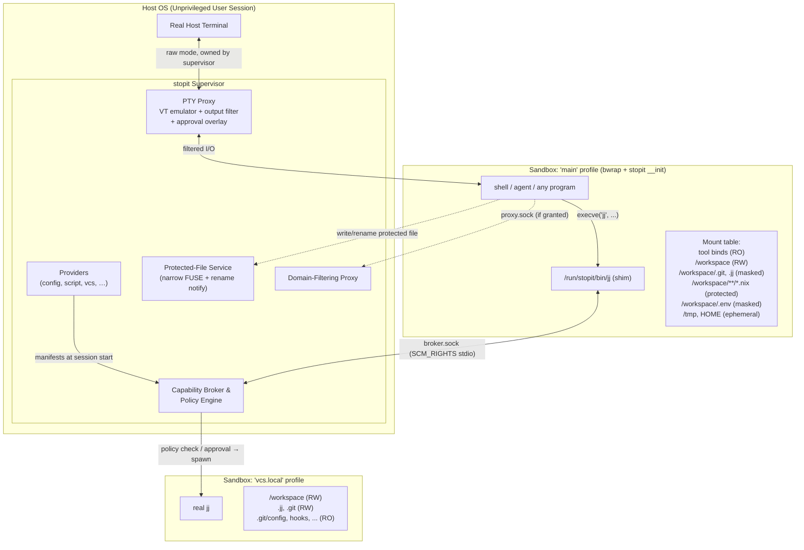

# `stopit` — System Architecture & Security Design Document

**Status:** Draft  
**Target Platform:** Linux (unprivileged user namespaces, Landlock ABI ≥ 4, seccomp user-notify, FUSE)  
**Sandbox Backend:** bubblewrap ≥ 0.11  
**Implementation Language:** Rust

---

## 1. Scope, Threat Model & Invariants

`stopit` is a general-purpose sandbox for running programs with **minimum-required privilege**. Interactive LLM agents are the primary motivating use case, but `stopit` has **no harness-specific features**: agents, their shells, and any other program are all described with the same configuration primitives (see §7.6 for a worked example).

### 1.1 Threat Classes

1. **The Actively Hostile Program (e.g. a prompt-injected agent):**
   * Attempts sandbox escape, data exfiltration, or planting delayed-execution backdoors that run when the human next interacts with the workspace on the host (`.git/hooks`, `.envrc`, `flake.nix` + `use flake`, editor configs).
2. **The Clumsy Program (e.g. a hallucinating agent):**
   * Runs destructive commands (`rm -rf ..`, `git clean -fdx`, `jj abandon`), forkbombs, or corrupts VCS state outside its task scope.
3. **Silent Secret Harvesting:**
   * Reads sensitive host files (`~/.ssh`, `~/.aws`, `~/.config/gh`, `.env`, harness credential directories, `/run/user/$UID/bus`, Nix tokens) which may then be sent to third parties (e.g. model providers as context).

### 1.2 Non-Goals

* **Code the user explicitly runs later.** If the sandboxed program edits `build.rs`, a `Makefile`, or a test, and the user later runs it on the host, that code runs. `stopit` protects against code that runs *without an explicit user action* (I3), not against code the user chooses to execute.
* **Kernel exploits.** Attack surface is reduced (seccomp, Landlock, namespaces) but not eliminated.
* **Secrets embedded inside the tool environment** granted by a provider (§3.6).

### 1.3 Core Security Invariants

These are the guarantees of `base = "default"`. Under `base = "none"` the same mechanisms exist but every grant must be added explicitly (§3.2).

* **I1 — Allowlist-First Visibility:** The sandbox filesystem starts as an empty `tmpfs` root. Nothing from the host — including `HOME` and `/run/user/$UID` — exists unless explicitly granted.
* **I2 — Irreversible Privilege Drop:** Every sandboxed process runs with all capabilities dropped, `PR_SET_NO_NEW_PRIVS` set, user-namespace creation disabled, and a seccomp filter installed. A sandboxed process cannot unmount, remount, or otherwise alter its mount table.
* **I3 — No Deferred Host Execution Without Approval:** Files that host tools execute *automatically* (on `cd`, on a VCS operation, on opening an editor) are **masked** or **protected** (§3.4). They change only with explicit user approval.
* **I4 — Trusted Terminal Ownership:** The sandbox never holds the host terminal. The supervisor owns it, filters sandbox output through an escape-sequence allowlist (§5.3), and renders approval prompts the sandbox cannot forge.
* **I5 — Explicit, Additive Policy:** `base = "none"` grants nothing. Every grant comes from a **provider** (§3.6), and everything `base = "default"` grants can be written out manually as providers (Appendix A).

---

## 2. System Architecture

`stopit` is a **single Rust binary** with several personas selected via `argv[0]` / subcommands:

1. **Supervisor (host process, `stopit run` / `stopit shell`):**
   * Owns the real host terminal; runs the **PTY proxy** with VT emulation, output filtering, and the **approval overlay** (§5).
   * Runs **providers** at session start to compute each profile's grants (§3.6).
   * Runs the **Capability Broker** for brokered tools (§7).
   * Runs the **Protected-File Service**: a narrow FUSE filesystem plus the seccomp rename-notify handler (§4).
   * Runs the **Network Proxy** for domain-allowlisted access (§8).
   * Applies optional **resource limits** (§10).
2. **Sandbox Init Helper (`stopit __init`, first process inside every sandbox):**
   * Fills the gaps bubblewrap does not cover: controlling-terminal setup, Landlock, the seccomp filter (including the rename user-notify listener, whose FD is sent to the supervisor), then `execve` of the target (§6.3).
3. **Capability Shim (`/run/stopit/bin/<tool>`):**
   * Symlinks to the `stopit` binary placed at the front of `PATH`. On execution, the shim sends an RPC request plus `stdin`/`stdout`/`stderr` FDs to the broker (§7.1).

### 2.1 Session Runtime Directory

All per-session state lives under `$XDG_RUNTIME_DIR/stopit/<session-id>/` on the host (never `/run/stopit`, which is root-owned):

| Host path (under session dir) | Sandbox path | Purpose |
| :--- | :--- | :--- |
| `broker-<sandbox-id>.sock` | `/run/stopit/broker.sock` | One socket per sandbox, so the broker knows which sandbox (and profile) is asking |
| `proxy.sock` | `/run/stopit/proxy.sock` | Network proxy (when granted) |
| `bin/` | `/run/stopit/bin` (RO) | Shim symlinks |
| `protected/` | bind-mounted per file (§4) | Narrow FUSE mount holding protected-file shadows |
| `ephemeral/` | per `ephemeral` rule (§3.4) | Session-scoped scratch (e.g. `/tmp`, sandbox `HOME`) |

### 2.2 Overview



---

## 3. Configuration Model

Configuration lives in `.stopit.toml` at the workspace root (optionally layered over a user-global config). It is read **only** when the supervisor starts or is explicitly asked to reload. It is the user's responsibility to verify it before use; it does not take effect on `cd`.

At startup the supervisor prints a short summary of every grant that **widens** access beyond the empty sandbox (binds, especially under `$HOME` or `/etc`; network domains; allowed brokered subcommands; sockets that delegate to host daemons; providers with `protect = false`). This is informational and does not block.

### 3.1 Structure: Top-Level Settings vs. Providers

The configuration has a single way of granting resources: **providers**. Only session-wide settings, which are not grants, live at the top level.

| Top level (session-wide, not grants) | Providers (`[[provider]]`, all grants) |
| :--- | :--- |
| `base` — starting set of providers (§3.2) | Filesystem rules and path modes |
| `[workspace]` — workspace identity and mount point | System mounts (`/proc`, `/dev`, synthesized `/etc`, `HOME`) |
| `[limits]` — resource limits (§10) | Environment (pass, deny, set, `PATH`) |
| `[approval]` — timeout, masked-file writes (§4.3) | Network |
| `[terminal]` — output-filter options, hotkey (§5) | Brokered shims and their policy |
| `[profiles.<name>]` — which sandboxes exist (§3.3) | Hardening opt-outs (namespace sharing, syscalls) |
| | Contributed profiles |

```toml
base = "default"

[workspace]
mount = "/workspace"          # where {workspace} appears inside the sandbox

[limits]
memory = "8G"

[approval]
timeout = "off"

[[provider]]
type = "script"
source = "scripts/agent-env.sh"

[[provider]]
type = "config"
[provider.sandbox]
fs.ro = ["/etc/ssl/certs"]
network = { mode = "proxy", allow_domains = ["static.crates.io", "index.crates.io"] }
```

**Workspace.** The workspace is the host directory the session is about: by default the directory containing `.stopit.toml` (or the current directory), overridable with `stopit run --workspace <dir>`. Its identity is session-wide because the supervisor depends on it (socket and hard-link scans, protected-file shadows, repository resolution, broker cwd checks) and every provider's `{workspace}` paths are relative to it. *Access* to it is still a grant: under `base = "none"` the workspace is defined but not mounted until a provider grants it. The workspace mount point (like `system.home`) is subject to the reserved-path rules in §6.2.

### 3.2 Bases

```toml
base = "default"   # "default" (the default) | "none"
```

The design rule is: **restrictions default on, grants default off.** A base is a set of built-in providers placed **before** the user's providers.

* `base = "none"` — no built-in providers. The sandbox is empty: nothing mounted (no `/proc`, no `/dev`), empty environment, no network at all (not even `lo`), full hardening, no shims. `stopit run /bin/sh` fails because `/bin/sh` does not exist. That is intended.
* `base = "default"` — a built-in `config` provider named `base` with the defaults below (the name is reserved: a user provider cannot use it under this base), plus the `vcs` provider (§7.3).

| Aspect | `base = "none"` | `base = "default"` |
| :--- | :--- | :--- |
| Filesystem | Empty `tmpfs` root | `/proc` (masked subset), minimal `/dev`, synthesized `/etc`, workspace RW + default path rules (§3.4), ephemeral `/tmp` and `HOME`, tool binds from user providers |
| Environment | Empty | `TERM`, `LANG`, `COLORTERM` passed through; secret patterns denied (§9) |
| Namespaces | All unshared (user, mount, pid, net, ipc, uts, cgroup) | Same |
| Network | **None** — no interfaces up | Loopback only |
| Hardening (seccomp, Landlock, `nosuid`/`nodev`, no caps, `NO_NEW_PRIVS`, no nested userns) | On | On |
| Terminal output filter | On | On |
| Brokered tools | None | `jj`, `git` via the `vcs` provider (§7.4) |

Notes:
* Standard I/O is always connected (through the PTY proxy or pipes); it is the channel back to the user, not a host capability.
* `base = "default"` does not include tools: at least one user provider must grant them, or `stopit` refuses to start and prints example configurations.
* Intermediate bases may be added later; they are just alternative built-in provider sets.
* A golden test asserts that Appendix A (everything written out under `base = "none"`) produces the same `SandboxSpec` as `base = "default"` (§12).

### 3.3 Profiles

A **profile** is a complete sandbox description: mounts, network, environment, shims. `stopit run` / `stopit shell` start the program in profile **`main`** unless `--profile <name>` is given. After that, the **only** way into another profile is a shim: each brokered command runs in a *fresh* sandbox built from the shim's target profile. Nothing ever leaves sandboxing entirely; a brokered command just gets a sandbox with different permissions.

```
main profile (shell / agent)                 vcs.local profile (fresh sandbox per command)
  /workspace        rw                         /workspace          rw
  /workspace/.git   masked   ── jj commit ──▶  /workspace/.git     rw
  network           loopback   (via shim)      .git/config, hooks  ro (locked)
                                               network             none
```

Profiles come from two places:
* **Declared by the user** at the top level, as structure only (which sandboxes exist):
  ```toml
  [profiles.harness]       # inherit = "main" is the default
  [profiles.bare]
  inherit = "none"         # starts from the empty sandbox, ignoring base
  ```
  Grants are then attached by providers (`config` providers take `profile = "<name>"`; §3.6).
* **Contributed by providers** as part of their manifest. These are prefixed with the provider's name to avoid collisions: the `vcs` provider contributes `vcs.ro`, `vcs.local`, `vcs.remote`. Inside the manifest they are written as plain single-segment names (`ro`, `local`, `remote`) and the prefix is added automatically (§3.6). Most users never see them.

`inherit = "<profile>"` (default `"main"`) means the profile starts from the parent's fully merged grants, then adds its own. `inherit = "none"` starts from the empty sandbox. `stopit-grant` (§7.5) creates a temporary profile: the caller's profile plus the requested delta.

### 3.4 Path Modes

| Mode | What the sandbox sees | Mechanism |
| :--- | :--- | :--- |
| `masked` | Name exists but is empty: empty RO file, or empty RO directory | bwrap `--ro-bind-data` (empty) / `--tmpfs` + `--remount-ro` |
| `ro` | Real content, read-only | bwrap `--ro-bind` |
| `rw` | Real content, writes go to the host | bwrap `--bind` |
| `protected` | Real content; writes trigger an approval prompt with a diff (§4) | Narrow FUSE shadow + seccomp rename notify |
| `ephemeral` | Writable, starts empty, deleted at session end; shared by all sandboxes of the session | bwrap `--bind` of a session-dir subdirectory |
| `cow` *(future)* | Writable, all changes staged for review | Full-workspace FUSE or overlayfs (§11) |

Semantics:
* **Masked ≠ absent.** A bind mount cannot remove a name from a bind-mounted directory; a true `ENOENT` would need overlay whiteouts or FUSE. Paths that are simply never granted (e.g. host `HOME`) are absent. A masked stub also prevents the sandbox from *creating* that name (e.g. a top-level `.git`).
* All mounts carry `nosuid,nodev`. Execute permission is **not** restricted by mount flags: `noexec` is not a security boundary (`bash script`, `ld.so ./bin`) and would break `cargo run`, test runners and scripts.
* `chmod` on a protected file counts as a change and goes through approval (the diff shows the mode change). `ro`/`masked` reject it with `EROFS`.
* **Deleting or renaming a protected file away** fails with `EBUSY` (it is a mount point). This is intended.
* **New files matching a protected glob** (e.g. a new `nix/foo.nix`) are written through directly: every pre-existing file that could reference them is itself protected. See §11 for the auto-import caveat.

Path syntax (in any provider):
* `{workspace}` — the host workspace directory, mounted at `workspace.mount` (default `/workspace`).
* `~/…` — host `$HOME/…` on the host side, sandbox `HOME` on the sandbox side (`/home/user` unless a provider sets `system.home`; the default base leaves it unset).
* Absolute paths map to the same path inside the sandbox; `fs.bind` entries remap explicitly.
* Built-in providers may resolve additional concrete host paths internally (e.g. `vcs` resolves git worktree and jj workspace storage, §7.3). These are not user-facing placeholders.
* **Syntactic validation (at load time):** no `.`/`..`/empty components, no NUL, no trailing `/`; the bare `/` is rejected; a glob is not allowed as the first component directly below `/` or `~` (`/*` and `~/**` are rejected; `{workspace}/**` is fine). Globs are validated too: `**` only as an entire component, no `/` (or range spanning `/`) in a `[...]` class, and the glob must compile. `?` and `[...]` match a single byte, so they do not match a non-ASCII character as a whole (e.g. a `masked` rule `?.env` does not match `é.env`; use `*`). `fs.ephemeral` entries must be literal paths, without glob characters (each rule is backed by one session directory).
* Globs (`*`, `**`) are expanded **once at session start** into concrete paths. Files created later are not retroactively masked or protected (except via the "new files are written through" rule above).

Additional checks:
* **Symlinks.** The workspace is writable by the sandbox, so a symlink in it may have been planted to reach host files. For `{workspace}` rules, symlinks below the workspace are never followed, even ones pointing inside it: a planted link could otherwise move a rule underneath a stricter one (`x -> .git` would turn an rw `{workspace}/x/hooks` into `.git/hooks`). A symlink in any component below the workspace (of a literal path, or of a glob's literal prefix) makes an `rw` rule or bind host be skipped with a warning, and makes a `masked`, `protected`, `ro` or `ephemeral` rule a startup error (a planted link must never switch a restriction off). The same applies to a mount destination below the workspace that passes through a symlink. The final component of a matched path is never followed, and globs never descend into symlinked directories. A symlink matched by a `{workspace}` glob is skipped with a warning for every mode: the walk visits the real files directly, so a planted link cannot make the glob miss them (with `config` renamed to `config2` and `config -> config2` planted, `{workspace}/**/*.env` still matches `config2/prod.env`). In short: links matched by a `{workspace}` glob are skipped for every mode; links in literal components (a literal path, a glob's literal prefix, a mount destination) are errors for restrictive modes. A legitimate link skipped this way leaves its target as readable as before if the target does not match the glob (see §11). Likewise, a path that exists but cannot be inspected, or a directory a glob walk cannot read, is a startup error for a `masked`, `protected`, `ro` or `ephemeral` rule, anywhere (the sandbox could otherwise `chmod 000` a directory it owns to switch a mask off at the next start), and skips an `rw` rule or bind host with a warning; a missing path (including an entry that vanishes during a glob walk) skips any rule with a warning. `~` and absolute rules follow symlinks (home-manager and `/etc/static` rely on it), and their globs keep matched links; see §11. A `masked` `~` or absolute rule matching a symlink masks it as its target's kind (an empty file or an empty directory); a dangling link is skipped with a warning, and a target that cannot be inspected otherwise is a startup error. A matched symlink inside the workspace is never bound: a bind mount would follow it.
* **Pinned parent directories.** Renaming a parent directory of a restrictive mount away (e.g. `mv config cfg2` with `{workspace}/config/secrets.env` masked) would otherwise make the literal rule "missing" at the next start, and the file readable as `cfg2/secrets.env`. So for every `masked`, `protected`, `ro` or `ephemeral` mount below the workspace, stopit self-binds each existing directory between the workspace root and the mount (`--bind d d`), turning it into a mount point: `rename` and `rmdir` on it fail with `EBUSY`, while creating, editing and deleting files inside it still work.
* **Unix sockets.** Network namespaces isolate abstract sockets, but a socket *file* created by a host process inside an RW directory is reachable through the bind mount (e.g. `.devenv/state/postgres/.s.PGSQL.5432`). With `fs.mask_sockets = true` (default base), sockets found in RW grants at startup are masked (connecting yields `ECONNREFUSED`).
* **Hard links.** A protected file with `nlink > 1` is writable through its other name. The sandbox cannot create such links (`link` across mounts fails with `EXDEV`), but pre-existing ones trigger a startup warning.

### 3.5 Merging & Precedence

All providers' manifests are merged per profile, in order: base providers first, then user providers in file order; a profile with `inherit` starts from its parent's merged result.

**Path rules** — for each path, the effective mode is decided by:
1. **Most specific path wins.** An exact path beats a glob; a deeper path beats a shallower one (`{workspace}/.git` beats `{workspace}`; `{workspace}/flake.nix` beats `{workspace}/**/*.nix`).
2. **A profile's own rules beat inherited rules** at equal specificity. This is what lets `vcs.local` (inheriting `main`) make `.git` writable although `main` masks it.
3. **Strictest mode wins** among the remaining ties: `masked` > `protected` > `ro` > `ephemeral` > `rw`.

To loosen a restriction, configure the provider that added it (e.g. `vcs` with `view = "ro"`), add a more specific rule, or use `base = "none"`. Mounts are applied in path-depth order so children overlay parents.

**Other sections:**

| Section | Merge rule |
| :--- | :--- |
| `env.pass` / `env.deny` | Union; **`deny` always wins** over `pass` |
| `env.set` | Conflicting values for the same variable are an **error** unless identical; a profile's own value overrides the inherited one, per variable |
| `env.path_prepend` | Later providers' entries first within a profile, then inherited entries; earlier entries take precedence in `PATH`; duplicates keep the first occurrence |
| `network.mode` | Within a profile: the most permissive granted mode (`none` < `loopback` < `proxy` < `full`). A profile's own value overrides the inherited one |
| `network.allow_domains` | Union |
| `shims` | Union; the same shim name from two providers in one profile is an **error**; a profile's own shim replaces an inherited one of the same name |
| `sandbox.share`, `sandbox.allow_syscalls` | Union |
| `system.proc`, `system.dev` | Logical OR within a profile; a profile's own explicit value overrides the inherited one |
| `system.etc` | Union |
| `system.home` | Conflicting values within a profile are an **error** (like `env.set`); a profile's own value overrides the inherited one |
| `fs.mask_sockets` | Tri-state (unset / `true` / `false`). Within a profile, `true` wins over `false` (strictest wins). A profile's own explicit value overrides the inherited one, so a contributed or user profile can opt out of masking that `main` enables |

### 3.6 Providers

A **provider** produces a **manifest**: the canonical grant structure used by every provider type. `[[provider]]` entries share these fields:

| Field | Applies to | Meaning |
| :--- | :--- | :--- |
| `type` | all | `config`, `script`, `vcs` (later: `nix`, …) |
| `name` | all | Optional; defaults to `type`. Prefix for contributed profiles; shown in the startup summary |
| `profile` | `config` | Profile the grants apply to (default `main`) |
| `[provider.sandbox]` | `config` | The manifest itself, written inline in TOML |
| `source` | `script` | Path to the executable, relative to `.stopit.toml`; executed **on the host** |
| `protect` | `script` | Whether `source` is automatically `protected` (default `true`) |
| `[provider.config]` | `script` only | Free-form parameters for the script, passed as JSON on stdin. Only scripts need a free-form keyspace |
| type-specific keys | built-in types (`vcs`, later `nix`) | Options written directly under `[[provider]]` (e.g. `view`, `tools`, `devshell`) |

```toml
[[provider]]
type = "config"
profile = "main"
[provider.sandbox]
fs.ro = ["/etc/ssl/certs"]
env.pass = ["RUST_*", "CARGO_*"]

[[provider]]
type = "script"
source = "scripts/agent-env.sh"
protect = true
[provider.config]
devshell = "agent"

[[provider]]
type = "vcs"
view = "masked"
```

**Manifest schema** (identical for `[provider.sandbox]` and script output):

```json
{
  "version": 1,
  "fs": {
    "rw": ["{workspace}"], "ro": [], "masked": [], "protected": [], "ephemeral": ["/tmp", "~"],
    "bind": [{ "host": "/etc/ssl/certs", "sandbox": "/etc/ssl/certs", "mode": "ro" }],
    "mask_sockets": true
  },
  "system":  { "proc": true, "dev": "minimal", "etc": ["passwd", "group", "hosts", "nsswitch.conf"], "home": "/home/user" },
  "env":     { "pass": ["TERM"], "deny": ["*_TOKEN"], "set": { "LANG": "C.UTF-8" }, "path_prepend": ["/nix/store/…/bin"] },
  "network": { "mode": "loopback", "allow_domains": [] },
  "sandbox": { "share": [], "allow_syscalls": [] },
  "shims":   { "<name>": { "binary": "…", "deny_flags": [], "default": { "decision": "ask", "profile": "main" }, "rules": [] } },
  "profiles": { "<name>": { "inherit": "main", "fs": {}, "env": {}, "network": {}, "shims": {} } }
}
```

* Top-level manifest sections apply to the target profile (`profile` for `config`; `main` for other types). Entries under `profiles` are contributed profiles, prefixed with the provider's `name`.
* **Contributed profile keys** inside a manifest are plain single-segment names (e.g. `local`); the provider's `name` prefix is added automatically (`vcs.local`). Contributed profiles cannot themselves contain `profiles` or `version`.
* **Reference rule:** within a manifest, a plain profile reference (`inherit = "local"`, shim `profile = "ro"`) resolves first to that manifest's own contributed profile, then to a user-declared profile. `main` and other providers' profiles are referenced by their full names. A full name (e.g. `vcs.local`) always resolves globally, including to the manifest's own profiles; plain names are preferred inside a manifest because the provider `name` can change.
* **Validation:** every manifest table accepts only maps (array forms are rejected) and unknown keys are rejected. A JSON manifest from a script **must** include `"version"`; an inline `[provider.sandbox]` may omit it (defaults to 1). Bind `mode` is one of `ro`, `rw`, `protected` only (`masked` and `ephemeral` have no host content to bind). Bind `host`/`sandbox` paths contain no globs (glob characters are `*`, `?`, `[`, `]`), and a bind's `sandbox` side additionally allows no `{workspace}` placeholder. Path rules are also validated syntactically at load time (§3.4).
* **Script providers** receive on stdin a JSON object containing their `[provider.config]` and a context (`workspace` host path, `workspace_mount`, `home`, `session_dir`, provider `name`, target `profile`), and print a manifest on stdout. A non-zero exit or invalid manifest aborts startup.
* **Scripts run on the host with the user's privileges.** With `protect = true` (default) the script — and its directory, if it sources other files — is `protected` so the sandbox cannot rewrite code that runs on the host next session. `protect = false` is allowed but flagged in the startup summary.
* Manifests are cached, keyed by a hash of the provider's protected inputs and config.

**Rust model:**

```rust
pub trait Provider: Send + Sync {
    fn name(&self) -> &str;
    /// Static grants, contributed profiles and shims, computed at session start.
    fn manifest(&self, ctx: &ProviderContext) -> Result<Manifest>;
    /// Optional runtime logic invoked by the broker (e.g. argv parsing, prompt facts).
    fn handlers(&self) -> Vec<Box<dyn BrokerHandler>> { Vec::new() }
}
```

Built-in providers can implement `handlers` in Rust (the `vcs` provider parses `jj`/`git` global flags, resolves push URLs for prompts, and resolves the on-disk VCS layout, §7.3.1). `config` and `script` providers declare shims with the declarative rule format only; a script-based handler protocol may come later.

**Provider types:**

| `type` | Status | Behavior |
| :--- | :--- | :--- |
| `config` | v1 | The manifest written inline in `[provider.sandbox]` |
| `script` | v1 | Runs `source`, passes `[provider.config]` + context on stdin, parses the manifest |
| `vcs` | v1 | Repository-root resolution, `.git`/`.jj` masking, VCS profiles and `jj`/`git` shims (§7.3) |
| `nix` | later | `devshell = "<name>"`: runtime closure of the devShell's `inputDerivation` plus `nix print-dev-env --json`, resolved on the host |

**Host daemons.** A provider may grant access to a host daemon's socket (e.g. a future `buck2` provider talking to the buck2 daemon). Such daemons run *outside* the sandbox — buck2 executes build rules on the host — so granting the socket is equivalent to granting host code execution (the same reason the Nix daemon is never exposed). This is allowed as a deliberate choice; socket grants are flagged as **delegates to host** in the startup summary.

**Nix guidance (outside `stopit` core):** define a comprehensive `devShells.agent` (or similar) in your flake and expose it through a `script` provider (later the `nix` provider). The closure-only manifest means only the store paths that environment needs are visible, not all of `/nix/store`, which on NixOS can contain secrets (e.g. `access-tokens` rendered into `nix.conf`). The `nix` provider refuses closures that pull in paths named `*-etc`, `*-home-manager-files`, or `*nix.conf*`. The sandbox has **no access to the Nix daemon**; changing the tool environment requires the user to edit the (protected) flake and restart or reload the session.

---

## 4. Protected Files & the Approval Flow

Any attempt to modify a protected file triggers an approval prompt showing the diff. The **kernel mounts remain the security boundary**; the FUSE service and the seccomp hook are there to implement the approval UX on top of them.

### 4.1 Two Writer Styles, Two Hooks

| Writer style | Syscalls | When is the full content known? | Typical users |
| :--- | :--- | :--- | :--- |
| In place | `open(O_TRUNC)` → `write`… → `close` | At `close` | Harness Edit/Write tools, shell `>`, Rust `fs::write` |
| Atomic rename | write `tmp` → `rename(tmp, target)` | At `rename` | `sed -i`, vim (often), formatters |

**In-place writes — narrow FUSE.** The supervisor mounts a small FUSE filesystem (via `fusermount3`, on the host, under the session dir) exposing a shadow copy of each protected file. Each shadow is bind-mounted over the real path inside the sandbox. The filesystem implements only `getattr`, `setattr` (truncate, mode), `open`, `read`, `write`, `flush`:
* The prompt fires in **`flush`** (called on every `close()`), not `release` (asynchronous; its error never reaches the program). It fires only when content or mode changed since the last decision.
* **Allow:** the supervisor writes the new content into the host file **in place** (truncate + write — never rename, which would break the inode pinned by single-file bind mounts), and `close()` returns 0.
* **Deny:** the shadow reverts to the host content and `close()` returns `EROFS`.

**Atomic renames — seccomp user-notify.** `rename(tmp, flake.nix)` never reaches FUSE: the target is a mount point (the VFS returns `EBUSY`) and the source lives on a different filesystem. So the init helper's seccomp filter sends `rename`/`renameat`/`renameat2` to the supervisor:
1. The supervisor resolves the target via `/proc/<pid>/root` and `/proc/<pid>/fd/<dirfd>`.
2. Not protected → `SECCOMP_USER_NOTIF_FLAG_CONTINUE` (the kernel still enforces all mounts).
3. Protected → copy the source content **into memory**, show the diff, and on **allow** write that exact copy into the host file in place and unlink the temp file (the sandbox cannot swap content between review and write). On **deny**, return `EROFS`.
* Check `SECCOMP_IOCTL_NOTIF_ID_VALID` before responding, to handle signals interrupting the blocked syscall.

### 4.2 Decisions

| Key | Decision | Effect |
| :--- | :--- | :--- |
| `y` | Allow once | Apply this change |
| `s` | Allow for this session | Apply, and apply further writes to this path without prompting |
| `p` | Allow and persist | Apply, and add an exact-path `rw` rule (which beats the protecting glob, §3.5) to a `config` provider named `approvals` in `.stopit.toml`, created if absent (edited via `toml_edit`, preserving formatting). The live policy updates immediately. The prompt states that this removes protection for future sessions |
| `n` | Deny | Revert; the syscall fails with `EROFS` |

The same four decisions are used for brokered-tool approvals (§7.4), where "persist" adds an allow rule for that shim to the `approvals` provider.

### 4.3 Details

* **Masked files** (e.g. `.env`): writes are denied without a prompt by default; the program never saw the original, so a diff is meaningless and approval would silently overwrite a secrets file. Configurable: `[approval] masked_writes = "deny" | "ask"`.
* **Approval timeout:** off by default (a pending write blocks indefinitely). Configurable: `[approval] timeout = "5m"` auto-denies.
* **Host-side conflicts:** the supervisor records each protected file's hash at session start. If the host copy changed during the session, the prompt shows a three-way diff instead of overwriting.
* **Ignored `close()` errors:** some programs ignore `close()` failures (e.g. Rust's `Drop` for `File`). They believe the write succeeded, but the file has been reverted. See §11.
* **Feedback to the sandboxed program:** a syscall can only return an errno, not a message. `stopit` generates an instruction snippet (for `AGENTS.md`/`CLAUDE.md` or similar) explaining that writes to files matching the protected rules prompt the user and that `Read-only file system` on them means the user denied the change. Shims print recent denials on stderr on their next invocation, and `stopit log` lists them.
* **Secrets and the prompt:** the overlay is drawn directly on the host terminal while sandbox output is buffered (§5), so the diff (including the old content of any file) is never visible to the sandbox.

---

## 5. Terminal: PTY Proxy, Output Filtering & Approval Overlay

`stopit run <cmd…>` runs `<cmd>` in the sandbox; `stopit shell` is shorthand for `stopit run $SHELL`. Interactive programs put the terminal into raw mode and draw TUIs, so the supervisor acts as a minimal terminal multiplexer.

### 5.1 PTY Proxy

* The supervisor allocates a PTY; the slave becomes the sandbox's stdio and controlling terminal (set up by `stopit __init`, §6.3). Host `/dev/tty` is never exposed.
* Sandbox output is parsed by a **VT emulator** (`vt100` or `alacritty_terminal` crate) that maintains a virtual screen. This is required both for filtering (§5.3) and for redrawing the screen after an overlay: switching the alternate screen (`?1049h`/`l`) alone breaks programs that already use it, and the alternate screen does not nest.
* `SIGWINCH` / window size changes are forwarded to the PTY.
* The dedicated hotkey (`[terminal] hotkey`, default `Ctrl+]`) opens the supervisor menu (pending approvals, session rules, `stopit log`).

### 5.2 State Machine

```mermaid
stateDiagram-v2
    [*] --> Passthrough: stopit shell / stopit run

    state Passthrough {
        [*] --> Forwarding
        Forwarding: Host TTY input → PTY master
        Forwarding: PTY master → VT emulator → filter → Host TTY
    }

    Passthrough --> Intercepting: approval request (broker, protected file) or hotkey

    state Intercepting {
        [*] --> Overlay
        Overlay: 1. Keep feeding sandbox output to the VT emulator only (not to the host TTY)
        Overlay: 2. Flush pending host input; ignore keys for a short arming delay
        Overlay: 3. Draw the overlay with the supervisor marker
        Overlay --> WaitDecision: read keys ONLY from the host TTY
        WaitDecision --> Restore: allow once / session / persist / deny
        Restore: Repaint the screen from the VT emulator state
    }

    Intercepting --> Passthrough: return decision
```



### 5.3 Output Filtering (Escape-Sequence Allowlist)

Raw sandbox output reaching the host terminal is an escape channel: OSC 52 can set the clipboard (malicious paste), some terminals support file transfer over escape sequences, and query/response tricks have caused RCE in some emulators. All OSC, DCS, APC, PM, and SOS sequences are **blocked by default**; the following are allowed:

| Sequence | Decision | Reason |
| :--- | :--- | :--- |
| OSC 0/1/2 (title) | Allow | Harmless |
| OSC 4/10/11/12 color *queries* | Allow | Light/dark detection (neovim, bat, delta, TUIs) |
| OSC 8 hyperlinks | Allow `http(s)` only | Used by cargo, gcc, ls; `file://` would open host paths |
| OSC 9 / 777 / 99 notifications | Allow (rate-limited) | "Task done" notifications |
| OSC 133 prompt marks | Allow | Emitted by fish 4 and others |
| OSC 52 clipboard **read** | Always block | Would leak the host clipboard |
| OSC 52 clipboard **write** | Block (`[terminal] clipboard_write = "block" \| "allow" \| "ask"`; `ask` shows the content) | Malicious paste risk |
| OSC 7 (cwd) | Drop | Sandbox paths are meaningless on the host |
| OSC 1337, OSC 5113, kitty graphics with file/shm sources, DCS `tmux;` passthrough | Block | File transfer, host file reads, bypassing an outer tmux's filter |
| CSI 20t / 21t (title report) | Block | Classic input-injection vector |

TIOCSTI from inside the sandbox only reaches the sandbox's own PTY and is harmless to the host; it is also blocked by seccomp (§6.3).

### 5.4 Approval Prompt Safeguards

* **Ground truth:** prompts display resolved facts, not sandbox claims: the exact binary path, arguments, working directory, capability delta; for pushes, the resolved remote URL plus the commits and bookmarks being pushed; for protected files, the diff.
* **No typeahead:** pending host input is flushed and keys are ignored for a short arming delay when an overlay opens, so keystrokes meant for the program cannot land on `y`.
* **Rate limiting:** repeated requests are coalesced or throttled to prevent approval fatigue.
* **Unforgeable marker:** the sandbox can draw anything in its own screen, including a fake prompt. The overlay carries a per-session secret word/color chosen at startup and shown in the supervisor's startup banner, so a genuine prompt is recognizable.
* **Precise session rules:** "Allow for this session" matches exactly the displayed scope (e.g. this remote *and* this bookmark), not the whole subcommand.
* **Deny feedback:** brokered commands return exit code `126` with `[stopit: denied by user]` on stderr; file writes return `EROFS` (§4.3).

---

## 6. Sandbox Construction

### 6.1 `SandboxEngine` Trait

The supervisor turns a profile's merged manifest into a backend-independent `SandboxSpec` (mounts and modes, namespaces, env, FDs, seccomp/Landlock policy, command) and hands it to an engine:

```rust
pub trait SandboxEngine: Send + Sync {
    fn spawn(&self, spec: &SandboxSpec, stdio: StdioFds) -> Result<ChildHandle>;
}
```

The only implementation is **`BwrapEngine`**. The trait is kept so other engines (e.g. macOS Seatbelt) can be added later without touching policy code.

### 6.2 `BwrapEngine`

`SandboxSpec` is compiled into bubblewrap arguments (passed over `--args FD` because closure-only binds can produce thousands of arguments):

1. **Namespaces:** `--unshare-all` (user, mount, pid, net, ipc, uts, cgroup), `--disable-userns`, `--die-with-parent`. Providers may grant sharing of individual namespaces (`sandbox.share = ["net"]`); `sandbox.share` accepts only `net`, `pid`, `ipc`, `uts`, `cgroup` (user and mount are always unshared).
2. **Root:** bwrap's empty `tmpfs` root; `--tmpfs` skeleton directories as needed.
3. **System mounts** (when granted): `--proc /proc` with `/proc/sys`, `/proc/bus`, `/proc/fs`, `/proc/irq`, `/proc/kcore`, `/proc/keys`, `/proc/timer_list` masked; `--dev /dev` (minimal: `null`, `zero`, `full`, `random`, `urandom`, `tty`, new `devpts` instance).
4. **Synthesized files:** `/etc/passwd`, `/etc/group`, `/etc/hosts`, `/etc/nsswitch.conf`, sandbox-`HOME` stubs (e.g. `.gitconfig` with `user.name`/`user.email`) via `--ro-bind-data`.
5. **Filesystem grants** (§3.4–3.5) in path-depth order: `--ro-bind`/`--bind`; masks via `--ro-bind-data` (empty, `--perms 0000`) for files and `--tmpfs` + `--remount-ro` for directories; protected files via `--bind` from the session's FUSE mount.
6. **Runtime directory:** `/run/stopit` (shims RO, broker socket, proxy socket if granted).
7. **Environment:** `--clearenv` plus the filtered/explicit variables (§9).
8. **Command:** `stopit __init -- <cmd…>`.

**Reserved paths.** The workspace mount (`[workspace] mount`) and `system.home` must not be equal to or an ancestor of any of `/proc`, `/dev`, `/etc`, `/tmp`, `/run/stopit`, and must not be inside `/proc`, `/dev`, `/etc` or `/run/stopit`. `system.home` must not equal the workspace mount or lie inside it. A workspace mount *inside* `system.home` or `/tmp` is allowed (it is mounted over the ephemeral directory), and so is a `system.home` inside `/tmp`. The sandbox destination of every filesystem rule and bind (any mode, `masked` included, and from any provider) must not equal, contain or be inside `/proc`, `/dev` or `/run/stopit`, and must not equal or contain a synthesized `/etc` file (`/etc/passwd`, `/etc/group`, `/etc/hosts`, `/etc/nsswitch.conf`, whether or not `system.etc` enables it): these are stopit's own, and a rule there would replace the sandbox's procfs or `/dev` with the host's, or shadow stopit's files. Other `/etc` paths (`/etc/ssl/certs`) and other `/run` subtrees (`/run/user/1000`) are fine; `/run` itself is not, since it contains `/run/stopit`. In particular path rules cannot target `/dev` (bwrap's binds are `nodev` anyway); device access belongs to a future `system.dev` mode, not to path rules. Paths are compared by component (`/procfs` is not inside `/proc`). This is checked when the `SandboxSpec` is built, after glob rules are expanded.

**Mount locking.** bubblewrap drops all capabilities before executing the init helper, so the sandbox cannot `umount` or `mount -o remount,rw` anything (no `CAP_SYS_ADMIN`). `--disable-userns` plus seccomp prevent creating a new user namespace to regain capabilities; even if one were created, the kernel marks all inherited mounts `MNT_LOCKED` and locks their `ro`/`nosuid`/`nodev` flags, so they could not be detached or remounted read-write individually.

### 6.3 Init Helper (`stopit __init`)

Runs as the first program inside the sandbox (bwrap remains PID 1 and reaps zombies), then:

1. **Controlling terminal:** `setsid()` + `ioctl(TIOCSCTTY)` on the PTY slave (bwrap's `--new-session` would leave no controlling terminal and break job control).
2. **FD hygiene:** move preserved FDs (stdio, broker socket) to fixed low numbers, then `close_range(first_free, ~0U, 0)`.
3. **Landlock:** a ruleset derived from the filesystem grants (defense in depth; Landlock cannot deny a subtree beneath an allowed tree, so mounts remain the primary control). ABI v4+ TCP port rules when network is granted; ABI v6 signal/abstract-socket scoping when available.
4. **Seccomp-BPF** (always installed; providers can opt specific syscalls back in with `sandbox.allow_syscalls`):
   * `clone3` → `ENOSYS` (its flags live in a struct seccomp cannot inspect; libc falls back to `clone`, which is filtered).
   * `clone`/`unshare` with any `CLONE_NEW*` flag → `EPERM`; `setns` → `EPERM`.
   * Mount APIs: `mount`, `umount2`, `pivot_root`, `fsopen`, `fsconfig`, `fsmount`, `fspick`, `open_tree`, `move_mount`, `mount_setattr` → `EPERM`.
   * Attack surface: `io_uring_*`, `bpf`, `perf_event_open`, `userfaultfd`, `keyctl`, `add_key`, `request_key`, `kexec_*`, `open_by_handle_at`, `ioctl(TIOCSTI | TIOCLINUX)` → `EPERM`.
   * `ptrace` → `EPERM` by default; opt-in via `allow_syscalls = ["ptrace"]` (debuggers are common tools; with a PID namespace it only reaches sandboxed processes).
   * `socket()` family allowlist: `AF_UNIX`, `AF_INET`, `AF_INET6`, `AF_NETLINK` (route only); notably **`AF_VSOCK` is denied** (not isolated by network namespaces).
   * **`allow_syscalls` accepts only:** `ptrace`, `perf_event_open`, `io_uring` (`io_uring_setup`/`enter`/`register`), `userfaultfd`, `bpf`, `keyctl` (`keyctl`/`add_key`/`request_key`). Namespace creation, mount APIs, `setns`, `clone3`, `kexec_*` and `open_by_handle_at` can never be re-enabled.
   * `rename`, `renameat`, `renameat2` → `SECCOMP_RET_USER_NOTIF` (§4.1); the listener FD is sent to the supervisor over the broker socket before `execve`.
5. `prctl(PR_SET_NO_NEW_PRIVS)` (bwrap sets it too) and `execve(<cmd…>)`.

---

## 7. Brokered Tools

### 7.1 Shims & Broker Protocol

* `/run/stopit/bin` (RO, front of `PATH`) contains a symlink to the `stopit` binary for every shim granted to the profile (`jj`, `git`, `stopit-grant`, user-defined shims).
* A shim sends a request (`argv`, workspace-relative cwd) plus `stdin`/`stdout`/`stderr` over `SCM_RIGHTS` to its sandbox's broker socket.
* **The shim is untrusted.** A sandboxed program can talk to the socket directly; the broker re-parses everything and trusts nothing from the request except what it verifies.
* **cwd:** the shim sends a workspace-relative path *and* an `O_PATH` FD. The broker checks the FD's `st_dev`/`st_ino` against the path resolved in the host view, then the tool sandbox opens the path itself with `openat2(RESOLVE_IN_ROOT | RESOLVE_NO_SYMLINKS)`. (Passing the FD through and `fchdir()`-ing into it would keep the *caller's* mount, so `.jj` would resolve to the caller's masked view.)
* **Lifecycle:** the broker relays signals (Ctrl+C, harness timeouts killing the shim) to the tool sandbox, kills the tool sandbox if the shim's connection closes, and returns the exit status to the shim.
* **Environment:** the broker discards the shim's environment and builds a clean one from the target profile.
* **Binary resolution:** a shim's `binary` is resolved in the target profile's `PATH`.
* Unlisted subcommands use the shim's `default` (required; conventionally `ask`).

**Shim declaration** (in any manifest):

```toml
[provider.sandbox.shims.cargo-publish]
binary     = "cargo"
deny_flags = ["--config"]
default    = { decision = "ask", profile = "publish" }
rules      = [
  { subcommand = ["publish"], decision = "ask", profile = "publish" },
]
```

* `binary` and `default` are **required**. `binary` is never inferred from the shim name, and `default` has no implicit value because `ask`/`allow` need a target profile.
* A rule or default with `decision = "deny"` must not name a `profile`; `allow` and `ask` must.
* Shim names `stopit` and `stopit-grant` are reserved.
* Each entry in a rule's `subcommand` list is one or more tokens separated by single spaces (`[a-z0-9][a-z0-9_-]*`); the last token may be `*` (e.g. `bookmark *`). A lone `*` is rejected (use `default`), and flags are not subcommands.

### 7.2 Global-Flag Parsing

Policy is matched after parsing each tool's global options with the tool's own grammar, so that flags anywhere in `argv` are seen. The `vcs` provider's handlers implement this for `jj` (`-R/--repository`, `--at-op`, `--ignore-working-copy`, `--config`, `--config-file`, `--config-toml`) and `git` (`-C`, `-c`, `--git-dir`, `--work-tree`, `--exec-path`, `--config-env`, `--upload-pack`, `--receive-pack`). Config-injection flags are denied outright. Declarative shims (from `config`/`script` providers) match on the first non-flag arguments and `deny_flags`.

### 7.3 The `vcs` Provider

```toml
[[provider]]
type    = "vcs"
view    = "masked"      # "masked" (default) | "ro"
tools   = ["jj", "git"]
fetch   = "ask"         # "deny" | "ask" (default) | "allow"
push    = "ask"         # "deny" | "ask" (default) | "allow"
signing = false         # SSH commit signing in vcs.local (§7.3.4)
```

#### 7.3.1 Layout Resolution

The provider cannot assume `{workspace}/.git` and `{workspace}/.jj` are self-contained directories. At session start it resolves the actual on-disk layout by asking the tools' own discovery logic (`git rev-parse --git-dir --git-common-dir --show-toplevel`, jj's workspace loading via `jj-lib`) on the host, never by trusting path strings written inside the workspace without validation:

| Layout | What `{workspace}` contains | Additional storage outside `{workspace}` |
| :--- | :--- | :--- |
| Plain git repo | `.git/` directory | — |
| Git worktree | `.git` **file** (`gitdir: …`) | Per-worktree admin dir (`<common>/.git/worktrees/<name>`: `HEAD`, `index`) and the **common dir** (`<common>/.git`: objects, refs, config) |
| jj repo (incl. colocated) | `.jj/` (`working_copy/`, `repo/`), plus `.git/` if colocated | — |
| jj secondary workspace | `.jj/working_copy/`, `.jj/repo` **file** pointing to the main workspace's `.jj/repo` | The main `.jj/repo` directory, and its git backend directory if the store is git-backed (e.g. the main workspace's colocated `.git`) |
| Workspace is a subdirectory of a checkout | No VCS metadata | The checkout root and its metadata |

The result is a set of concrete host paths in three categories:
1. **Workspace metadata:** the workspace's own `.git` (file or directory) and `.jj`.
2. **Backing storage:** git common dir, worktree admin dir, main jj repo dir, jj's git backend dir.
3. **Checkout root:** only when `{workspace}` is a subdirectory of the checkout. VCS operations snapshot or scan the whole working tree, so they need all of it.

Pointer files (`.git` gitfiles, `.jj/repo`) live in the agent-writable workspace, so they are read and resolved **by the supervisor at session start**, before any sandbox runs, and every resolved path appears in the startup summary.

#### 7.3.2 Grants

* **`main`:** the workspace metadata is **masked** (`view = "masked"`) or **RO** (`view = "ro"`, for projects whose tools read `.git` directly, e.g. `build.rs` using `git describe`, gix/libgit2 tools; note `.git/config` may contain credentials when using HTTPS remotes). Backing storage is **not granted** in `main` (absent) with `view = "masked"`, and RO with `view = "ro"`. The checkout root outside `{workspace}` is never granted to `main`.
* **Contributed profiles** (each inherits `main`; the VCS paths below are granted on top):

| Profile | Workspace metadata + backing storage | Locked read-only even when RW | Checkout root (if outside `{workspace}`) | Network |
| :--- | :--- | :--- | :--- | :--- |
| `vcs.ro` | RO | — | RO | None |
| `vcs.local` | RW | Git config files in every resolved git dir (`config`, `config.worktree`, `info/attributes`; `hooks/` masked as an empty stub), submodule configs/hooks (`modules/*/config`, `modules/*/hooks/`), worktree configs (`worktrees/*/config.worktree`); legacy `.jj/repo/config.toml` if present | RW | None (filtered signing agent if `signing = true`, §7.3.4) |
| `vcs.remote` | RW | Same as `vcs.local` | RW | Per-command tunnel to the resolved remote + filtered SSH agent (§7.3.3). Only created if `fetch` or `push` is not `"deny"` |

* **Shims** `jj` and `git` (per `tools`) with the default policy (§7.4) and the runtime handlers (flag parsing, remote resolution, push URL/commit resolution for prompts).

#### 7.3.3 Remote Access (`fetch` / `push`)

`fetch` and `push` each take `"deny" | "ask" | "allow"` (default `"ask"` for both). They decide which remote-touching commands are routed to `vcs.remote`, and with which decision:

| Setting | jj | git |
| :--- | :--- | :--- |
| `fetch` | `git fetch`, `git clone` (see below) | `fetch`, `pull`, `ls-remote`, `remote update`, `clone` (see below) |
| `push` | `git push` | `push` |

`"deny"` returns exit code `126` with `[stopit: <fetch|push> disabled by policy]`. Push is the main exfiltration channel, so a common configuration is `fetch = "allow"`, `push = "ask"`.

**Which remotes.** Only remotes listed by `git remote` are reachable:
* The supervisor reads the remote list and URLs **on the host** from `.git/config`, which the sandbox cannot modify (`git remote add` / `jj git remote add` fail with `EROFS` in `vcs.local`).
* URLs are resolved with the user's host git config (`git remote get-url`, plus `--push` for pushes), so `insteadOf` rewrites apply.
* Commands must name a remote; **URLs passed on the command line are denied**.
* **Clone** is treated as a fetch and allowed only when the URL matches a configured remote's URL. Cloning is not a sandbox-escape risk (git writes the new repository's config itself and never clones hooks); the restriction exists because an arbitrary URL means a connection to an arbitrary host, which can encode data in the hostname or path.

**What an approved command gets** (set up for that one command and torn down when it exits):
1. **Transport:** the safe git config sets `core.sshCommand = ssh -F /run/stopit/ssh_config`, whose `ProxyCommand stopit __connect %h %p` opens a CONNECT tunnel through `proxy.sock`. The proxy allows **only the resolved remote's `host:port`** (e.g. `github.com:22`). DNS stays in the proxy. Recent jj versions run `git` for fetch and push, so this covers both tools.
2. **Authentication:** a supervisor-served **filtered SSH agent** socket that relays to the user's real agent, offering only the key for the resolved host (optionally with per-use confirmation). The raw `SSH_AUTH_SOCK` is never forwarded and private key files are never mounted.
3. **`ssh_config`:** synthesized from `ssh -G <host>` run on the host (resolving aliases such as `github-work`, `HostName`, `User`, `Port`), plus `IdentityAgent` pointing at the filtered socket, `IdentitiesOnly yes`, and `StrictHostKeyChecking yes`. The user's `~/.ssh/config` is never mounted.
4. **`known_hosts`:** only the target host's entries, extracted from the user's `~/.ssh/known_hosts`. Mounting the whole file would reveal every host the user connects to.

The approval prompt shows the remote name, resolved URL, `host:port`, key fingerprint, and for pushes the commits and bookmarks being pushed.

The `ssh` client binary must be present in the tool environment granted by the user's providers.

HTTPS remotes (proxy environment plus a credential helper) are future work.

#### 7.3.4 Commit Signing (`signing`)

With `signing = true`, `vcs.local` (and `vcs.remote`) get a filtered SSH agent socket offering **only the signing key** — no network. The supervisor reads the signing configuration from the user's host config (git: `gpg.format = ssh`, `user.signingKey`, `commit.gpgSign`; jj: `signing.backend = "ssh"`, `signing.key`, `signing.behavior`) and carries it into the safe git/jj configs. `ssh-keygen` must be present in the tool environment.

#### 7.3.5 Details

* **jj repository config** is stored outside the repository in current jj versions (under `~/.config/jj/repos/`). The VCS profiles mount that repository's config directory **read-only** so brokered jj behaves like jj on the host.
* **Safe overrides** in the VCS profiles:
  * `GIT_CONFIG_NOSYSTEM=1`, `GIT_CONFIG_GLOBAL=/run/stopit/gitconfig-safe` (`core.hooksPath=/dev/null`, `core.fsmonitor=false`, `core.pager=cat`, `protocol.ext.allow=never`).
  * `JJ_CONFIG=/run/stopit/jjconfig-safe.toml` (`ui.pager=":builtin"`, external diff/merge tools and `fix.tools` disabled).
* Brokered commands see the **host** version of protected files (only approved content exists there).

### 7.4 Default `vcs` Shim Policy

| Tool | Subcommand | Decision | Profile | Notes |
| :--- | :--- | :--- | :--- | :--- |
| `jj` | `status`, `diff`, `log`, `show`, `evolog`, `op log` | Allow | `vcs.ro` | |
| `jj` | `new` (without `-A`/`-B`), `commit`, `describe` | Allow | `vcs.local` | |
| `jj` | `squash`, `rebase`, `abandon`, `restore`, `undo`, `bookmark *`, `op *` | Ask | `vcs.local` | |
| `jj` | `git fetch`, `git clone` | `fetch` setting (default Ask) | `vcs.remote` | Named remotes only; clone only from a configured remote's URL (§7.3.3) |
| `jj` | `git push` | `push` setting (default Ask) | `vcs.remote` | Shows resolved URL, commits, bookmarks |
| `git` | `status`, `diff`, `log`, `show`, `add`, `commit` | Allow | `vcs.local` | |
| `git` | `reset`, `rebase`, `checkout`, `switch`, `branch`, `tag`, `clean`, `stash` | Ask | `vcs.local` | |
| `git` | `fetch`, `pull`, `ls-remote`, `remote update`, `clone` | `fetch` setting (default Ask) | `vcs.remote` | Named remotes only; clone only from a configured remote's URL |
| `git` | `push` | `push` setting (default Ask) | `vcs.remote` | Shows resolved URL, commits, refs |
| any | Config-injection flags (§7.2) | Deny | — | |
| any | Anything unlisted | Ask | `vcs.local` | |

### 7.5 `stopit-grant` (Ad-Hoc Capability Requests)

```
stopit-grant +net:<domain> +rw:<path> +secret:<NAME> +ssh-agent:<key> -- <cmd…>
```

Always **Ask**. Runs `<cmd>` in a temporary profile derived from the caller's plus the requested delta:
* `+secret:<NAME>` injects a named secret (from the user's global config or a host secret store) as an environment variable for that command only, e.g. `CARGO_REGISTRY_TOKEN` for `cargo publish`.
* `+ssh-agent:<key>` exposes a filtered SSH agent offering only the named key, with per-use confirmation.

### 7.6 Worked Example: Running an Agent Harness

There is no harness-specific feature; profiles, providers and shims cover it. To give a harness its credentials and model API access while running every shell it spawns in the stricter `main` profile:

```toml
[profiles.harness]          # inherits "main"

[[provider]]
type = "config"
profile = "harness"
[provider.sandbox]
fs.rw   = ["~/.claude"]
network = { mode = "proxy", allow_domains = ["api.anthropic.com"] }
env.set = { SHELL = "/run/stopit/bin/sh-main" }
shims.sh-main = { binary = "fish", default = { decision = "allow", profile = "main" } }
```

```
stopit run --profile harness claude
```

Trade-offs to be aware of:
* The harness's built-in file tools run in the `harness` profile and see its credentials directory, but nothing else from the host.
* Model API domains are **exfiltration-capable** (a hostile program can use an attacker's API key to upload data), and are tagged as such (§8).
* The alternative — harness on the host with `SHELL` pointing at `stopit shell` — sandboxes only shell commands; the harness's own file tools can still read host secrets.

---

## 8. Networking

Network access is a manifest section:

```toml
[provider.sandbox.network]
mode = "proxy"   # "none" | "loopback" | "proxy" | "full"
allow_domains = ["cache.nixos.org", "index.crates.io", "static.crates.io"]
```

| Mode | Behavior |
| :--- | :--- |
| `none` | Network namespace with no interfaces up — no connectivity at all, not even `lo`. **The `base = "none"` state.** |
| `loopback` | Only `lo` (`127.0.0.1`/`::1`). Local servers, databases and tests work. **The `base = "default"` setting.** |
| `proxy` | `loopback` plus an HTTP CONNECT / SOCKS5 proxy on `proxy.sock`, forwarded to `127.0.0.1:1080` inside the sandbox; `HTTP_PROXY`/`HTTPS_PROXY`/`ALL_PROXY` set. Domain allowlist enforced |
| `full` | `pasta` (from passt) with `--no-map-gw` so host localhost services stay unreachable. No domain filtering; flagged in the startup summary |

Proxy details:
* The CONNECT host and the TLS SNI must both match the allowlist **and each other**. Domain fronting through CDNs that permit it cannot be detected without TLS interception (§11).
* **`allow_domains` entries** are lowercase DNS hostnames only: at least two labels, and the final label starts with a letter. This rejects IP literals (including short and hex forms), wildcards, ports, schemes and a trailing dot.
* DNS is resolved by the proxy; the sandbox has no resolver access. The proxy refuses connections whose resolved address is host-local (e.g. `foo.localhost`): 127.0.0.0/8, ::1, 0.0.0.0, ::, 169.254.0.0/16, fe80::/10, and IPv4-mapped IPv6 forms of these, even when the name is allowlisted.
* **Exfiltration tagging:** domains that accept uploads (`github.com`, `gist.github.com`, `pastebin.com`, model API endpoints such as `api.anthropic.com`/`api.openai.com`) are tagged **exfiltration-capable** in prompts and the startup summary, distinguishing them from read-only package registries.

Abstract unix sockets are isolated by the network namespace; path-based sockets are handled by masking (§3.4).

---

## 9. Environment

The environment is a manifest section:

```toml
[provider.sandbox.env]
pass = ["TERM", "LANG", "COLORTERM", "RUST_*", "CARGO_*", "PKG_CONFIG_*"]
deny = ["*_TOKEN", "*_KEY", "*_SECRET", "*_PASSWORD", "AWS_*", "GITHUB_*", "SSH_AUTH_SOCK", "NIX_CONFIG"]
set  = { EDITOR = "nvim" }
path_prepend = ["/nix/store/…/bin"]
```

* Host variables are passed **only** if they match a `pass` pattern. **`deny` always wins** over `pass` (e.g. `CARGO_REGISTRY_TOKEN` matches both and is denied).
* `NIX_CONFIG` is denied by the default base (it commonly carries `access-tokens`).
* `set` values are explicit and not subject to the host filter; conflicting `set` values across providers are an error (§3.5). `set` must not contain `PATH`: `PATH` is built from `path_prepend`, whose entries are absolute sandbox paths and must not contain `:`.
* Under `base = "none"` the environment is empty.

---

## 10. Resource Limits (Optional, Top-Level)

```toml
[limits]
pids   = 4096
memory = "8G"
cpu    = "400%"   # of one CPU
```

Session-wide, so not a provider setting. Off unless configured. Applied by launching the session's sandboxes in a transient cgroup scope (`systemd-run --user --scope` or direct cgroup v2 delegation), so limits are scoped to the session rather than the user's whole login. Mitigates forkbombs and runaway memory (threat class 2).

---

## 11. Known Limitations & Future Work

* **Nested repository creation.** The sandbox can create `subdir/.git` (or `.jj`) with hostile config (e.g. `core.fsmonitor`) that a shell prompt running `git status` on `cd` would execute on the host. Not mitigated in v1. Future fix: full-workspace FUSE (below) can intercept `mkdir .git` anywhere.
* **Ignored `close()` errors** make denied in-place writes look successful to some programs (§4.3).
* **Auto-import patterns** (`import-tree`, haumea, `listFilesRecursive`) evaluate *new* `.nix` files without any protected file changing. Data files read during provider evaluation (`rust-toolchain.toml`, `Cargo.toml`) are not protected by default.
* **Secrets inside granted tool closures** (packages that embed tokens) are visible.
* **Git history** (including removed secrets) is reachable through brokered VCS commands.
* **HTTPS remote credentials** in `.git/config` are readable when `vcs` uses `view = "ro"`.
* **Domain fronting** cannot be detected by the proxy.
* **Masked/protected globs** are evaluated once at startup.
* **Path resolution is path-based.** Rule paths are resolved to concrete host paths at startup and mounted by path, so another session on the same workspace can swap a component (e.g. replace a directory with a symlink) between resolution and mounting. The same holds for mount destinations inside the workspace: they are checked for symlinks when the mounts are planned, but a link planted between that check and bwrap's mount is still followed. A workspace mount inside an ephemeral `HOME` or `/tmp` passes through a directory shared by all sandboxes of the session, so a link planted there by one sandbox redirects where the next sandbox's workspace is mounted; no escape is known (masks follow the same link), but one sandbox can rearrange another's view. Planned hardening: resolve to `O_PATH` file descriptors (for `{workspace}` rules and for destinations inside the workspace `openat2(O_PATH, RESOLVE_NO_SYMLINKS)`, which enforces the same no-symlink rule) and mount them with bwrap `--bind-fd`/`--ro-bind-fd`. The same `RESOLVE_NO_SYMLINKS` resolution, or stopit creating and checking those mount points itself, covers the shared ephemeral directories.
* **Only mount destinations are reserved.** The reserved-path check (§6.2) looks at where a rule or bind is mounted, not at its host source: a bind or absolute rule whose host source is (or links to) `/proc` or `/sys` can still expose host process information elsewhere in the sandbox (e.g. at `/hostproc`). A host-source check is future work, tied to how far providers are trusted.
* **Symlink refusal is keyed on the `{workspace}` anchor.** A `~` or absolute rule that points into the workspace or another RW grant (e.g. `~/.cache/tool/x/**` with `~/.cache/tool` granted `rw`) still follows symlinks the sandbox planted there.
* **Literal restrictive rules rely on pinned parents.** A literal `masked`/`protected` rule only survives the sandbox renaming a parent directory away because those parents are pinned as mount points (§3.4, Pinned parent directories). `{workspace}/**/<name>` globs are robust anyway: they find the file wherever it was moved.
* **Legitimate links matched by a restrictive `{workspace}` glob are skipped.** With `.env -> secrets/prod.conf` and `{workspace}/**/.env` masked, the link is skipped with a warning and `secrets/prod.conf` stays readable, since it does not match the glob. The warning tells the user to write a rule for the target.
* **Masks apply to sandbox paths, not host content.** A grant whose host source contains the host workspace (e.g. `~/Projects` granted `ro` while the workspace is `~/Projects/stopit`, a bind of a workspace subdirectory, or an absolute rule naming the host workspace path) exposes masked and protected content through that other sandbox path. Follow-up: compiling the `SandboxSpec` will reject or warn on such overlaps.
* **The destination symlink check looks at the workspace host tree.** It inspects `<host workspace>/<rel>` for a destination inside the workspace mount even when an ancestor sandbox path is itself a bind or ephemeral mount, whose host directory (the one bwrap actually traverses) is a different one.

**Future:**
* **`WorkspaceBackend` abstraction** with `BindBackend` (v1) and `FuseBackend`: full-workspace FUSE using FUSE passthrough (Linux 6.9+), likely built on `fuse-backend-rs`. Gains: renames handled natively (no seccomp hook), nested-`.git` control, live policy changes, a write log. Costs: the daemon becomes a security boundary (requires `O_PATH`-per-inode, `openat2(RESOLVE_BENEATH | RESOLVE_NO_SYMLINKS)` discipline), and every lookup/stat still goes through the supervisor. Benchmark on a cargo build and an `npm install` before adopting; keep kernel bind mounts for `.git` stubs and masks on top, and allow large low-risk directories (`target/`, `node_modules/`) to bypass FUSE.
* **`cow` mode** with session-end diff review.
* **Additional bases** between `none` and `default`.
* **More providers:** `nix`, `buck2` (host-daemon delegation, §3.6), script-based broker handlers.
* **Other engines** behind `SandboxEngine` (e.g. macOS).

---

## 12. Phased Implementation Plan & Verification

### Phase 1: Scaffold, Configuration, Providers, `BwrapEngine`
* Cargo package (a library plus the `stopit` binary) + `flake.nix` dev environment (Rust toolchain, bubblewrap, jujutsu, git).
* Config parser: top-level settings, bases, profiles (`inherit`), `[[provider]]` with `config` and `script` types, manifest v1, merging and precedence (§3.5).
* Path modes `masked`/`ro`/`rw`/`ephemeral`; env; network `none`/`loopback`.
* `SandboxSpec` → `BwrapEngine`; `stopit __init` (controlling terminal, FD hygiene, Landlock, seccomp).
* Startup summary of widening grants.

### Phase 2: PTY Proxy, Output Filter & Approval Overlay
* PTY allocation, VT emulator, escape-sequence allowlist, window-size forwarding.
* Overlay with arming delay, input flush, supervisor marker, four-way decisions, approval timeout setting.
* "Ask" decisions are only enabled once this phase lands.

### Phase 3: Broker, Shims & the `vcs` Provider
* Per-sandbox broker sockets, `SCM_RIGHTS`, cwd verification, signal/exit relay, declarative shim rules, `BrokerHandler`.
* `vcs` provider: layout resolution (git worktrees, jj secondary workspaces, subdirectory workspaces), masking, `vcs.ro`/`vcs.local`/`vcs.remote`, `jj`/`git` handlers.
* Remote access: `fetch`/`push` settings, remote resolution, `stopit __connect` tunnel, filtered SSH agent, synthesized `ssh_config`/`known_hosts`; `signing`.
* `stopit-grant` with `+net`, `+rw`, `+secret`, `+ssh-agent`.

### Phase 4: Protected Files
* Narrow FUSE shadow filesystem, prompt in `flush`, in-place host writes, conflict detection.
* Seccomp rename user-notify handling.
* Persist-to-config (`approvals` provider via `toml_edit`); agent instruction snippet generation; `stopit log`.

### Phase 5: Network Proxy, Resource Limits, More Providers
* Proxy mode with SNI/CONNECT matching and exfiltration tagging; `full` mode via `pasta`.
* `[limits]` via transient cgroup scopes.
* `nix` provider.

### Escape & Behavior Test Suite (`tests/escape_suite.rs`)
1. `umount` / `mount -o remount,rw` on masked and RO paths → `EPERM`.
2. `mv`/`rm -rf` on masked `/workspace/.git` → `EBUSY`/`EROFS`.
3. `unshare -U -m` → fails; `clone3` → `ENOSYS`; `io_uring_setup` → `EPERM`; `socket(AF_VSOCK, …)` → fails.
4. Read `/workspace/.env` → empty; read `~/.ssh` → `ENOENT`.
5. FDs ≥ 3 other than the preserved set → `EBADF`.
6. Connect to `/run/user/$UID/bus` → `ENOENT`; connect to a masked workspace socket → `ECONNREFUSED`.
7. Network `none`: no interfaces, `lo` down. Network `loopback`: `lo` works, `1.1.1.1` unreachable.
8. Output filter: emitting OSC 52, OSC 5113, OSC 1337, CSI 21t produces nothing on the host TTY.
9. Protected in-place write denied → `close()` returns `EROFS`, host unchanged; allowed → host content updated **with the same inode**.
10. Protected rename denied → `EROFS`; allowed → host updated in place, temp file removed.
11. `base = "none"`: `stopit run /bin/sh` fails (nothing mounted); network has no interfaces; environment is empty.
12. **Expressiveness golden test:** Appendix A under `base = "none"` compiles to the same `SandboxSpec` as `base = "default"` for every profile.
13. **Precedence:** an exact-path `rw` beats a protecting glob; `vcs.local`'s own `rw` on `.git` beats `main`'s inherited mask; equal-specificity ties resolve to the strictest mode; conflicting `env.set` across providers fails startup; `inherit = "none"` yields the empty sandbox.
14. Brokered `jj commit` succeeds; `jj --config-toml=… status` is denied; `jj -R /elsewhere` is rejected; writing `.git/config` from `vcs.local` → `EROFS`.
15. **VCS layouts:** brokered `git commit` works from a git worktree (common dir writable, common `config` read-only, hooks masked); brokered `jj commit` works from a jj secondary workspace; from a subdirectory workspace, `jj status` sees the full checkout while `main` sees only `{workspace}`; backing storage is absent in `main` with `view = "masked"`.
16. **Remote access:** `git push <url>` is denied; `git push origin` reaches only the resolved `host:port` (any other destination through the tunnel is refused); the filtered agent offers only the remote's key; `fetch = "deny"` returns `126`; `jj git clone` of a non-configured URL is denied; with `signing = true`, `jj commit` produces a signed commit while `vcs.local` still has no network.

---

## Appendix A: `base = "default"` Written Out Explicitly

```toml
base = "none"

[workspace]
mount = "/workspace"

[approval]
timeout = "off"
masked_writes = "deny"

[terminal]
hotkey = "ctrl-]"
clipboard_write = "block"

# --- What the built-in default `config` provider grants ---
[[provider]]
type = "config"
name = "base"
profile = "main"
[provider.sandbox]
system = { proc = true, dev = "minimal", etc = ["passwd", "group", "hosts", "nsswitch.conf"] }
network = { mode = "loopback" }
[provider.sandbox.fs]
rw = ["{workspace}"]
masked = [
  "{workspace}/**/.env", "{workspace}/**/.env.*", "{workspace}/**/*.pem",
  "{workspace}/**/*.key", "{workspace}/**/.npmrc", "{workspace}/**/.pypirc",
]
mask_sockets = true
protected = [
  "{workspace}/**/*.nix", "{workspace}/flake.lock", "{workspace}/.envrc",
  "{workspace}/.stopit.toml", "{workspace}/.vscode", "{workspace}/.idea",
  "{workspace}/.github/workflows",
]
ephemeral = ["/tmp", "~"]
[provider.sandbox.env]
pass = ["TERM", "LANG", "COLORTERM"]
deny = ["*_TOKEN", "*_KEY", "*_SECRET", "*_PASSWORD", "AWS_*", "GITHUB_*", "SSH_AUTH_SOCK", "NIX_CONFIG"]

# --- The built-in `vcs` provider with its default options ---
[[provider]]
type    = "vcs"
view    = "masked"
tools   = ["jj", "git"]
fetch   = "ask"
push    = "ask"
signing = false

# Plus at least one user provider granting tools (required).
```

For reference, the `vcs` provider's manifest is ordinary manifest data plus Rust handlers. For a **plain colocated repository** (all metadata inside `{workspace}`), its grants are equivalent to the following. For worktrees, jj secondary workspaces and subdirectory workspaces, the provider adds the resolved backing-storage and checkout-root paths (§7.3.1) as concrete absolute paths in the same sections. Inside a manifest, contributed profiles use plain names and references (§3.6); from outside they appear as `vcs.ro`, `vcs.local`, `vcs.remote`.

```toml
[provider.sandbox.fs]                      # applied to "main"
masked = ["{workspace}/.git", "{workspace}/.jj"]

[provider.sandbox.profiles.ro]             # appears as "vcs.ro"; inherits "main"
fs.ro = ["{workspace}/.git", "{workspace}/.jj", "~/.config/jj/repos/<repo-id>"]

[provider.sandbox.profiles.local]          # appears as "vcs.local"
fs.rw = ["{workspace}/.git", "{workspace}/.jj"]
fs.ro = [
  "{workspace}/.git/config", "{workspace}/.git/config.worktree", "{workspace}/.git/info/attributes",
  "{workspace}/.git/modules/*/config", "{workspace}/.git/worktrees/*/config.worktree",
  "{workspace}/.jj/repo/config.toml", "~/.config/jj/repos/<repo-id>",
]
fs.masked = ["{workspace}/.git/hooks", "{workspace}/.git/modules/*/hooks"]

[provider.sandbox.profiles.remote]         # appears as "vcs.remote"
inherit = "local"
network.mode = "proxy"                     # domains derived from the resolved remote at approval time

[provider.sandbox.shims.jj]
binary = "jj"
deny_flags = ["--config", "--config-file", "--config-toml"]
default = { decision = "ask", profile = "local" }
rules = [
  { subcommand = ["status", "diff", "log", "show", "evolog", "op log"], decision = "allow", profile = "ro" },
  { subcommand = ["new", "commit", "describe"], decision = "allow", profile = "local", deny_flags = ["-A", "--insert-after", "-B", "--insert-before"] },
  { subcommand = ["git fetch", "git clone"], decision = "ask", profile = "remote" },   # from `fetch`
  { subcommand = ["git push"], decision = "ask", profile = "remote" },                 # from `push`
]

[provider.sandbox.shims.git]
binary = "git"
deny_flags = ["-c", "--config-env", "--exec-path", "--upload-pack", "--receive-pack"]
default = { decision = "ask", profile = "local" }
rules = [
  { subcommand = ["status", "diff", "log", "show", "add", "commit"], decision = "allow", profile = "local" },
  { subcommand = ["fetch", "pull", "ls-remote", "remote update", "clone"], decision = "ask", profile = "remote" },  # from `fetch`
  { subcommand = ["push"], decision = "ask", profile = "remote" },                                                 # from `push`
]
```

The declarative form above reproduces the `vcs` provider's *grants*; its runtime handlers (global-flag parsing, remote-name enforcement, the per-command SSH tunnel and filtered agent, push URL/commit resolution for prompts) exist only in the built-in provider.

---

## Appendix B: Changes from Draft v1

* Added bases (`none`/`default`), the explicit additive policy model (I5), path modes including `protected` and `ephemeral`, profiles, and Appendix A.
* **Provider-centric configuration:** every grant (filesystem, system mounts, env, network, shims, hardening opt-outs, contributed profiles) comes from a `[[provider]]` (`config`, `script`, `vcs`, later `nix`). Only `base`, `[workspace]`, `[limits]`, `[approval]`, `[terminal]` and `[profiles.*]` remain top-level. Explicit merge/precedence rules.
* Replaced Nix integration (flake trust cache, nix-broker, daemon access) with tool-agnostic providers; closure-only tool binds; no Nix daemon access.
* `.git`/`.jj` masked in the main profile by the `vcs` provider; all VCS access brokered. Added VCS layout resolution (worktrees, jj secondary workspaces, subdirectory workspaces), jj's external repo config, and more locked paths inside `.git`.
* Protected files with prompt-on-save (narrow FUSE + seccomp rename notify) and four-way decisions.
* Terminal output filtering (escape-sequence allowlist), VT emulation for overlay restore, prompt safeguards.
* Dropped `NativeLinuxEngine`; bubblewrap plus the `stopit __init` helper. Corrected the mount-locking rationale.
* Seccomp additions: `clone3` → `ENOSYS`, new mount API, `setns`, socket-family allowlist (`AF_VSOCK` denied), configurable `ptrace`.
* Broker fixes: per-sandbox sockets under `$XDG_RUNTIME_DIR`, cwd verification without `fchdir` into the caller's mount, signal/exit relay, global-flag parsing, explicit shim default.
* Network `none` mode; CONNECT/SNI matching; model APIs tagged exfiltration-capable.
* Env `deny` wins; `NIX_CONFIG` denied.
* Optional resource limits; unix-socket masking; hard-link warning; no harness-specific features (§7.6 example instead).
* **Implementation-driven clarifications:** syntactic path and manifest validation rules (§3.4, §3.6), the in-manifest profile reference rule, required shim `binary`/`default`, per-key `system.*` and `fs.mask_sockets` merge rules, reserved paths for the workspace mount and `system.home`, the proxy's refusal of host-local addresses, and the exact values accepted by `sandbox.share`, `sandbox.allow_syscalls`, `allow_domains`, `env.set` and `path_prepend`.
