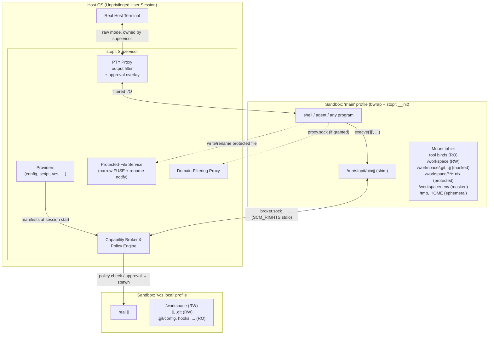

# `stopit`: system architecture and security design

**Status.** Draft, partly implemented (§12).  
**Target platform.** Linux 5.13 or newer, with unprivileged user namespaces and Landlock (any ABI, with more protection on newer ones, §6.3). The planned protected-file flow (§4) adds seccomp user-notify and FUSE.  
**Sandbox backend.** bubblewrap 0.12 or newer.  
**Implementation language.** Rust 1.88 or newer.

---

## 1. Scope, threat model and invariants

`stopit` is a general-purpose sandbox for running programs with **minimum-required privilege**. Interactive LLM agents are the primary motivating use case, but `stopit` has **no harness-specific features**: agents, their shells, and any other program are all described with the same configuration settings (see §7.6 for a worked example).

### 1.1 Threat classes

1. **The actively hostile program**, such as a prompt-injected agent.
   * Attempts sandbox escape, data exfiltration, or planting delayed-execution backdoors that run when the human next interacts with the workspace on the host (`.git/hooks`, `.envrc`, `flake.nix` + `use flake`, editor configs).
2. **The clumsy program**, such as a hallucinating agent.
   * Runs destructive commands (`rm -rf ..`, `git clean -fdx`, `jj abandon`), forkbombs, or corrupts VCS state outside its task scope.
3. **Silent secret harvesting.**
   * Reads sensitive host files (`~/.ssh`, `~/.aws`, `~/.config/gh`, `.env`, harness credential directories, `/run/user/$UID/bus`, Nix tokens) which may then be sent to third parties (e.g. model providers as context).

### 1.2 Non-goals

* **Code the user explicitly runs later.** If the sandboxed program edits `build.rs`, a `Makefile`, or a test, and the user later runs it on the host, that code runs. `stopit` protects against code that runs *without an explicit user action* (I3), not against code the user chooses to execute.
* **Kernel exploits.** Attack surface is reduced (seccomp, Landlock, namespaces) but not eliminated.
* **Secrets embedded inside the tool environment** granted by a provider (§3.6).

### 1.3 Core security invariants

These are the guarantees of `base = "default"`. Under `base = "none"` the same mechanisms exist but every grant must be added explicitly (§3.2).

* **I1. Allowlist-first visibility.** The sandbox filesystem starts as an empty `tmpfs` root. Nothing from the host, `HOME` and `/run/user/$UID` included, exists unless a grant names it.
* **I2. Irreversible privilege drop.** Every sandboxed process runs with all capabilities dropped, `PR_SET_NO_NEW_PRIVS` set, user-namespace creation disabled, and a seccomp filter installed. A sandboxed process cannot unmount, remount, or otherwise alter its mount table.
* **I3. No deferred host execution without approval.** Files that host tools execute *automatically* (on `cd`, on a VCS operation, on opening an editor) are **masked** or **protected** (§3.4). They change only with explicit user approval.
* **I4. Trusted terminal ownership.** The sandbox never holds the host terminal. The supervisor owns it, filters sandbox output through an escape-sequence allowlist (§5.3), and renders approval prompts the sandbox cannot forge.
* **I5. Explicit, additive policy.** `base = "none"` grants nothing. Every grant comes from a **provider** (§3.6), and everything `base = "default"` grants can be written out manually as providers (Appendix A).

### 1.4 Attacker capabilities in scope

This fixes what a reviewer may assume the attacker can do, so that a failure within these capabilities is a bug and one outside them is an accepted limit.

**In scope.** The sandboxed program runs arbitrary code with everything its profile grants, and:
* **Leaves state behind.** Anything it writes to a sandbox-writable location persists: in the workspace and any `rw` grant, to later sandboxes of the same session (other profiles, brokered commands) and to later sessions; in ephemeral `HOME` (dotfiles included, which another profile of the session may share, §3.4) and `/tmp`, to later sandboxes of the same session. That includes planted symlinks, renamed or deleted directories, `chmod` (e.g. `chmod 000` on a directory it owns), files replaced by directories and vice versa, hard links it can create (within one mount), and socket files. Every decision stopit makes at startup must stay safe whatever the sandbox left behind (§3.4, Symlinks and Pinned parent directories; §6.2, Untrusted links; known gaps: §11, Ephemeral backing directories and Literal restrictive rules rely on pinned parents).
* **Emits terminal output**, including any escape sequence (§5.3), and draws anything on its own screen (§5.4).
* **Talks to the broker and the approval flow** directly, with any request, argument or file descriptor, and as often as it likes (§4, §5.4, §7.1).
* **Runs concurrently** with other sandboxes of the same session, which may act on the same writable locations at the same time, including while a brokered command's sandbox is being mounted (known gap: §11, Path resolution is path-based).

**Out of scope** (documented limitations, not bugs):
* **Host processes changing files during stopit's startup**: another session on the same workspace, or the user editing it. Rules are checked and then mounted by path, so a component swapped in between is followed; fd-based mounting is planned to narrow this (§11, Path resolution is path-based).
* **Directories an earlier session granted `rw`** but this one does not: stopit cannot know their history, so links planted in them are trusted like the host's (§11, Untrusted roots are only what this session grants, Directories granted `rw` only by an earlier session). The workspace is the exception, always untrusted.
* The non-goals of §1.2, **kernel and bubblewrap vulnerabilities**, and **side channels** (timing, cache, resource usage).
* **`/proc` magic links** in host sources, which the kernel resolves differently from their link text (§11, Untrusted links are found by resolving link text).
* **Hard links the host created** to content outside the sandbox's view, or to masked or protected content (§3.4, Hard links; §11, Masks apply to sandbox paths, not host content).
* **A malicious configuration author or provider script.** The configuration defines the policy, and providers run on the host with the user's privileges (§3.6), so they are trusted; stopit validates the configuration to catch mistakes, not to contain its author (§11, Only mount destinations are reserved).

### 1.5 Errors and warnings

The project's **layout** (files, links, modes and permissions on disk, including anything a sandbox left behind, §1.4) can contradict the **configuration**: a rule names a path that is missing, a glob matches a planted link, masked content is visible at another sandbox path. stopit then resolves to the **safe outcome**, the one that never grants more access than the configuration intended (a restriction stays on; a grant may be dropped), and emits a **warning** naming the rule and the layout, so the maintainer can fix the layout. It does not special-case such layouts. It does not refuse to start either, so that what a sandbox left behind cannot stop the next session from starting. The exceptions are the layouts below with no safe outcome yet, and those listed in §11. Examples (§3.4, §6.2): a missing path, or a final link whose target is missing, skips its rule; a directory a restrictive rule cannot inspect (one a sandbox made `chmod 000` or `chmod a-x`, say) is masked as a whole, with a louder warning when that hides a whole grant, such as the workspace mount; a link matched by a glob inside an untrusted root is skipped; an `rw` rule or bind through a planted link is dropped; content under a mask visible at another sandbox path (or protected content writable there) is masked (or protected) at that path too.

Errors are reserved for:
1. **Configuration mistakes**: invalid or contradictory configuration itself, such as reserved paths (§6.2, Reserved paths), a mount of stopit's own state directories or of anything inside them, and an `rw` grant containing one (`rw ~` containing `~/.local/share/stopit`), which no cover could make safe since the sandbox could still create or move the directory (§6.2, Reserved host paths; a read-only grant containing the runtime directory, or an existing data directory, is masked there instead, with a warning), the workspace mounted at a second sandbox path (§6.2, Workspace exposure), two rules conflicting at the same path (two binds, or a bind and a path rule, mounting different content at one sandbox path), settings merging cannot resolve (conflicting `env.set` or `system.home` values, the same shim from two providers in one profile, §3.5), invalid provider output, or a provider that cannot run (§3.6). A script provider's source is part of the configuration: it is `protected` by default (`protect = true`, §3.6) in every profile wherever the sandbox could write it, so the sandbox cannot modify it, and renaming its parent directories away is covered by pinned parents (pending, §11, Literal restrictive rules rely on pinned parents); with `protect = false` it must not be sandbox-writable. A script whose path runs through a symlink inside the workspace or a directory a `config` provider grants `rw` is refused, since the sandbox could have planted that link, and so is a protected source with more than one hard link, which the sandbox could rewrite through another name (§3.6); so is a nested `.stopit.toml` found by walking up below one owned by the user (§3).
2. **Layout contradictions with no safe outcome in general yet**: currently a restrictive (`masked`, `protected`, `ro` or `ephemeral`) rule whose host source, glob prefix or (for any restrictive mode, `ephemeral` included) mount destination runs through a symlink inside an untrusted root, or a mask whose shape such a link would decide (§3.4, Symlinks; §6.2, Untrusted links). bwrap follows the link, so stopit cannot mask the link itself and must refuse rather than let a planted link switch the restriction off. These can become warnings once mounts use file descriptors (§11, Path resolution is path-based).

Some current behaviour does not follow this principle yet; see §11, Behaviour not yet aligned with §1.5.

---

## 2. System architecture

`stopit` is a **single Rust binary** with several personas selected via `argv[0]` / subcommands:

1. **Supervisor**, the host process of `stopit run` and `stopit shell`.
   * Owns the real host terminal; runs the **PTY proxy** with output filtering, and the **approval overlay** (§5).
   * Runs **providers** at session start to compute each profile's grants (§3.6).
   * Runs the **Capability Broker** for brokered tools (§7).
   * Runs the **Protected-File Service**: a narrow FUSE filesystem plus the seccomp rename-notify handler (§4).
   * Runs the **Network Proxy** for domain-allowlisted access (§8).
   * Applies optional **resource limits** (§10).
2. **Sandbox init helper**, `stopit __init`, the first process inside every sandbox.
   * Fills the gaps bubblewrap does not cover: controlling-terminal setup, Landlock, the seccomp filter (including the rename user-notify listener, whose FD is sent to the supervisor), then `execve` of the target (§6.3).
3. **Capability shim**, `/run/stopit/bin/<tool>`.
   * Symlinks to a small static trampoline placed at the front of `PATH`. On execution, the trampoline runs the provisioned stopit as `__shim`, which sends a request plus `stdin`/`stdout`/`stderr` FDs to the broker (§7.1).

### 2.1 Session runtime directory

All per-session state lives under `$XDG_RUNTIME_DIR/stopit/<session-id>/` on the host (never `/run/stopit`, which is root-owned):

| Host path (under session dir) | Sandbox path | Purpose |
| :--- | :--- | :--- |
| `broker-<sandbox-id>.sock` | `/run/stopit/broker.sock` | One socket per sandbox, so the broker knows which sandbox (and profile) is asking |
| `proxy.sock` | `/run/stopit/proxy.sock` | Network proxy (when granted) |
| `stopit` | `/run/stopit/stopit` (RO) | Copy of the running `stopit` binary, mode 0500 |
| `lib/` | `/run/stopit/lib` (RO) | Its program interpreter (0500) and shared libraries (0400); empty for a static build |
| `bin/` | `/run/stopit/bin` (RO) | Shim symlinks |
| `protected/` | bind-mounted per file (§4) | Narrow FUSE mount holding protected-file shadows |
| `ephemeral/` | per `ephemeral` rule, keyed by pattern as written (§3.4) | Session-scoped scratch (e.g. `/tmp`, sandbox `HOME`) |
| `lock` | not mounted | Holds the session's exclusive `flock` for as long as the session lives |
| `server.json` | not mounted | A `stopit server` session's workspace and pid (§5.5) |
| `control/` | not mounted | A `stopit server` session's control socket (§5.5) |

`$XDG_RUNTIME_DIR` must be set to an absolute path of a directory owned by the user and not writable by group or others; stopit never falls back to `/tmp`. `stopit/` and every session directory below it are mode 0700, and an existing `stopit/` must be a real directory (not a link) owned by the user with no group or other access. A session directory is created fresh under a random 128-bit id, never reused, and removed when the session ends (best effort, after its sandboxes exit and its mounts are unmounted). Its creator takes an exclusive `flock` on its `lock` file right after making the directory and holds it until the directory is gone. A stopit killed with `SIGKILL` leaves its directory behind with nobody holding the lock, and the next session to start removes every such directory while holding its lock. A directory without a `lock` file is left alone, since it is still being created or belongs to an older stopit that may still run. `stopit/` is a reserved host path (§6.2, Reserved host paths): no rule or bind may mount it or anything inside it, no `rw` one may contain it, and a read-only one containing it gets it masked.

**Self-provisioning.** `stopit __init` must run in every sandbox, including one that sees neither `/nix/store` nor `/usr`. So at session start the supervisor copies its own binary (the canonical path of `/proc/self/exe`) to `stopit` in the session directory, and its runtime closure to `lib/`: the program interpreter named by its `PT_INTERP`, and every library that interpreter resolves for it in list mode (`<interp> --list <exe>`, which is what `ldd` runs; the environment is cleared so `LD_LIBRARY_PATH` and `LD_PRELOAD` do not change the result). Symlinks are resolved and their targets copied under the names the loader asked for (the `DT_NEEDED` soname); every copy is written to a new file (`O_EXCL`, nothing existing is followed or overwritten) and given its mode explicitly. Both are mounted read-only at `/run/stopit`, so the sandbox can never change them. Copying rather than binding the host paths exposes no host store directories to the sandbox, keeps working if the binary is upgraded or garbage-collected mid-session, and adds no mounts that could collide with user rules. A static binary has no interpreter and is copied alone. Libraries that are only `dlopen`ed (NSS modules, gconv, a `libgcc_s` that is not `DT_NEEDED`) are not copied; `__init` must not use NSS (`getpw*`, `getaddrinfo`) or iconv.

### 2.2 Overview



---

## 3. Configuration model

Configuration lives in `.stopit.toml` at the workspace root, layered over the user-global `config.toml` described below. It is read **only** when the supervisor starts or is explicitly asked to reload. It is the user's responsibility to verify it before use; it does not take effect on `cd`.

Since it decides what the sandbox may do and which script providers run on the host as the user, `.stopit.toml` (found by walking up from the current directory, §3.1, or the one in `--workspace`) is only read if no one else could have written it: it must be a regular file owned by the user, without the group or other write bit, and its directory must be owned by the user or root and not writable by group or others unless it is sticky (as `/tmp` is). The directory is opened, the file opened in it without following a symlink, and both checked with `fstat` on those descriptors, so the file read is the file checked. The configuration's path is canonical (discovery resolves the workspace) and is its key in the trust store (below), so the directory is opened with `openat2(RESOLVE_NO_SYMLINKS)`: a link swapped in on the way since discovery is refused, naming the directory, rather than followed to a file the key does not name (`openat2` needs Linux 5.6, older than the 5.13 Landlock needs; without it, or under a seccomp profile that blocks it with `EPERM`, the run fails with an error saying so). A `.stopit.toml` that is a symlink is refused, whatever it points to. A file that fails these checks is an error naming the file and the reason, never skipped: walking up from `/tmp/proj` would otherwise find a `/tmp/.stopit.toml` that any user can create. These checks do not cover a `.stopit.toml` the sandbox itself writes in the workspace: it is the user's own file. Instead, **the supervisor protects the loaded configuration file** in every profile of its session, wherever the profile would let the sandbox write it, like a script provider's source (§3.6: the supervisor's rule, not a grant, attributed to `stopit`, a provider name reserved for this, §3.2), so neither `base = "none"` nor a loosening rule leaves it writable. The default base also protects every other existing `.stopit.toml` in the workspace (`{workspace}/.stopit.toml` and `{workspace}/**/.stopit.toml`, Appendix A), so the sandbox cannot change one; but a glob only protects what exists at the start (§3.4), so the sandbox can still create `sub/.stopit.toml`, which a later `stopit run` from `sub/` would find first. So **nested configurations are refused when found by walking up**: once a `.stopit.toml` is found, the directories above it are checked too, and if one of them has a `.stopit.toml` owned by the user (any entry of that name, whatever its mode or its directory's), stopit refuses to start, naming both files and suggesting `--workspace` with the inner directory (to use a nested configuration on purpose) and, if the outer one passes the checks above, with the outer directory (to use it); otherwise the error says the outer one fails them. Ownership alone decides because a sandbox can change modes in the workspace but not owners: with `chmod 0777` on the workspace root, which it owns, it could otherwise make the outer configuration fail the checks and so switch the rule off (that configuration is then refused when loaded too, the safe direction). One owned by someone else (a `/tmp/.stopit.toml` anyone could have created) is skipped: it is never loaded, so it protects nothing. The rule's soundness rests on the supervisor's protection of the loaded configuration, not on the default base: every session of the outer workspace protected the outer file, so a sandbox cannot have created or changed it, and a planted inner one is never used without the user naming its directory. `--workspace` does not look up, so it is how a nested configuration is used deliberately. Since trust on first use (below) refuses a planted configuration anyway, this rule is now defence in depth.

**Trust on first use.** Like direnv, stopit only uses a `.stopit.toml` the user has allowed, in its exact current content. `stopit allow [--workspace DIR]` finds the configuration exactly as `stopit run` does (the same walk-up, trust checks and nested-configuration rule), reads it through the same checked descriptor, parses it to catch mistakes (no provider runs, no sandbox starts), and records its canonical path with the SHA-256 of the bytes read in the trust store, replacing any earlier entry for that path; it prints the path, the file's size in bytes and the whole SHA-256 of what it read, so that the user can check (with `sha256sum`) that the version they reviewed is the one allowed (exit 0, or 125 on an error). `stopit revoke [--workspace DIR]` finds the configuration as `allow` does and removes its entry (without reading the file, which may be gone or fail the checks; nothing to remove is not an error). `stopit revoke PATH` removes the entry of the configuration file `PATH` (as `stopit allowed` lists it, or relative to the current directory) without looking for a workspace, so that the entry of a workspace that is gone can be removed too: `PATH` is matched as written (made absolute), and if no entry has that path, its directory is resolved as far as it exists (following the links on the way, as discovery would have) and joined with its file name, as `allow` would have recorded it; a directory is refused, and `PATH` and `--workspace` cannot be given together. `stopit allowed` lists the entries, each with the start of its hash, marking `(missing)` those whose file is gone. `stopit run` and `stopit shell` read the configuration once and then, **before any provider runs and before the session directory is created**, look its canonical path up in the store and hash the bytes read: a missing entry or a different hash is refused (exit 125) with a message saying the configuration is new (never allowed, or revoked) or changed since it was last allowed, and to review it, then run `stopit allow` (with `--workspace` and the workspace, if `--workspace` was given). The same bytes are then parsed, so the file cannot be swapped between the check and its use. A workspace without a `.stopit.toml` runs the default configuration (`base = "default"`), with nothing to allow: the workspace is then the current directory, or the directory given to `--workspace`. **Unless an allowed configuration is missing there**: if the store has an entry for a `.stopit.toml` where discovery looked (in the directory given to `--workspace`; otherwise in the current directory or any directory above it, the nearest named), that configuration was allowed and is gone (deleted, or moved away with a directory on its path), and the default configuration may grant what it did not, so the run is refused too (exit 125), naming the file and saying to restore it, or to run `stopit revoke <path>` to use the defaults there. The same holds for an entry at or below a symbolic link on the way to the workspace as the user named it: the directory given to `--workspace` (against the current directory), or else `$PWD`, the current directory as the shell tracks it, if it is absolute and is the current directory (the kernel's current directory has its links resolved already); its path is resolved one link at a time, and the links followed collected. Entries are canonical, so that path was a directory when the entry was recorded: a sandbox with `rw` on the directory holding a workspace can move the workspace away and put a link to a directory without configuration in its place, which discovery, resolving links, would otherwise run with the defaults. The message names the link. A stale entry (the user moved the project and left a link behind) is refused alike, the safe direction: the user allows the configuration again at its new path, or revokes the old entry. Deleting a configuration nested below an allowed outer one is not refused: walking up then finds the outer one, which runs, since the user allowed it. A command that a message suggests quotes its paths for bash and zsh (not POSIX sh or fish), so that it can be pasted as printed: a path of plain characters (`A-Za-z0-9` and `_@%+=:,./-`, not starting with `=`, which zsh expands) as it is, any other in single quotes (a `'` as `'\''`), and one with control characters, deceptive ones (bidi overrides, zero-width spaces) or bytes that are not UTF-8 in ANSI-C quotes (`$'…'`, those as `\xHH`), so that the terminal never sees them. A sandbox can still create a `.stopit.toml` there, below a workspace, or in any directory it can write, but a later run that finds it refuses it until the user allows it. `allow` trusts whatever the file holds at that moment, so review it first. What allowing does not cover is in §11 (What trust on first use does not cover).

**The trust store** is the file `allowed.json` in stopit's data directory (§6.2, Reserved host paths: `<home>/.local/share/stopit` from the password database, or `STOPIT_STATE_DIR`). `run`, `shell`, `allow`, `revoke` and `allowed` all create the directory if it is missing (its parents with `create_dir_all`, itself with mode 0700; with a home directory in the password database that is missing or not the user's to write, such as `/nonexistent` or `/var/empty`, that fails, and the error says to set `STOPIT_STATE_DIR` to a directory the user owns), then require it to be a real directory (not a link) owned by the user with no group or other access, as `stopit/` is in §2.1, open it without following a link, and check that the descriptor is the directory checked. The store file is opened relative to that descriptor without following a link, and must be a regular file owned by the user with no group or other access (0600), checked with `fstat` on the descriptor read: others able to write it could allow configurations for the user, and others able to read it learn the user's projects. A missing file is an empty store; one that does not parse is an error naming it, never an empty store. It is JSON, `{"version": 1, "allowed": {"<path>": "<sha256>"}}`, each path the lowercase hex of its bytes (a path may hold any byte but NUL, which a JSON string cannot carry) and each hash lowercase hex; it is not meant to be edited by hand. An update holds an exclusive `flock` on the directory while it reads the store, writes the new one to a temporary file in the directory (`O_EXCL`, 0600; one a crashed update left behind is removed first), `fsync`s it, renames it over the store and `fsync`s the directory: concurrent `allow`s lose no entry, and a reader, which takes no lock, sees the old store or the new one, never part of one. No mount may show the store from inside, a read-only view containing it masks it (silently, so `ro ~` does not warn on every run), and no `rw` mount may contain it (§6.2, Reserved host paths).

**The user-global configuration** is `config.toml` in stopit's configuration directory, `<home>/.config/stopit` with `<home>` from the password database. Neither `HOME` nor `XDG_CONFIG_HOME` moves it, for the same reason as the data directory. `STOPIT_CONFIG_DIR` overrides the directory and must be absolute. It holds what every workspace needs, typically the tool provider granting `/nix/store` or `/usr` and the agent profiles, so each `.stopit.toml` only adds what is specific to its project.

It needs no `stopit allow`, because the configuration directory is reserved like the data directory. No mount may show anything inside it, no `rw` mount may contain it, and a read-only view containing it masks it. The mask is silent for the active directory, so `ro ~` does not warn. With `STOPIT_CONFIG_DIR` set elsewhere, the default `<home>/.config/stopit` stays reserved too, and masking it warns.

stopit still checks ownership before reading. It opens the directory with `openat2(RESOLVE_NO_SYMLINKS)`. The directory must be owned by the user or root and not writable by group or others unless sticky, and so must the directory holding each link on the way to it. Then stopit opens `config.toml` in it without following a link. A regular file must be owned by the user or root without the group or other write bit, checked with `fstat` on the descriptor read.

A symbolic link is accepted too, since Home Manager and dotfile managers install the file that way. The link must be owned by the user or root. stopit opens its target and checks it like a regular file. It reads the target's canonical path from `/proc/self/fd`, opens the directory holding it with `openat2(RESOLVE_NO_SYMLINKS)`, applies the directory rule, and checks that the name there is still the inode it read. `/nix/store` passes the directory rule as a root-owned sticky directory. A link whose target is missing is an error, never an absent configuration.

A file or target with more than one hard link is refused when the user could write it, since a sandbox could rewrite it through the other name. Nix store files that `auto-optimise-store` hard-links pass, as for script sources (§3.6). Every failure names the file and the reason. A missing directory or a missing `config.toml` means no global configuration.

The target and the scripts of the global configuration often live outside the reserved directory, so the supervisor guards them in every session. Before any provider runs, it resolves `config.toml` and the source of every protected global `script` provider from their declared paths. A symbolic link on the way inside the workspace or a `config` provider's `rw` grant is refused, since a sandbox could re-point it, as for script providers (§3.6). The canonical paths are then protected in every profile, like the workspace's `.stopit.toml`. A workspace granting `rw` on a dotfiles repository therefore cannot change the file a link names, rename it, rename a directory above it, or give it a second name. This holds for global scripts the session does not run too, such as one a workspace provider replaced by name.

Relative `script` provider sources in `config.toml` resolve against the configuration directory, which is also their working directory.

When the workspace's `.stopit.toml` sets `base = "none"`, the global layer does not apply. stopit still reads, checks and parses `config.toml` to guard its target and scripts, so a broken or untrusted one stops that workspace too. Otherwise the two layer as described in §3.5.

At startup the supervisor prints a short summary of every grant that **widens** access beyond the default base (binds, especially under `$HOME` or `/etc`; network domains; brokered commands; sockets that delegate to host daemons; providers with `protect = false`). This is informational and does not block.

`stopit run` and `stopit shell` print it to stderr, one `stopit: `-prefixed line each, after the warnings and right before the sandbox starts, for the profile that runs (not for the session's other profiles). The first line names the profile, the workspace and the mode of the workspace mount (`stopit: profile "main" (workspace ~/proj rw at /workspace)`, or `(workspace ~/proj, not mounted)` when no mount is at the workspace mount point); each further line is one grant beyond what the default base gives, so under the default configuration there is only the header, plus a `broker` line each for `jj` and `git` when the workspace is a repository the `vcs` provider supports (§7.3):

```
stopit: profile "main" (workspace ~/proj rw at /workspace)
stopit:   rw       ~/.cargo/registry  (provider "cache")
stopit:   ro       /nix/store  (provider "tools")
stopit:   sockets  not masked in rw grants
stopit:   network  full
stopit:   script   provider "env" runs unprotected (protect = false)
stopit:   env pass RUST_*
stopit:   env set  API_URL
```

What is listed: host content mounted `rw`, `protected` (`prot`) or `ro` outside the workspace, or inside it with a mode wider than the workspace mount's (`rw` over `protected` over `ro`: an `rw` `{workspace}/out` under an `ro` workspace is listed, a `ro` part of an `rw` workspace is not; with the workspace not mounted, every mount of its content is), one line per mount with its provider, `rw` first, then `prot`, then `ro` (`host -> sandbox` when the sandbox path differs; the sandbox `HOME` is written `~` like the host's, so a `~` rule shows as one path); `sockets  not masked in rw grants` when `fs.mask_sockets` is off and any host content is mounted `rw` (§3.4; sockets that delegate to host daemons get their own flag once such grants exist, below); the network if its mode is not `none` or `loopback` (`full`, or `proxy to` the domains); shared namespaces (`share`), re-enabled syscalls (`syscalls`), brokered commands (`broker`, with their provider), script providers with `protect = false` (`script`), and environment `pass` patterns and `set` names the default base does not already have (`env pass`, `env set`: names only, never values). Left out, as they widen nothing: the workspace's own mount and anything inside it no wider than that mount, masked and ephemeral mounts, and the supervisor's own rules (the protected configuration file). A provider with more than 10 mounts of one mode (a Nix closure can have thousands) gets one line with their count instead (`ro       4312 mounts  (provider "tools")`), and a name list is cut after 10 names with `and N more`. Paths under the host `HOME` are written with `~`, and every value is escaped like the rest of what stopit prints (§5). `--quiet` (`-q`) on `run` and `shell` leaves the summary out; warnings and errors are still printed. Like every stopit option it must come before the command: after it, `-q` is the command's own.

### 3.1 Structure of top-level settings and providers

The configuration has a single way of granting resources: **providers**. Only session-wide settings, which are not grants, live at the top level.

| Top level | Providers, `[[provider]]` |
| :--- | :--- |
| `base`, starting set of providers, see §3.2 | Filesystem rules and path modes |
| `[workspace]`, workspace identity and mount point | System mounts for `/proc`, `/dev`, synthesized `/etc`, and `HOME` |
| `[limits]`, resource limits, see §10 | Environment pass, deny, set, and `PATH` |
| `[approval]`, approval timeout, see §4.3 | Network |
| `[terminal]`, output-filter options, see §5 | Brokered shims and their policy |
| `[profiles.<name>]`, which sandboxes exist, see §3.3 | Hardening opt-outs for namespace sharing and syscalls |
| | Contributed profiles |

```toml
base = "default"

[workspace]
mount = "/workspace"          # where {workspace} appears inside the sandbox

[limits]
memory = "8G"

[approval]
timeout = "off"

[[provider]]
type = "script"
source = "scripts/agent-env.sh"

[[provider]]
type = "config"
[provider.sandbox]
fs.ro = ["/etc/ssl/certs"]
network = { mode = "proxy", allow_domains = ["static.crates.io", "index.crates.io"] }
```

**Workspace.** The workspace is the host directory the session is about: by default the directory with the nearest `.stopit.toml`, walking up from the current directory (§3), else the current directory, overridable with `stopit run --workspace <dir>`. Its identity is session-wide because the supervisor depends on it (socket and hard-link scans, protected-file shadows, repository resolution, broker cwd checks) and every provider's `{workspace}` paths are relative to it. *Access* to it is still a grant: under `base = "none"` the workspace is defined but not mounted until a provider grants it. The workspace mount point (like `system.home`) is subject to the reserved-path rules in §6.2. Otherwise `{workspace}` rules are resolved and checked like `~` and absolute ones (§3.4, §6.2); the workspace is special in exactly three ways: (1) it is the session's identity, whose path comes from `.stopit.toml` or `--workspace` and which the supervisor relies on, so it must appear in the sandbox only at its mount (§6.2, Workspace exposure); (2) it is always an untrusted root for symlinks, even when no profile of the session grants it `rw` (§3.4, Symlinks); (3) the default base grants it `rw` (§3.2).

### 3.2 Bases

```toml
base = "default"   # "default" (the default) | "none"
```

The design rule is: **restrictions default on, grants default off.** A base is a set of built-in providers placed **before** the user's providers.

* `base = "none"` has no built-in providers. The sandbox is empty: nothing mounted (no `/proc`, no `/dev`), an environment of only `HOME`, `USER` and `LOGNAME` (§9), no network at all (not even `lo`), full hardening, no shims. `stopit run /bin/sh` fails because `/bin/sh` does not exist. That is intended.
* `base = "default"` has a built-in `config` provider named `base` with the defaults below, plus the `vcs` provider (§7.3) named `vcs`. A user provider cannot be named `base` under this base. A user provider of type `vcs` replaces the built-in one, so its options apply, and otherwise the name `vcs` is reserved as well. Under every base, the provider name `stopit` is reserved too, since it names the supervisor's own rules (the protection of the loaded configuration, §3), so a user provider cannot use it.

| Aspect | `base = "none"` | `base = "default"` |
| :--- | :--- | :--- |
| Filesystem | Empty `tmpfs` root | `/proc` (masked subset), minimal `/dev`, synthesized `/etc`, workspace RW + default path rules (§3.4), ephemeral `/tmp` and `HOME`, tool binds from user providers |
| Environment | `HOME`, `USER`, `LOGNAME` only (§9) | Identity (`HOME`, `USER`, `LOGNAME`); `TERM`, `LANG`, `COLORTERM` passed through; secret patterns denied (§9) |
| Namespaces | All unshared (user, mount, pid, net, ipc, uts, cgroup) | Same |
| Network | **None**, no interfaces up | Loopback only |
| Hardening (seccomp, Landlock, `nosuid`/`nodev`, no caps, `NO_NEW_PRIVS`, no nested userns) | On | On |
| Terminal output filter | On | On |
| Brokered tools | None | `jj`, `git` via the `vcs` provider (§7.4) |

Notes:
* Standard I/O is always connected (through the PTY proxy or pipes); it is the channel back to the user, not a host capability.
* `base = "default"` does not include tools. At least one provider from the global `config.toml` or `.stopit.toml` must grant `fs.ro`, `fs.rw`, `fs.bind`, or `env.path_prepend` in some profile, or `stopit run` exits 125 before the sandbox starts. The message names both files and prints an example tool provider. Restrictions such as `fs.masked`, and `env.set` or `env.pass`, do not count, since the host `PATH` never reaches the sandbox (§9). Under `base = "none"` nothing is refused, because an empty sandbox is what was asked for.
* Intermediate bases may be added later; they are just alternative built-in provider sets.
* A golden test asserts that Appendix A (everything written out under `base = "none"`) produces the same `SandboxSpec` as `base = "default"` (§12).

### 3.3 Profiles

A **profile** is a complete sandbox description: mounts, network, environment, shims. `stopit run` / `stopit shell` start the program in profile **`main`** unless `--profile <name>` is given. After that, the **only** way into another profile is a shim: each brokered command runs in a *fresh* sandbox built from the shim's target profile. Nothing ever leaves sandboxing entirely; a brokered command just gets a sandbox with different permissions.

```
main profile (shell / agent)                 vcs.local profile (fresh sandbox per command)
  /workspace        rw                         /workspace          rw
  /workspace/.git   masked   ── jj commit ──▶  /workspace/.git     rw
  network           loopback   (via shim)      .git/config, hooks  ro (locked)
                                               network             none
```

Profiles come from two places:
* **Declared by the user** at the top level, as structure only (which sandboxes exist):
  ```toml
  [profiles.harness]       # inherit = "main" is the default
  [profiles.bare]
  inherit = "none"         # starts from the empty sandbox, ignoring base
  ```
  Grants are then attached by providers (`config` providers take `profile = "<name>"`; §3.6).
* **Contributed by providers** as part of their manifest. These are prefixed with the provider's name to avoid collisions: the `vcs` provider contributes `vcs.ro`, `vcs.local`, `vcs.remote`. Inside the manifest they are written as plain single-segment names (`ro`, `local`, `remote`) and the prefix is added automatically (§3.6). Most users never see them.

`inherit = "<profile>"` (default `"main"`) means the profile starts from the parent's fully merged grants, then adds its own. `inherit = "none"` starts from the empty sandbox. `stopit-grant` (§7.5) creates a temporary profile: the caller's profile plus the requested delta.

### 3.4 Path modes

| Mode | What the sandbox sees | Mechanism |
| :--- | :--- | :--- |
| `masked` | Name exists but is empty: empty RO file, or empty RO directory | bwrap `--ro-bind-data` (empty) / `--tmpfs` + `--remount-ro` |
| `ro` | Real content, read-only | bwrap `--ro-bind` |
| `rw` | Real content, writes go to the host | bwrap `--bind` |
| `protected` | Real content; writes trigger an approval prompt with a diff (§4) | Narrow FUSE shadow + seccomp rename notify |
| `ephemeral` | Writable, starts empty, deleted at session end; shared by all sandboxes of the session | bwrap `--bind` of a session-dir subdirectory |
| `cow` *(future)* | Writable, all changes staged for review | Full-workspace FUSE or overlayfs (§11) |

Semantics:
* **Masked ≠ absent.** A bind mount cannot remove a name from a bind-mounted directory; a true `ENOENT` would need overlay whiteouts or FUSE. Paths that are simply never granted (e.g. host `HOME`) are absent. A masked stub also prevents the sandbox from *creating* that name (e.g. a top-level `.git`).
* **Ephemeral backing directories are keyed by pattern.** Each `ephemeral` rule gets one backing directory under `ephemeral/` per session, keyed by the rule's pattern as written (`~`, `/tmp`, `{workspace}/target`), not its expansion, and shared by every sandbox of the session. So `~` is one directory across profiles even with different `system.home`: a profile's own `system.home` does not isolate an ephemeral `~`; to keep a profile's HOME separate, write its ephemeral rule as an absolute path (`ephemeral = ["/home/agent"]`). Ephemeral rules of equal precedence at one sandbox path never conflict; the first in rule order names the backing directory, so a later one's pattern is not backed there in that profile.
* All mounts carry `nosuid,nodev`. Execute permission is **not** restricted by mount flags: `noexec` is not a security boundary (`bash script`, `ld.so ./bin`) and would break `cargo run`, test runners and scripts.
* `chmod` on a protected file counts as a change and goes through approval (the diff shows the mode change). `ro`/`masked` reject it with `EROFS`.
* **Deleting or renaming a protected file away** fails with `EBUSY` (it is a mount point). This is intended.
* **New files matching a protected glob** (e.g. a new `nix/foo.nix`) are written through directly: every pre-existing file that could reference them is itself protected. See §11 for the auto-import caveat.

Path syntax (in any provider):
* `{workspace}` is the host workspace directory, mounted at `workspace.mount` (default `/workspace`).
* `~/…` is host `$HOME/…` on the host side and sandbox `HOME` on the sandbox side (`/home/user` unless a provider sets `system.home`; the default base leaves it unset).
* Absolute paths map to the same path inside the sandbox; `fs.bind` entries remap explicitly.
* Built-in providers may resolve additional concrete host paths internally (e.g. `vcs` resolves git worktree and jj workspace storage, §7.3). These are not user-facing placeholders.
* **Syntactic validation (at load time):** no `.`/`..`/empty components, no NUL, no trailing `/`; the bare `/` is rejected; a glob is not allowed as the first component directly below `/` or `~` (`/*` and `~/**` are rejected; `{workspace}/**` is fine). Globs are validated too: `**` only as an entire component, no `/` (or range spanning `/`) in a `[...]` class, and the glob must compile. `?` and `[...]` match a single byte, so they do not match a non-ASCII character as a whole (e.g. a `masked` rule `?.env` does not match `é.env`; use `*`). `fs.ephemeral` entries must be literal paths, without glob characters (each rule is backed by one session directory).
* Globs (`*`, `**`) are expanded **once at session start** into concrete paths. Files created later are not retroactively masked or protected (except via the "new files are written through" rule above).

Additional checks:
* **Symlinks: trust by writer.** Every symlink attack needs a link the sandbox planted, and a sandbox can only plant links where it can write. So stopit trusts a link by who could have written it. The **untrusted roots** of a session are the host directories some sandbox of the session can write: the host workspace (always, even when no profile grants it `rw`: another session or an earlier one may have), and the host source, resolved to its canonical path, of every `rw` mount (path rules and `rw` binds) of **every** profile of the session, since a sandbox in one profile can plant links that a rule of another follows. Session ephemeral backing directories under §2.1 act as untrusted roots when bwrap mounts are prepared, so nested mount destinations and pinned parents inside an ephemeral mount refuse symlinks planted by an earlier sandbox of the session. stopit never follows a symlink located inside an untrusted root, whatever the rule's anchor and however the lookup got there; links outside every root (`/nix/store`, `/etc/static`, home-manager links in `~`) are the host's and are followed fully. Roots may nest (`rw` grants of `~/.cache` and `~/.cache/tool`); a link is attributed to the innermost root containing it. An `rw` source written through host links (`~/cachelink/tool` with `~/cachelink -> .cache`) makes the directory it leads to a root; one that cannot be resolved is not a root (it could not be mounted, and is dropped below).

  Rules of every anchor are resolved alike, `{workspace}`, `~` and absolute ones: symlinks on the way to a rule's host path are followed (home-manager and `/etc/static` rely on it), the final component of a matched path is kept as it is (a bind follows it when mounting), and globs never descend into symlinked directories below their walk root. The untrusted-root checks then decide (§6.2, Untrusted links): a host source, or a mount destination on the way through the mount underneath it, that runs through a symlink inside an untrusted root, however the lookup got there, makes a `masked`, `protected`, `ro` or `ephemeral` mount a startup error (a planted link must never switch a restriction off) and drops an `rw` mount (rule or bind) with a warning. This holds for links pointing inside their root too: with the workspace granted `rw`, a planted `x -> .git` would otherwise turn an rw `{workspace}/x/hooks` into a mount at `.git/hooks`, under a stricter rule. A symlink **matched by a glob** inside an untrusted root is skipped with a warning for every mode instead: the walk visits the real files directly, so a planted link can neither redirect the glob nor make it miss them (with `config` renamed to `config2` and `config -> config2` planted, `{workspace}/**/*.env` still matches `config2/prod.env`). Such a match is skipped after the winner at its sandbox path is picked, so nothing is mounted there. A link matched outside every root (a home-manager link matched by `~/.config/*`) is the host's and is kept, and a glob whose literal prefix or walk root runs through a link inside a root reached whatever that link leads to, so its matches are refused like a literal rule's. For a link inside the host workspace, the one root known before every profile is planned, this is decided before walking: such a glob is a startup error for a restrictive mode and skipped with a warning for `rw`, so that a planted `config -> /` cannot make `{workspace}/config/**/*.env` walk the whole host filesystem first (for other roots, see §11). In short: links matched by a glob inside a root are skipped for every mode; links on the way (in a literal path, a glob's literal prefix, a mount destination) or at the end of a literal path are errors for restrictive modes, except that a final link whose target is missing mounts nothing and is skipped like a missing path. A legitimate link skipped this way leaves its target as readable as before if the target does not match the glob (see §11). Likewise, a path that exists but cannot be inspected, or a directory a glob walk cannot read, is never skipped by a `masked`, `protected` or `ro` rule, anywhere (the sandbox could otherwise `chmod 000` a directory it owns to switch a mask off at the next start): the directory that cannot be searched or read (the deepest directory on the way, as written, that can itself be inspected, or the one the walk cannot read) is masked as a whole instead, with a warning, which hides everything the rule could apply to there, and more (§1.5); a glob's other matches still apply. A glob walk lists the entries of a directory that can be read but not searched (`chmod a-x`) without inspecting them, so every match of a restrictive glob is inspected, and one that cannot be masks that directory the same way. Such a mask outranks every other rule at its sandbox path, since a less strict one winning there would lift the restriction below it. When it hides another rule's mount there entirely (the workspace mount, with the workspace itself made unsearchable, or an `rw` grant of that directory), a separate, louder warning names that grant, says it is hidden this session, and how to get it back (restore the directory's permissions). Mounts below it are kept, as below any masked directory (nothing below a directory that cannot be searched can be resolved, so they show other content). An `rw` rule or bind host is skipped with a warning instead. A missing path (including an entry that vanishes during a glob walk, or a path through a dangling link) skips any rule with a warning, and so does a final link whose target is missing (§6.2, Workspace exposure). A `masked` rule matching a symlink masks it as its target's kind (an empty file or an empty directory); a dangling link is skipped with a warning (there is nothing to hide), and a target that cannot be inspected otherwise is a startup error (§11, Behaviour not yet aligned with §1.5), except for a link matched by a glob inside an untrusted root, which is skipped like any such match without looking at its target. A mask whose shape would be decided by a link inside an untrusted root is a startup error like any other restrictive rule: a planted link must not change a mask's shape.
* **Pinned parent directories.** Renaming a parent directory of a restrictive mount away, such as running `mv config cfg2` when `{workspace}/config/secrets.env` is masked, would otherwise make the literal rule missing at the next start and leave `cfg2/secrets.env` readable. For every `masked`, `protected`, `ro`, or `ephemeral` mount strictly inside a mount of an untrusted root, including the workspace mount, an `rw` mount, or an `ephemeral` mount, stopit self-binds each existing intermediate directory in parent-first order with `--bind-fd` or `--ro-bind-fd`. Each intermediate directory becomes a mount point, so `rename` and `rmdir` on it fail with `EBUSY` while creating, editing, and deleting files inside it still work.
* **Unix sockets.** Network namespaces isolate abstract sockets, but a socket *file* created by a host process inside an RW directory is reachable through the bind mount (e.g. `.devenv/state/postgres/.s.PGSQL.5432`). With `fs.mask_sockets = true` (default base), sockets found in RW grants at startup are masked (an empty file with mode 0000, so connecting fails with `EACCES`).
* **Hard links.** A protected file with `nlink > 1` is writable through its other name. The sandbox cannot create such links (`link` across mounts fails with `EXDEV`), but pre-existing ones trigger a startup warning.

### 3.5 Merging and precedence

All providers' manifests are merged per profile, in order: base providers first, then the global `config.toml`'s providers in file order, then `.stopit.toml`'s providers in file order; a profile with `inherit` starts from its parent's merged result.

**Layering `.stopit.toml` over `config.toml`.** Each provider carries the layer that declared it, `builtin` < `global` < `workspace`, and the project file wins wherever both say something:

* A top-level field written in `.stopit.toml` overrides the same field in `config.toml`, field by field (`base`, `workspace.mount`, each `[limits]` value, `approval.timeout`, `terminal.clipboard_write`). Writing the built-in default counts as writing it. A field neither file writes takes the built-in default.
* `[profiles.<name>]` declarations are a union, and `.stopit.toml`'s declaration of a name replaces `config.toml`'s.
* A `[[provider]]` in `.stopit.toml` with the same name as one in `config.toml` replaces it, including the implicit names such as `config`. When both are unnamed, stopit warns, since that is rarely meant. Two providers with one name in the same file stay an error.
* Within a profile's own contributions, `env.set` variables, `shims` names, and `system.home` from a higher layer override a lower layer's. Two providers of the same layer that disagree stay an error, even when a higher layer also sets the key.
* Two path rules or binds at one sandbox path with the same rank under the rules below and different sources go to the higher of the global and workspace layers, so a project `fs.bind` can replace a global one at the same destination and mode. Two such sources within one layer conflict, even when a higher layer also has one, as for `env.set`. A built-in rule is never replaced this way, and a user rule of the same rank with another source conflicts with it.
* `env.path_prepend` needs nothing new. Later providers come first, so project entries precede global ones in `PATH`.

When `.stopit.toml` sets `base = "none"`, the global layer does not apply, though stopit still checks it (§3).

**Path rules.** For each path, these decide the effective mode:
1. **Most specific path wins.** An exact path beats a glob; a deeper path beats a shallower one (`{workspace}/.git` beats `{workspace}`; `{workspace}/flake.nix` beats `{workspace}/**/*.nix`).
2. **A profile's own rules beat inherited rules** at equal specificity. This is what lets `vcs.local` (inheriting `main`) make `.git` writable although `main` masks it.
3. **Strictest mode wins** among the remaining ties: `masked` > `protected` > `ro` > `ephemeral` > `rw`.

To loosen a restriction, configure the provider that added it (e.g. `vcs` with `view = "ro"`), add a more specific rule, or use `base = "none"`. Mounts are applied in path-depth order so children overlay parents.

Two kinds of mounts are not rules and stand outside this precedence: the masks synthesized over a directory a restrictive rule cannot inspect (§3.4, Symlinks), which outrank every rule at their path, and the protection of script providers' sources (§3.6) and of the loaded configuration file (§3), which the supervisor adds after planning wherever a profile would let the sandbox write them, whatever the rules say there.

**Other sections:**

| Section | Merge rule |
| :--- | :--- |
| `env.pass` / `env.deny` | Union; **`deny` always wins** over `pass` |
| `env.set` | Conflicting values for the same variable are an **error** unless identical; a profile's own value overrides the inherited one, per variable |
| `env.path_prepend` | Later providers' entries first within a profile, then inherited entries; earlier entries take precedence in `PATH`; duplicates keep the first occurrence |
| `network.mode` | Within a profile: the most permissive granted mode (`none` < `loopback` < `proxy` < `full`). A profile's own value overrides the inherited one |
| `network.allow_domains` | Union |
| `shims` | Union; the same shim name from two providers in one profile is an **error**; a profile's own shim replaces an inherited one of the same name |
| `sandbox.share`, `sandbox.allow_syscalls` | Union |
| `system.proc`, `system.dev` | Logical OR within a profile; a profile's own explicit value overrides the inherited one |
| `system.etc`, `system.groups` | Union |
| `system.home` | Conflicting values within a profile are an **error** (like `env.set`); a profile's own value overrides the inherited one |
| `fs.mask_sockets` | Tri-state (unset / `true` / `false`). Within a profile, `true` wins over `false` (strictest wins). A profile's own explicit value overrides the inherited one, so a contributed or user profile can opt out of masking that `main` enables |

### 3.6 Providers

A **provider** produces a **manifest**: the canonical grant structure used by every provider type. `[[provider]]` entries share these fields:

| Field | Applies to | Meaning |
| :--- | :--- | :--- |
| `type` | all | `config`, `script`, `vcs` (later: `nix`, …) |
| `name` | all | Optional; defaults to `type`. Prefix for contributed profiles; shown in the startup summary |
| `profile` | `config` | Profile the grants apply to (default `main`) |
| `[provider.sandbox]` | `config` | The manifest itself, written inline in TOML |
| `source` | `script` | Path to the executable, relative to `.stopit.toml`; executed **on the host** |
| `protect` | `script` | Whether `source` is automatically `protected` (default `true`) |
| `[provider.config]` | `script` only | Free-form parameters for the script, passed as JSON on stdin. Only scripts need a free-form keyspace |
| type-specific keys | built-in types (`vcs`, later `nix`) | Options written directly under `[[provider]]` (e.g. `view`, `tools`, `devshell`) |

```toml
[[provider]]
type = "config"
profile = "main"
[provider.sandbox]
fs.ro = ["/etc/ssl/certs"]
env.pass = ["RUST_*", "CARGO_*"]

[[provider]]
type = "script"
source = "scripts/agent-env.sh"
protect = true
[provider.config]
devshell = "agent"

[[provider]]
type = "vcs"
view = "masked"
```

**Manifest schema** (identical for `[provider.sandbox]` and script output):

```json
{
  "version": 1,
  "fs": {
    "rw": ["{workspace}"], "ro": [], "masked": [], "protected": [], "ephemeral": ["/tmp", "~"],
    "bind": [{ "host": "/etc/ssl/certs", "sandbox": "/etc/ssl/certs", "mode": "ro" }],
    "mask_sockets": true
  },
  "system":  { "proc": true, "dev": "minimal", "etc": ["passwd", "group", "hosts", "nsswitch.conf"], "home": "/home/user", "groups": [] },
  "env":     { "pass": ["TERM"], "deny": ["*_TOKEN"], "set": { "LANG": "C.UTF-8" }, "path_prepend": ["/nix/store/…/bin"] },
  "network": { "mode": "loopback", "allow_domains": [] },
  "sandbox": { "share": [], "allow_syscalls": [] },
  "shims":   { "<name>": { "binary": "…", "deny_flags": [], "default": { "decision": "ask", "profile": "main" }, "rules": [] } },
  "profiles": { "<name>": { "inherit": "main", "fs": {}, "env": {}, "network": {}, "shims": {} } }
}
```

* Top-level manifest sections apply to the target profile (`profile` for `config`; `main` for other types). Entries under `profiles` are contributed profiles, prefixed with the provider's `name`.
* **Contributed profile keys** inside a manifest are plain single-segment names (e.g. `local`); the provider's `name` prefix is added automatically (`vcs.local`). Contributed profiles cannot themselves contain `profiles` or `version`.
* **Reference rule:** within a manifest, a plain profile reference (`inherit = "local"`, shim `profile = "ro"`) resolves first to that manifest's own contributed profile, then to a user-declared profile. `main` and other providers' profiles are referenced by their full names. A full name (e.g. `vcs.local`) always resolves globally, including to the manifest's own profiles; plain names are preferred inside a manifest because the provider `name` can change.
* **Validation:** every manifest table accepts only maps (array forms are rejected) and unknown keys are rejected. A JSON manifest from a script **must** include `"version"`; an inline `[provider.sandbox]` may omit it (defaults to 1). Bind `mode` is one of `ro`, `rw`, `protected` only (`masked` and `ephemeral` have no host content to bind). Bind `host`/`sandbox` paths contain no globs (glob characters are `*`, `?`, `[`, `]`), and a bind's `sandbox` side additionally allows no `{workspace}` placeholder. Path rules are also validated syntactically at load time (§3.4).
* **Script providers** receive on stdin a JSON object containing their `[provider.config]` and a context (`workspace` host path, `workspace_mount`, `home`, `session_dir`, provider `name`, target `profile`), and print a manifest on stdout. A non-zero exit or invalid manifest aborts startup.
* **Scripts run on the host with the user's privileges.** With `protect = true` (default) the script is `protected`, so the sandbox cannot rewrite code that runs on the host next session. The plan is to protect its directory too if it sources other files, but only the script itself is protected so far (§11). `protect = false` is allowed but flagged in the startup summary.
* **How a source is protected.** The script is resolved once to its canonical path, which is both the file run and the file protected (protecting a link would leave its target writable). That protection is the supervisor's rule, not a grant, so it is not a path rule competing in precedence (§3.5), where an exact `rw` rule of the same path, or a profile's own rule, would beat it, and no provider's output can lift it. Instead, once a profile's mounts are planned and checked (§6.2, after the restricted-content covers), the source P is protected wherever the profile lets the sandbox write it, in **every** profile of the session: for every `rw` mount M whose canonical source S is P or an ancestor of it, M shows P at X, M's sandbox path joined with P's path below S; unless another mount lies between M's path and X (mounted on top: a mask there hides P, a read-only or protected mount shows it read-only, an `rw` one is compared in turn), X gets a `protected` mount of P, attributed to the script provider, replacing M if X is M's own path. So the source is protected at its aligned path when it lies in the workspace, and at every other path an `rw` grant shows it (a `~` grant, a bind); a profile where it is not visible, masked or read-only gets nothing. Like the covers of Restricted content exposure (§6.2), these mounts need no other checks: P is canonical and lies inside S, and X lies below M's path, reached through M's tree along P. A directory P is protected as a directory, and an `rw` mount whose source lies strictly inside it is not the narrower grant it would be under a protected rule: it is mounted `protected` too, with a warning naming both providers. A source that cannot be inspected when the session is compiled is an error naming the provider, and so is a regular file with more than one hard link that the user owns or can write (`faccessat`, so ACLs count; a Nix store file deduplicated by `auto-optimise-store`, owned by root and read-only, cannot be rewritten through any name and is accepted): the sandbox could rewrite it through another name inside an `rw` tree, which no mount at the protected name prevents, so there is no safe outcome (§1.5); give the script a single link. A script provider checks this right after resolving its path, before the script runs (it may already have been rewritten that way), and the session compiler checks every protected source again. Hard links to files inside a protected directory are not detected (§11). The supervisor protects the loaded `.stopit.toml` the same way (§3). These protected mounts are checked and mounted by path like every other, so they inherit its gap (§11, Path resolution is path-based; Literal restrictive rules rely on pinned parents): another session of the same workspace could swap a parent directory between the compile and the mount.
* **Script paths through writable links are refused.** Before a script runs, its path as declared (`source` joined to the configuration's directory) is resolved one component at a time like a host source (§6.2, Untrusted links), and that one lookup gives the canonical path that is run and protected; if it runs through a symlink inside the workspace or inside a directory that a `config` provider grants `rw` (in any profile: an `fs.rw` path, a glob's literal prefix, or the host side of an `rw` bind), the final component included, the provider is refused with an error naming it, the link and that directory. This holds even when the lookup fails after following the link, as a planted link may be why it fails. The sandbox can plant or replace such a link (only the link's target is protected), and the next session would run whatever it leads to. There is no safe outcome (running it is host code execution; skipping the provider changes the grants), so this is an error (§1.5): point `source` at a path without links inside them. These are the untrusted roots known before any script runs: `config` providers' rules are static, while the `rw` grants of script providers are known only once they have run (§11). Renaming a parent directory of a protected source away is covered by pinned parents, still pending (§11, Literal restrictive rules rely on pinned parents).
* Manifests are cached, keyed by a hash of the provider's protected inputs and config.

**Rust model:**

```rust
pub trait Provider: Send + Sync {
    fn name(&self) -> &str;
    /// Static grants, contributed profiles and shims, computed at session start.
    fn manifest(&self, ctx: &ProviderContext) -> Result<Manifest>;
    /// Optional runtime logic invoked by the broker (e.g. argv parsing, prompt facts).
    fn handlers(&self) -> Vec<Box<dyn BrokerHandler>> { Vec::new() }
}
```

Built-in providers can implement `handlers` in Rust (the `vcs` provider parses `jj`/`git` global flags, resolves push URLs for prompts, and resolves the on-disk VCS layout, §7.3.1). `config` and `script` providers declare shims with the declarative rule format only; a script-based handler protocol may come later.

**Provider types:**

| `type` | Status | Behavior |
| :--- | :--- | :--- |
| `config` | v1 | The manifest written inline in `[provider.sandbox]` |
| `script` | v1 | Runs `source`, passes `[provider.config]` + context on stdin, parses the manifest |
| `vcs` | v1 | Repository-root resolution, `.git`/`.jj` masking, VCS profiles and `jj`/`git` shims (§7.3) |
| `nix` | later | `devshell = "<name>"`: runtime closure of the devShell's `inputDerivation` plus `nix print-dev-env --json`, resolved on the host |

**Host daemons.** A provider may grant access to a host daemon's socket (e.g. a future `buck2` provider talking to the buck2 daemon). Such daemons run *outside* the sandbox (buck2 executes build rules on the host), so granting the socket is equivalent to granting host code execution (the same reason the Nix daemon is never exposed). This is allowed as a deliberate choice; socket grants are flagged as **delegates to host** in the startup summary.

**Nix guidance (outside `stopit` core).** Define a `devShells.agent` (or similar) in your flake with every tool the agent needs and expose it through a `script` provider (later the `nix` provider). The closure-only manifest means only the store paths that environment needs are visible, not all of `/nix/store`, which on NixOS can contain secrets (e.g. `access-tokens` rendered into `nix.conf`). The `nix` provider refuses closures that pull in paths named `*-etc`, `*-home-manager-files`, or `*nix.conf*`. The sandbox has **no access to the Nix daemon**; changing the tool environment requires the user to edit the (protected) flake and restart or reload the session.

---

## 4. Protected files and the approval flow

Any attempt to modify a protected file triggers an approval prompt showing the diff. The **kernel mounts remain the security boundary**; the FUSE service and the seccomp hook are there to implement the approval UX on top of them.

### 4.1 Two writer styles, two hooks

| Writer style | Syscalls | When is the full content known? | Typical users |
| :--- | :--- | :--- | :--- |
| In place | `open(O_TRUNC)` → `write`… → `close` | At `close` | Harness Edit/Write tools, shell `>`, Rust `fs::write` |
| Atomic rename | write `tmp` → `rename(tmp, target)` | At `rename` | `sed -i`, vim (often), formatters |

**In-place writes through a narrow FUSE.** The supervisor mounts a small FUSE filesystem (via `fusermount3`, on the host, under the session dir) exposing a shadow copy of each protected file. Each shadow is bind-mounted over the real path inside the sandbox. The filesystem implements only `getattr`, `setattr` (truncate, mode), `open`, `read`, `write`, `flush`:
* The prompt fires in **`flush`** (called on every `close()`), not `release` (asynchronous; its error never reaches the program). It fires only when content or mode changed since the last decision.
* **Allow:** the supervisor writes the new content into the host file **in place** (truncate and write, never rename, which would break the inode pinned by single-file bind mounts), and `close()` returns 0.
* **Deny:** the shadow reverts to the host content and `close()` returns `EROFS`.

**Atomic renames through seccomp user-notify.** `rename(tmp, flake.nix)` never reaches FUSE: the target is a mount point (the VFS returns `EBUSY`) and the source lives on a different filesystem. So the init helper's seccomp filter sends `rename`/`renameat`/`renameat2` to the supervisor:
1. The supervisor resolves the target via `/proc/<pid>/root` and `/proc/<pid>/fd/<dirfd>`.
2. Not protected → `SECCOMP_USER_NOTIF_FLAG_CONTINUE` (the kernel still enforces all mounts).
3. Protected → copy the source content **into memory**, show the diff, and on **allow** write that exact copy into the host file in place and unlink the temp file (the sandbox cannot swap content between review and write). On **deny**, return `EROFS`.
* Check `SECCOMP_IOCTL_NOTIF_ID_VALID` before responding, to handle signals interrupting the blocked syscall.

### 4.2 Decisions

| Key | Decision | Effect |
| :--- | :--- | :--- |
| `y` | Allow once | Apply this change |
| `s` | Allow for this session | Apply, and apply further writes to this path without prompting |
| `p` | Allow and persist | Apply, and add an exact-path `rw` rule (which beats the protecting glob, §3.5) to a `config` provider named `approvals` in `.stopit.toml`, created if absent (edited via `toml_edit`, preserving formatting). The live policy updates immediately. The prompt states that this removes protection for future sessions |
| `n` | Deny | Revert; the syscall fails with `EROFS` |

The same four decisions are used for brokered-tool approvals (§7.4), where "persist" adds an allow rule for that shim to the `approvals` provider.

### 4.3 Details

* **Masked files.** Writes to masked paths such as `.env` always fail with `EROFS` or `EACCES` without prompting. Because the sandbox never saw the original content, a diff would mean nothing and approval would overwrite a secrets file.
* **Approval timeout.** Off by default so a pending approval waits until answered. Setting `[approval] timeout = "5m"` auto-denies after five minutes.
* **Host-side conflicts:** the supervisor records each protected file's hash at session start. If the host copy changed during the session, the prompt shows a three-way diff instead of overwriting.
* **Ignored `close()` errors:** some programs ignore `close()` failures (e.g. Rust's `Drop` for `File`). They believe the write succeeded, but the file has been reverted. See §11.
* **Feedback to the sandboxed program:** a syscall can only return an errno, not a message. `stopit` generates an instruction snippet (for `AGENTS.md`/`CLAUDE.md` or similar) explaining that writes to files matching the protected rules prompt the user and that `Read-only file system` on them means the user denied the change. Shims print recent denials on stderr on their next invocation, and `stopit log` lists them.
* **Secrets and the prompt:** the overlay is drawn directly on the host terminal while sandbox output is buffered (§5), so the diff (including the old content of any file) is never visible to the sandbox.

---

## 5. Terminal proxy, output filtering and approvals

`stopit run [--workspace DIR] [--profile NAME] [-q|--quiet] [--server ID | --standalone] [--] <cmd> [args…]` runs `<cmd>` in the sandbox, in the session of the `stopit server` serving the workspace if there is one (§5.5); everything from `<cmd>` on is the command's, flags included. `stopit shell` is shorthand for `stopit run $SHELL`, with `SHELL` from the host environment (it is an error if unset; the sandbox must grant that shell). The supervisor exits with the command's status, or `128 + N` if it was killed by signal `N`, as shells report it. When it fails itself before the command starts (configuration, providers, the session directory, a missing bwrap or a failure to spawn it), it prints `stopit: error: …` and exits with 125. The supervisor passes `--json-status-fd` to bwrap so a bwrap setup failure before the sandboxed command runs exits with 125 instead of passing bwrap's own exit code 1 through as the command's status. Warnings are printed as `stopit: warning: …`, each distinct message once (an inherited rule is planned, and warns, again in every profile inheriting it), except missing paths of the default base's own rules (`.envrc`, `flake.lock`, …, which most workspaces lack). After them, unless `--quiet` is given (before the command, like every stopit option), comes the startup summary of what the profile grants (§3). Every line stopit prints is escaped: control and format characters are shown as `\u{1b}` (§6.3), since configuration, scripts and the filesystem put text in them; bwrap's own messages are not stopit's and are not escaped. The supervisor catches `SIGINT`, `SIGQUIT`, `SIGTERM` and `SIGHUP` from the start (a signal ignored when it started stays ignored). One that arrives before bwrap is spawned kills any running script provider's process group, removes the session directory, and exits with `128 + N`; one that arrives while bwrap runs is forwarded to bwrap, whose death ends the sandbox (`--die-with-parent`), and the supervisor then removes the session directory and exits with bwrap's status (`128 + N` when the signal killed it). Caught signals return to their default action on `exec`, so bwrap and script providers inherit nothing from this. Whenever a terminal is involved, the supervisor also ignores `SIGTSTP`, `SIGTTIN` and `SIGTTOU` (`__init` resets them for the command), refuses to start in the background of its terminal, and restores the terminal's settings (`tcsetattr`) after the command. Interactive programs put the terminal into raw mode and draw TUIs, so the supervisor relays a PTY of the sandbox's own to the host terminal.

### 5.1 PTY proxy

* When any of the supervisor's stdin, stdout and stderr is a terminal, it opens a PTY and gives the sandbox the slave in place of each one that is. The slave is opened from the master with `TIOCGPTPEER`, never by path, and starts with the host terminal's settings and window size. Standard descriptors that are pipes or files stay as they are, so `stopit run cmd > out.txt` still writes the file directly.
* `__init` starts a new session and makes the slave its controlling terminal (§6.3 step 2), so bwrap gets no `--new-session` then. bwrap itself leaves the host terminal's session through `setsid` before it runs, so no process of the sandbox's tree has the host terminal as its controlling terminal. `/dev/tty` inside is the slave, and the sandbox cannot reach the host's foreground process group, line discipline, or settings. With no terminal on stdio but a controlling terminal the sandbox could open as `/dev/tty`, bwrap's `--new-session` detaches it instead, and no PTY is opened.
* When stdin is a terminal, the supervisor puts it in raw mode and passes keys to the master unchanged. Ctrl-C, Ctrl-Z and the rest reach the sandbox's own line discipline, so job control works inside the sandbox. `stopit shell` can stop, resume and interrupt its jobs while stopit itself keeps running. Raw mode ends when the sandbox does, also on an error or a caught signal, and input still queued then is discarded, since it was meant for the sandbox or is a terminal's reply to its last query. Only `SIGKILL` leaves the terminal raw, as with ssh. Keys are read only while none are waiting for the sandbox, and output is read only while little waits for the host terminal, on non-blocking descriptors. The supervisor opens the terminal again for them, and if that fails it makes a duplicate non-blocking for the run. A side that stops reading slows the other down and never makes the supervisor buffer without bound or stop answering signals.
* The supervisor keeps a slave descriptor of its own until the sandbox ends, so a sandbox that closes its stdio and later opens `/dev/tty` still reaches the terminal.
* Sandbox output is not emulated. It goes through the streaming escape-sequence filter of §5.3 and straight to the host terminal, so scrollback, mouse reporting, synchronized output and the kitty keyboard protocol work as they would without stopit. The filter keeps only the sequence in progress, never more than a fixed bound.
* `SIGWINCH` makes the supervisor copy the host terminal's window size to the master, and the kernel signals the sandbox's foreground process group.
* When the sandbox ends, the supervisor passes on its last output and then changes back what the sandbox left changed. That covers the alternate screen, mouse reporting in every encoding, focus events, bracketed paste, synchronized output, theme change and in-band resize reports, cursor keys and keypad modes, reverse video, origin mode, autowrap, a hidden cursor, insert mode, line drawing, a scroll region, xterm key modifiers, kitty keyboard flags on each screen, and character attributes. A TUI killed in the alternate screen thus leaves a usable terminal. A host terminal that takes no output for two seconds is given up on.

### 5.2 State machine

The overlay below is not built. Without a screen model the supervisor cannot repaint the sandbox's screen after drawing on it, so approval prompts appear on the terminal of `stopit server` instead (§5.4, §5.5).

```mermaid
stateDiagram-v2
    [*] --> Passthrough: stopit shell / stopit run

    state Passthrough {
        [*] --> Forwarding
        Forwarding: Host TTY input → PTY master
        Forwarding: PTY master → filter → Host TTY
    }

    Passthrough --> Intercepting: approval request

    state Intercepting {
        [*] --> Overlay
        Overlay: 1. Keep feeding sandbox output to the VT emulator only (not to the host TTY)
        Overlay: 2. Flush pending host input; ignore keys for a short arming delay
        Overlay: 3. Draw the overlay with the supervisor marker
        Overlay --> WaitDecision: read keys ONLY from the host TTY
        WaitDecision --> Restore: allow once / session / persist / deny
        Restore: Repaint the screen from the VT emulator state
    }

    Intercepting --> Passthrough: return decision
```



### 5.3 Output filtering (escape-sequence allowlist)

Raw sandbox output reaching the host terminal is an escape channel: OSC 52 can set the clipboard (malicious paste), some terminals support file transfer over escape sequences, and query/response tricks have caused RCE in some emulators. All OSC, DCS, APC, PM, and SOS sequences are **blocked by default**; the following are allowed:

| Sequence | Decision | Reason |
| :--- | :--- | :--- |
| CSI sequences | Allow, except media copy (`CSI i`), window operations other than size reports and the title stack (`CSI t`), ANSI modes other than insert mode, and DECSCL | Cursor, colors, modes, mouse and kitty keyboard are what TUIs need. Keyboard lock, local echo, newline mode and 8-bit replies would outlast the sandbox |
| C0 controls, C1 controls, invalid UTF-8 | Pass `\t`, `\n`, `\r`, backspace and bell; drop other C0 and every C1 control in either encoding; replace invalid UTF-8 with U+FFFD | Some terminals obey C1 controls encoded as UTF-8 |
| OSC 0/1/2 (title) | Allow, cut to 256 bytes | Harmless |
| OSC 4/10/11/12 color *queries* | Allow | Light/dark detection (neovim, bat, delta, TUIs) |
| OSC 8 hyperlinks | Allow `http(s)` only | Used by cargo, gcc, ls; `file://` would open host paths |
| OSC 9, OSC 777 `notify`, OSC 99 notifications | Allow, one per second | "Task done" notifications. Numbered OSC 9 commands other than progress set the working directory or run macros in some terminals, and other OSC 777 commands reach urxvt extensions, so both are dropped |
| OSC 9;4 progress | Allow | Updates a progress indicator only |
| OSC 133 prompt marks | Allow | Emitted by fish 4 and others |
| OSC 52 clipboard **read** | Always block | Would leak the host clipboard |
| OSC 52 clipboard **write** | Block (`[terminal] clipboard_write = "block" \| "allow" \| "ask"`). `allow` and `ask` pass only strict base64. `ask` prompts on the server's terminal (§5.4). A standalone run blocks what would be asked and says after the command how many writes it blocked | Malicious paste risk |
| OSC 7 (cwd) | Drop | Sandbox paths are meaningless on the host |
| OSC 1337, OSC 5113, every APC, PM and SOS string including all kitty graphics, DCS other than sixel and the DECRQSS and XTGETTCAP queries | Block | File transfer, host file reads, `DCS tmux;` passthrough bypassing an outer tmux's filter |
| CSI 20t / 21t (title report) | Block | Classic input-injection vector |

The filter assumes a UTF-8 host terminal. On a terminal that reads bytes as Latin-1, continuation bytes 0x80 to 0x9F of valid UTF-8 text would act as C1 controls.

TIOCSTI from inside the sandbox only reaches the sandbox's own PTY and is harmless to the host; it is also blocked by seccomp (§6.3).

### 5.4 Approval prompt safeguards

Approval prompts appear on the terminal of `stopit server`, which no sandbox can write to. A run attached to the server sends each request over a connection of its own to the control socket, naming the run number the server gave it, and the server asks about one request at a time. OSC 52 clipboard writes under `clipboard_write = "ask"` and brokered commands whose rule says `ask` (§7.1) use it today, and `stopit-grant` will (§7.5). A brokered command's prompt comes from the broker, which sends it to the server for the run. A standalone run has no one to ask, so it denies every request and says how many it denied after the command. An attached run says so too.

* **Ground truth:** prompts display resolved facts, not sandbox claims. The server looks up the run by its number and shows the run number, its profile and its command. A clipboard write shows its byte count, its newline count and its selections, and its content with every byte visible: newlines, tabs, control characters and invalid UTF-8 are escaped (`\n`, `\xff`). Content over 200 characters shows its first 160 and its last 40. The filter passes only strict base64, so what the prompt shows is what the host terminal decodes, and content that does not decode is denied without a prompt. A brokered command's prompt shows the binary with its arguments, the target profile, the working directory, the shim and the rule (§7.1). Planned prompts add the capability delta for `stopit-grant`, and for pushes the resolved remote URL and the commits and bookmarks being pushed.
* **No typeahead:** the prompt rings the bell, discards pending input on the server's terminal, waits 300 ms, and discards it again before reading one key, so keystrokes meant for something else cannot land on `y`. The server reads keys from its own non-blocking descriptor of the terminal, so a key another reader takes cannot wedge the prompt.
* **Foreground only:** the server asks only while its terminal has it in the foreground, as the supervisor refuses to run in the background (§6.2). A server moved to the background with `&` would otherwise be stopped by the kernel on its first prompt. In the background, on a terminal that is not its controlling terminal, or without a terminal on stdin, the server denies every request, and logs why once per run. Server log lines wait while a prompt is up, so they never cut into it.
* **Answers:** `y` allows once, `s` allows for the rest of the session within the request's scope, and any other key, Ctrl-C and Escape included, denies. So does `approval.timeout` passing, the client going away, the server stopping, or a signal the client catches while it waits. That signal then reaches the sandbox as usual. A request whose client left while it waited for an earlier prompt is denied without a prompt.
* **Rate limiting:** after the user denies a request, requests in the same scope are denied without a prompt for five seconds, so a sandbox cannot bury the user in prompts. A timeout or a cancel does not start this quiet period.
* **Client-side memory:** the server's answer says whether it covers the session or starts a quiet period, and the client remembers that for its run. Later writes it covers cost no connection to the server.
* **Unforgeable by construction:** the sandbox draws only on its own PTY, and the prompt is in another window, so the prompt needs no secret marker.
* **Precise session rules:** "Allow for this session" matches exactly the displayed scope, which is clipboard writes from that profile, or a brokered command's shim and rule. Planned remote rules narrow that to this remote *and* this bookmark. Session answers live in the server's memory and end with it. Writing them to `.stopit.toml` is not built.
* **Deny feedback:** a denied clipboard write is dropped. A denied brokered command exits with `126` and `[stopit: <shim>: denied by user]` on its stderr.

### 5.5 `stopit server`

`stopit server [--workspace DIR] [-q]` loads a workspace's session once and keeps it until it is stopped. It finds and checks the configuration, runs the providers and provisions stopit as a standalone run does, and fails the same way. Before any provider runs, it takes an exclusive `flock` on `server-<hash>.lock` next to the session directories, so a second server for the same workspace is refused, naming the first. It records the canonical workspace in `server.json` and listens on `control/socket` in its session directory. `SIGINT`, `SIGTERM`, `SIGQUIT` or `SIGHUP` stop the server. It then starts no new sandbox and kills the ones it runs with `SIGKILL`. It signals them through pidfds, so a recycled pid is never signalled. Once they are gone, it removes the session directory and exits with `128 + N`. Unless `--quiet`, it logs a line to stderr when it starts serving and when each run starts and ends. The server makes itself non-dumpable, since it holds every client's environment.

`stopit run` and `stopit shell` attach to a live server for the workspace they find, or to the session named with `--server ID` from anywhere. `--server` with a `--workspace` the server does not serve is an error. `--standalone` runs without a server, as does a run in a workspace no server serves. A run whose server does not answer warns and runs without it. A server is live when its `server.json` exists and someone holds its session's lock. Every sandbox of a server shares the session, so `ephemeral` directories such as `/tmp` and the sandbox `HOME` carry over between runs and between sandboxes running at once. Running an agent in one terminal and `stopit shell` in another thus gives both the same scratch space.

The server compiles every profile again for each run, from the provider outputs it got at startup, so globs, masks and missing paths are decided when the sandbox starts, as for a standalone run. A `.env` created after the server started is masked in the next sandbox. Script providers run only once, at startup, and the configuration is read only then. A `.stopit.toml` changed or revoked after the server started takes effect when the server restarts.

The client keeps the terminal side. It opens the PTY, checks that it is in the foreground, and runs the output filter, as a standalone run does (§5.1). It sends the server the three descriptors for the sandbox's stdin, stdout and stderr with `SCM_RIGHTS`, the PTY slave in place of each terminal and its own descriptor otherwise. Then it sends the command, `--profile`, `--quiet`, its whole environment, and whether a PTY is involved, as JSON frames of at most 8 MiB with byte strings in hex. The request carries a protocol version, and a server refuses a client of another version with a message to run both from the same build. The server builds the target environment from the client's environment with the profile's filter (§9), so `TERM` and the rest come from the client's terminal. The client puts its terminal into raw mode before sending, as a standalone run does before bwrap starts. The server answers with the run number, the warnings and summary for the client to print, and the session's `clipboard_write` setting for the client's filter. Signals the client catches go to the server, which passes `SIGINT`, `SIGQUIT`, `SIGTERM` and `SIGHUP` to that run's bwrap and nothing else. A signal before the run starts ends the client. When the client goes away, the server kills that run's bwrap. When the run ends, the server sends its status and the client exits with it, or with 125 and the server's message if the run failed to start.

The server's own terminal never reaches a sandbox. bwrap starts in a session of its own (`setsid`), and the sandbox runs on the client's PTY, where `__init` starts its session, or detached with `--new-session` when the client has no terminal. No mount shows the control socket, since the session directory is a reserved host path (§6.2), and that is what keeps sandboxes away from it. The server's `SO_PEERCRED` check refuses other users, but a sandbox's user namespace maps its uid to the user's own, so that check does not tell sandboxes apart. A client that sends nothing for ten seconds is dropped, and the server serves at most 64 clients at once.

---

## 6. Sandbox construction

### 6.1 `SandboxEngine` trait

The supervisor turns a profile's merged manifest into a backend-independent `SandboxSpec` (mounts and modes, namespaces, env, FDs, seccomp/Landlock policy, command) and hands it to an engine:

```rust
pub trait SandboxEngine: Send + Sync {
    fn spawn(&self, spec: &SandboxSpec, stdio: StdioFds) -> Result<ChildHandle>;
}
```

The only implementation is **`BwrapEngine`**. The trait is kept so other engines (e.g. macOS Seatbelt) can be added later without touching policy code.

### 6.2 `BwrapEngine`

`SandboxSpec` compiles into bubblewrap arguments passed over `--args FD` because closure-only binds can produce thousands of arguments. Only `--args FD -- <cmd...>` appears on bwrap's argv, plus `--json-status-fd FD` when the supervisor spawns bwrap. Before bwrap starts, the supervisor writes the serialized arguments and each empty `--ro-bind-data` file into sealed memfds. A memfd holds arbitrary data without a reader, whereas a pipe written before spawn blocks above 64 KiB. Host sources, pinned parent directories, and ephemeral backing directories inside untrusted roots or session `ephemeral/` are opened before spawn with `openat2` using `O_PATH | O_CLOEXEC` and `RESOLVE_NO_SYMLINKS` for `--bind-fd` and `--ro-bind-fd`. The supervisor creates all of these descriptors close-on-exec so only bwrap inherits them at the numbers the arguments name. In the forked child right before `exec`, `close_range` with `CLOSE_RANGE_CLOEXEC` runs first on descriptors `3` through `u32::MAX` to mark every other open descriptor close-on-exec. Next, the child reopens each memfd through `/proc/self/fd/N` at offset 0 and moves it onto its target number with `dup2`, clearing `FD_CLOEXEC`. Finally, `fcntl` with `F_SETFD` clears `FD_CLOEXEC` in place on each `O_PATH` bind descriptor and any status pipe descriptor. bwrap accepts at most 9000 arguments across argv and `--args`, which caps a sandbox at roughly 3000 mounts. stopit refuses a larger spec with an error telling the user to narrow the profile's globs, as covered in §11.

1. **Namespaces.** stopit unshares user, mount, pid, net, ipc, uts, and cgroup namespaces individually with `--unshare-user`, `--unshare-pid`, and the matching flags rather than `--unshare-all`, which would make user and cgroup namespaces optional. It also passes `--disable-userns` and `--die-with-parent`. When any supervisor stdio descriptor is a terminal, the sandbox runs on the supervisor's PTY (§5.1). bwrap then leaves the host session with `setsid` before it runs, and `__init` starts the sandbox's session (§6.3), so bwrap gets no `--new-session`. When none is, but the supervisor holds a controlling terminal the sandbox could open via `/dev/tty`, stopit passes `--new-session` to detach from it. Seccomp blocks `TIOCSTI` and `TIOCLINUX` in either case (§6.3). The supervisor ignores `SIGTSTP`, `SIGTTIN`, and `SIGTTOU` before spawning bwrap, while `__init` resets those dispositions to `SIG_DFL` for the target command. Keys reach the sandbox's own line discipline in raw mode, so Ctrl-Z stops a job inside the sandbox rather than stopit. With any stdio on a terminal, the supervisor also refuses to start with exit 125 unless `tcgetpgrp` matches its own process group, so `stopit run ... &` fails. In the background it would put the shell's terminal into raw mode and read it. A terminal on stdio that is not the supervisor's controlling terminal has no foreground check and passes. Without a terminal, Ctrl-C reaches bwrap in the supervisor's process group and terminates the sandbox via `--die-with-parent`, and the supervisor forwards caught signals to bwrap as well in §5. The supervisor restores the host terminal's attributes with `tcsetattr` when it leaves raw mode. Providers may share individual namespaces through `sandbox.share = ["net"]`, which omits the corresponding `--unshare-*` flag; `sandbox.share` accepts `net`, `pid`, `ipc`, `uts`, and `cgroup`, while user and mount are always unshared. An unshared UTS namespace receives `--hostname stopit` so `uname -n` never leaks the host's name, while a shared UTS namespace keeps the host's name. With network mode `full`, bwrap gets no `--unshare-net`, since the network namespace is stopit's own, made before bwrap runs (§8); every other mode has bwrap unshare it. When `bwrap` creates a network namespace it brings `lo` up, which matches `loopback` and `proxy`. For `network = "none"` with `net` unshared, `BwrapCommand::for_init` passes `--cap-add CAP_SYS_ADMIN --cap-add CAP_NET_ADMIN --cap-add CAP_SETPCAP` so `stopit __init` can unshare a fresh network namespace owned by bwrap's inner user namespace where `lo` stays down and then zero every capability mask before dropping privileges.
2. **Root:** bwrap's empty `tmpfs` root; `--tmpfs` skeleton directories as needed. bwrap leaves that root writable, so `--remount-ro /` is the very last option, once every mount point exists: the sandbox cannot create anything next to its mounts (`/x`, `/run/y`, or inside the intermediate directories bwrap created for mount points, such as `/home` for an ephemeral `/home/user`). The remount is not recursive, so the `rw` and ephemeral mounts on top stay writable.
3. **System mounts** (when granted): `--proc /proc` with `/proc/sys`, `/proc/bus`, `/proc/fs`, `/proc/irq` masked by an empty read-only `tmpfs` and `/proc/kcore`, `/proc/keys`, `/proc/timer_list` by an empty file with mode 0000. The masks whose entry depends on the kernel configuration (`/proc/bus`, `/proc/kcore`, `/proc/keys`, `/proc/timer_list`) are left out when the host's `/proc` has no such entry, since bwrap could not create a mount point in procfs; the others are always applied, failing closed, since the host's `/proc` may be mounted with `subset=pid` while the sandbox's is a full new instance; `--dev /dev` (minimal: `null`, `zero`, `full`, `random`, `urandom`, `tty`, new `devpts` instance).
4. **Synthesized files:** the `/etc` files `system.etc` lists, each via `--perms 0444 --ro-bind-data` (read-only, so writing fails with `EROFS`), and sandbox-`HOME` stubs (e.g. `.gitconfig` with `user.name`/`user.email`; not generated yet, §11). Their content comes from the spec and the sandbox user's ids, never from the host's `/etc`:
   * `passwd`: the sandbox user, named `user` whatever the host user is called (the sandbox does not need the host's user name), with the caller's uid and gid (bwrap's `--unshare-user` maps the caller's real ids to themselves; stopit passes no `--uid`/`--gid`, so files created in `rw` mounts belong to the user on the host), an empty GECOS field, `system.home` as its home and `/bin/sh` as its shell (the conventional default, whether or not the sandbox has one). Then `nobody` with the overflow id 65534 (home `/nonexistent`, shell `/bin/false`): every id not mapped into the user namespace, host root included, shows as 65534, so files of other host users and supplementary groups then have a name. There is no `root` entry: host root is unmapped and shows as `nobody`, so uid 0 does not exist in the sandbox unless stopit itself runs as root. An entry whose id the sandbox user already has is left out. `system.home` contains no `:` and no control character (checked when it is parsed), so it cannot add fields or entries.
   * `group`: the sandbox user's primary group, also named `user`, then `nogroup` (65534) unless that is the user's gid, then each name in `system.groups` as another name for 65534. That list is for programs that look up a group by a name the file lacks, such as `nobody`, Fedora's name for 65534. Names follow `groupadd`'s default rule (`[a-z_][a-z0-9_-]*`, at most 32 bytes), and `user` is refused. They are left out with `nogroup` when the user's gid is 65534, take effect only when `system.etc` lists `group`, and change only what user-space lookups by name see: a listed `docker` makes `getgrnam("docker")` name a group the user's unmapped supplementary groups also show as, while the kernel still decides access by the real ids.
   * `hosts`: `localhost` for `127.0.0.1` and `::1`, each line also naming the sandbox's hostname, `stopit` (step 1), so that it resolves (`127.0.0.1 localhost stopit`, `::1 localhost stopit`). With a shared UTS namespace (`sandbox.share = ["uts"]`) stopit sets no hostname, so the lines name `localhost` only: the host's name is not copied, which would leak it a second time.
   * `nsswitch.conf`: `files` for every database, and `files dns` for `hosts`, both built into glibc (2.34+), so glibc never tries `systemd`, `sss`, `ldap` or other modules the sandbox lacks. In `loopback` and `proxy` modes DNS lookups fail fast (the proxy resolves names, §8).
    * `resolv.conf`, only with `network = "full"` in a network namespace of stopit's own (§8). It holds `nameserver 169.254.1.1`, pasta's DNS forwarder, and names no search domains, since the host's would tell the sandbox where it runs. stopit adds it to `system.etc` itself, and configuration cannot list it. In that case `/etc/resolv.conf` is reserved like the other files, and a rule mounting the host's is an error that says so. With another mode, or a shared network namespace, a provider may grant the host's file.

   The `/etc` files come before the filesystem grants and cannot be hidden by them: no rule or bind may equal or contain one (Reserved paths, below), and grants elsewhere in `/etc` (`/etc/ssl/certs`) coexist with them, bwrap creating `/etc` and the mount points in its root `tmpfs`. The `HOME` stubs are to come after the grants instead, so that an ephemeral or granted `HOME` does not hide them.
5. **Filesystem grants** (§3.4 to §3.5) in path-depth order, parents first, using `--ro-bind-fd` and `--bind-fd` for sources and pinned parent self-binds inside untrusted roots or session `ephemeral/`, and `--ro-bind` and `--bind` path strings outside untrusted roots. Masks use `--ro-bind-data` with empty content and `--perms 0000` for files, masked sockets, FIFOs, and device nodes, and `--tmpfs` followed by `--remount-ro` for directories. Protected files use read-only binds until the session FUSE mount exists. Ephemeral rules use `--bind-fd` of their session backing directory, created mode 0700 if missing and otherwise required to be a real directory owned by the user. A masked directory's `--remount-ro` comes after every filesystem mount and after every mount nested below it so bwrap can create their mount points in the `tmpfs` first. Remounting is not recursive, so the mounts nested below keep their own mode.
6. **Runtime directory:** `/run/stopit`, after every filesystem mount so none can hide it (the reserved paths forbid mounts there anyway). Only the provisioned pieces are mounted, each read-only and on its own: `stopit`, `lib/` and `bin/` (§2.1). With shims, `bin/` is the profile's own directory of shims, and the trampoline `shim` and the broker's socket `broker.sock` join them (§7.1). In proxy mode the proxy's socket `proxy.sock` does too (§8). The session directory as a whole is never mounted: it also holds `ephemeral/` (every sandbox's scratch, of every profile) and the other sandboxes' sockets.
7. **Environment:** `--clearenv`, and stopit sets nothing in bwrap's own environment. The sandbox working directory (`--chdir`) is the workspace mount if the profile mounts something there, else `/`. bwrap itself sets `PWD` to the sandbox working directory after applying `--clearenv` and `--unsetenv`, so `__init` starts with `PWD` alone. That is not a loader-controlled variable, and `__init` discards it: the target's working directory is still the one `--chdir` set, but its `PWD` is whatever its own environment says. The target's environment (the filtered and explicit variables, §9) is not given to bwrap but handed to `__init` over an inherited file descriptor (step 8).
8. **Command.** bwrap runs `stopit __init --env-fd N --spec-fd M -- <cmd...>` from the provisioned copy in §2.1 through its copied interpreter `/run/stopit/lib/<interp> --library-path /run/stopit/lib /run/stopit/stopit __init --env-fd N --spec-fd M -- <cmd...>`, or `/run/stopit/stopit __init --env-fd N --spec-fd M -- <cmd...>` in a static build. Everything after `--` is the target's argv, passed on unchanged. Invoking the loader directly avoids relying on host `PT_INTERP` or runpath entries inside the sandbox and avoids setting `LD_LIBRARY_PATH` in the target's environment. `--library-path` precedes `DT_RUNPATH` and standard library directories, so the provisioned libraries win even when a profile mounts `/usr/lib` or `/nix/store`. Inside the sandbox `/proc/self/exe` points to the interpreter rather than `stopit`, so `__init` never relies on `/proc/self/exe`. Because `LD_*` and `GLIBC_TUNABLES` would affect the loader and `__init` before Landlock and seccomp take effect, bwrap starts `__init` with `--clearenv`, leaving only bwrap's own `PWD`, which `__init` discards. The supervisor passes two sealed memfds across `exec` to `__init`. `--env-fd N` carries each environment entry as `KEY=VALUE` followed by a NUL byte, capped at 16 MiB, with non-empty unique keys containing no `=` or NUL. `--spec-fd M` carries the JSON `InitSpec`, capped at 4 MiB, describing loopback teardown, PTY slave setup, Landlock path and scope rules, and seccomp `allow_syscalls`. Both the supervisor and `__init` validate both payloads and fail closed on malformed input.

**Reserved paths.** The workspace mount (`[workspace] mount`) and `system.home` must not be equal to or an ancestor of any of `/proc`, `/dev`, `/etc`, `/tmp`, `/run/stopit`, and must not be inside `/proc`, `/dev`, `/etc` or `/run/stopit`. `system.home` must not equal the workspace mount or lie inside it. A workspace mount *inside* `system.home` or `/tmp` is allowed (it is mounted over the ephemeral directory), and so is a `system.home` inside `/tmp`. The sandbox destination of every filesystem rule and bind (any mode, `masked` included, and from any provider) must not equal, contain or be inside `/proc`, `/dev` or `/run/stopit`, and must not equal or contain a synthesized `/etc` file (`/etc/passwd`, `/etc/group`, `/etc/hosts`, `/etc/nsswitch.conf`, whether or not `system.etc` enables it): these are stopit's own, and a rule there would replace the sandbox's procfs or `/dev` with the host's, or shadow stopit's files. Other `/etc` paths (`/etc/ssl/certs`) and other `/run` subtrees (`/run/user/1000`) are fine; `/run` itself is not, since it contains `/run/stopit`. In particular path rules cannot target `/dev` (bwrap's binds are `nodev` anyway); device access belongs to a future `system.dev` mode, not to path rules. Paths are compared by component (`/procfs` is not inside `/proc`). This is checked when the `SandboxSpec` is built, after glob rules are expanded.

**Reserved host paths.** stopit keeps its own state in three host directories: the **runtime directory** `$XDG_RUNTIME_DIR/stopit`, holding every session's directory (§2.1: other sessions' sockets, shims and ephemeral backing directories, with whatever those sessions' sandboxes wrote there), the **data directory**, which holds its persistent state: the trust store of the configurations the user allowed (§3, Trust on first use), and the **configuration directory**, which holds the user-global `config.toml` (§3, The user-global configuration). What they hold decides what the next session trusts and runs, so no sandbox may write them, nor anything on the way to them.

The configuration directory follows the same rules as the data directory below. Its location is `<home>/.config/stopit` from the password database, never `$HOME` or `$XDG_CONFIG_HOME`. `STOPIT_CONFIG_DIR` overrides it, and with the override set both directories are reserved. A read-only view masks a configuration directory that exists, silently for the active one and with a warning for the default one while the override is set. Protected sources that lie inside a reserved directory, such as a regular `config.toml` or a global script provider, get no protected mount of their own, since no mount can show them writable.

The data directory has a fixed location per user: `<home>/.local/share/stopit`, where `<home>` is the user's home directory in the password database (`getpwuid_r` for the real uid; the supervisor runs on the host, so NSS is available). Without an entry, or with a relative home directory there, stopit refuses to start. It is deliberately not taken from the environment: neither `$HOME` nor `$XDG_DATA_HOME` is consulted. Each session can only reserve the location it computes, so if the location came from the environment, a session started with `XDG_DATA_HOME=/x` and `rw ~` would pass the check, its sandbox could create `~/.local/share/stopit` with a planted store, and a later session started without `XDG_DATA_HOME` (from another shell, over ssh, from a systemd unit) would trust it. The same holds for `HOME`. One explicit override exists, for testing and special setups: `STOPIT_STATE_DIR`, an absolute path (a relative or empty one is an error), is the data directory itself. With it set, both it and the default location are reserved, so a sandbox cannot plant a store for sessions started without it; without it, only the default location is. A session started without the override does not reserve the override's directory, just as a session started with another `XDG_RUNTIME_DIR` does not reserve the other runtime directory: the user must set it consistently, in every session that should use that store.

Each state directory is resolved once per session: every symlink on the way that exists is followed, and the rest, which need not exist yet (the data directory usually does not), is joined as written, so a link such as `~/.local -> /data/local` does not hide where it is; the links followed are kept too. Every mount with a host source (any mode, after planning and every other check, so the covers of restricted content and the protected script sources and configuration are included) is compared by its canonical source S:
* S equal to or inside a state directory is an error, whatever the mode, `masked` included: no rule has a reason to name stopit's state, and the runtime directory exposes other sessions.
* An `rw` S that contains a state directory, or one of the symlinks on the way to it, is an error naming the mount, its provider, the directory and the fix: grant narrower `rw` paths that leave it out, or make the mount `ro`; when the mount is the workspace's own (a workspace in `~` itself, which the default base grants `rw`, or any workspace containing the data directory), use a workspace that leaves it out, such as a project directory below `~`, or one elsewhere. This is the usual case of `rw ~` containing `~/.local/share/stopit`. It is a configuration mistake rather than a layout contradiction (§1.5), and there is no safe outcome short of refusing: masking the directory inside the grant, as a cover would, still lets the sandbox create the data directory before stopit does or replace a link on the way, and plant a directory the next session would read as its trust store. `rw` is the only writable mode with a host source: `ephemeral` has none, and `protected` is a read-only bind until protected files are served by FUSE, whose writes each need approval.
* A read-only (`ro` or `protected`) S that contains the runtime directory (`ro /run/user/1000`), or a data directory that exists (`ro ~`, which would show the trust store and so the list of the user's projects), is masked there: the safe outcome (§1.5). The runtime directory, and a data directory other than the store in use (the default location while `STOPIT_STATE_DIR` is set, which holds the store of sessions started without it), are masked with a warning; the store's own directory is masked silently, since it always exists (below) and `ro ~`, the recommended way to show the home directory (below), always contains it, so a warning would come with every such run and say nothing the user can act on. The directory gets an empty read-only mount where the mount shows it (M's sandbox path joined with its path below S), attributed to `stopit`, unless another mount lies between M's path and that path, mounted on top (it is checked in turn). That mask cannot be moved aside: every `rw` grant containing a state directory is refused above, so no sandbox can rename or replace anything on the way to it; its destination is reached through M's tree along canonical directories, and lies below a valid destination, so it needs no other check. The store's own directory always exists, since every run creates it before compiling the session (§3, The trust store); a data directory that does not exist (the default location while `STOPIT_STATE_DIR` is used, if never used without it) shows nothing, and is left alone, since a read-only view has no mount point for a mask.
* A `masked` S shows nothing.

So `ro ~` with `rw` grants of narrower paths (`~/.cache/tool`, the workspace) is the way to give a sandbox most of the home directory.

**Workspace exposure.** The workspace must appear in the sandbox only at its mount. This is part of its role as the session's identity (§3.1): the supervisor maps sandbox paths to workspace files through the workspace mount alone (the broker's cwd check takes workspace-relative paths, §7.1), pinned parents pin directories below the workspace mount (§3.4), and restrictions on workspace content that are neither masks nor protected files (an `ro` `.git` under an `rw` workspace, §7.3) apply only there, so a second view of the workspace could bypass them. Masks and protected files are covered more generally by the next check, which this one runs before. For every filesystem rule and bind with a host source except `masked` ones (which show nothing of it; `fs.ephemeral` has no host source), the source, resolved to its canonical path (following symlinks, as the mount would), must not be the host workspace or an ancestor of it (e.g. `~/Projects` while the workspace is `~/Projects/stopit`), unless it is the workspace itself at the workspace mount; and a source inside the host workspace must be mounted at its aligned path, the workspace mount joined with its path relative to the host workspace. So `{workspace}/sub` is fine, as is a `~` rule that lands on the aligned path (workspace `~/proj` mounted at `/home/user/proj`, rule `~/proj/x`), while a bind of `{workspace}/sub` to `/opt/sub`, an absolute rule for a path inside the workspace, or a rule for `~/ws-link` linking to the workspace is rejected. A source that cannot be resolved (its final link's target is missing, loops or lies below a directory that cannot be searched) cannot be checked: if the target is missing, the mount is skipped with a warning whatever its mode (there is nothing to show, as for a missing path); an `rw` mount is dropped with a warning whatever the cause; a `masked` one, which shows nothing of its source and whose shape was decided while planning, is kept with a warning (its content is then not compared below); a `protected` or `ro` one inside a masked directory of the profile is dropped with a warning (the mask hides it anyway; the planner masks a directory a restrictive rule cannot inspect below, so this covers a layout that changed since); and any other `protected` or `ro` one is a startup error, since its target cannot be inspected and not even the shape of a mask over it is known (§11, Behaviour not yet aligned with §1.5). If the lookup followed a link inside an untrusted root before failing for any other reason than a missing target, a restrictive mount is refused for that link instead (Untrusted links, below). A missing target is skipped first, before the destination is checked, wherever the link lies: the mount would show nothing. A mask nested inside such a grant (e.g. `~/Projects/stopit` masked under `~/Projects` `ro`) does not make it acceptable; instead grant narrower paths that leave the workspace out, mask the path, or reach the files through the workspace mount.

**Restricted content exposure.** Masks and protected files apply to sandbox paths, not to host content, so host content covered by a `masked` mount should not be visible, nor content covered by a `protected` mount writable, at another sandbox path of the same sandbox. For every such mount R of the host path P (canonical) at the sandbox path T_R, and every other mount M that shows host content of the canonical source S at T_M (for a `masked` R any mode but `masked`; for a `protected` R only `rw`, since a read-only view exposes nothing protected: the content is readable at T_R anyway; `fs.ephemeral` has no host content): if S is P or an ancestor of it, M shows P at T_M joined with P's path below S, which is fine only if that is T_R (R covers it there) or if another mount lies between T_M and that path, mounted on top of M (that mount is checked in turn). If S lies strictly inside P (a directory), M exposes nothing, wherever it is mounted: the most specific rule wins (§3.5), and a grant of part of a masked or protected directory is a narrower, explicit grant of that part. So masking `~/Projects` to hide the other projects keeps the workspace `~/Projects/stopit` at its mount, and a bind of `~/.config/tool/token` to `/opt/token` with `~/.config/tool` masked shows the token there. Only a grant of P itself or of an ancestor, a grant at least as broad as the restriction, exposes it. Specificity is decided on canonical paths, so a grant written outside P (and outside R's source as written) that reaches strictly inside P through a host link (`ro ~/.toolrc` with `~/.toolrc -> .ssh/id_ed25519` and `~/.ssh` masked) is not covered either, but is warned about: the user may not realize it lies under the restriction. The workspace mount is never covered: a `masked` rule matching the host workspace itself (a shared `~/Projects/*` masked to hide other projects, while the workspace is `~/Projects/stopit`) does not apply to the workspace mount, since the workspace's identity wins (Workspace exposure, above); the workspace stays mounted and a warning names the rule and suggests excluding the workspace from it. Restricted content inside the workspace, shown through the workspace mount, is still covered there. Anything else is a layout contradiction with a safe outcome (§1.5): such content is commonly host-controlled rather than planted (a home-manager file masked at `~/.config/foo` whose `/nix/store` target is mounted too, with the rest of the store), so refusing it would break ordinary setups. Instead stopit **covers** it at the other sandbox path X for this session, and warns. M shows P at X, and no other mount shows anything at X (it would be mounted on top). So X gets a mount of P, attributed to R's provider: a `masked` one of P's kind (an empty file or directory) for a masked R, a `protected` one for a protected R (for now a read-only bind of P; with protected files served by FUSE, the same content). Restrictive mounts of the same content (two masked home-manager links to one store path, or a masked and a protected one) meet at the same X, which gets one mount, the stricter (`masked`); exposures at several paths, or through several mounts, get one mount each. If X is M's own path (S is P: a grant of the restricted path itself, mounted elsewhere), the cover replaces M, being stricter. An exposure inside a cover that already hides it (inside a masked directory X, or for protected content inside a protected one) adds nothing. Mounts planned below X stay on top of the cover, as below any mask, showing what their own rules configure (and are compared in turn); the covers are placed in plan order like any mount. A covering mask is not one of the masked directories the Workspace exposure check consults (they are taken from the plan, before any cover is added), so a `protected` or `ro` mount below it whose source cannot be resolved is not dropped as hidden by a mask, and stays a startup error. They need none of the other checks: their sources are canonical, so run through no link, and lie inside M's source, which passed the workspace check; their destinations lie at or below M's, reached through M's tree along P itself, so with no link on the way, and a path below a valid destination is valid too (Reserved paths). The warning names both mounts, where the content was shown (or writable) and how it is covered there, and how to fix the configuration so it does not happen: narrow the grant, add a rule for the content's host path where the mount shows it at that path (`masked /nix/store/…-foo` under an aligned `ro /nix/store`), or an `ephemeral` rule over the other sandbox path. An absolute rule cannot mask a bind destination: it names a host path, which for `/opt/cfg/tool/token` does not exist, so it is skipped as missing. So with `~/.config/tool/token` masked, `ro ~/.config` mounted at its own path is fine (the mask covers the token there), while a bind of `~/.config` to `/opt/cfg` masks `/opt/cfg/tool/token` too, with a warning, unless something covers it there already; likewise a protected `~/proj2/flake.nix` with `~/proj2` bound `rw` to `/src` gets a protected `/src/flake.nix` (bound `ro`, nothing is added), and an `rw` bind of a protected `~/proj2` itself to `/src` is replaced by a protected mount. Each sandbox is one profile, so the mounts of one profile are compared, and covered in that profile's spec only, after the destination check has dropped what it drops. Host paths are compared canonically, so what this cannot see is listed in §11 (Masks apply to sandbox paths).

**Untrusted links.** Resolving a host source must not follow any symlink that lies inside an untrusted root (§3.4, Symlinks: the workspace and the canonical source of every `rw` mount of every profile of the session), whatever the rule's anchor and however the path got there; this applies to every mode, `masked` included (the planner takes a mask's shape from the entry the lookup ends at, and a planted link must not decide it). The sandbox can plant links there, so `~/proj/x` with `x -> ../.ssh` would otherwise mount `~/.ssh`, which neither contains nor lies inside the workspace; likewise, with `~/.cache/tool` granted `rw` in any profile, `ro ~/.cache/tool/cfg` and a planted `cfg -> ../../.ssh` would mount `~/.ssh` read-only. The same holds for a path that enters a root through a link outside it: with `~/current -> Projects/stopit` (the workspace), `~/current/config` and a planted `config -> ../../.ssh` would mount `~/.ssh` where the rule would otherwise be rejected as misaligned, and so would `~/.toolrc -> Projects/stopit/toolrc` once `toolrc` is replaced by a link. The source is therefore resolved one component at a time, as the kernel does, following links outside every root and refusing a link found inside one (links in a root's ancestors are fine): it makes a `masked`, `protected` or `ro` mount a startup error and drops an `rw` mount (rule or bind) with a warning, since a dropped grant only removes access (a planted link must never switch a restriction off, but may switch a grant off). The error names the link, the root and what made it untrusted (the workspace, or the `rw` grant, its provider and its profile), the source as written and where it resolves to; the fix is to remove the link or change the rule. Only links count: a literal `..` may leave a root again, since the sandbox cannot change what it means and only the config author writes it. Rule paths cannot contain `..`, but the target of a link outside the roots can (`~/via -> proj/../.ssh` mounts `~/.ssh` like any other path to it). This applies alike to every rule and bind with a host source, whatever its anchor: the workspace is just one root. A link matched by a glob inside a root is skipped with a warning before any of these checks (§3.4, Symlinks); one reached through a link inside a root is not, and is refused like any source.

Mount **destinations** are checked too, against the mount underneath them. bwrap applies the mounts parents first and resolves each destination in the sandbox's mount tree as built so far, following symlinks, so the host directory it traverses is that of the destination's nearest ancestor mount: the ancestor's canonical host source joined with the destination's path below it. With `rw ~/.cache/tool` mounted at `/home/user/.cache/tool`, a bind to `/home/user/.cache/tool/cfg` (or an ephemeral rule there) and a planted `cfg -> ../../.ssh` would land the mount on `~/.ssh`'s sandbox path instead, and a mask there would leave the real `cfg` visible. (A rule `ro ~/.cache/tool/cfg` would be refused by the host-source check as well, since its source is the planted link; a bind of another source, or an ephemeral rule, has no such source.) So every component on that way, the final one included, is inspected without following links, and a symlink inside an untrusted root makes a `masked`, `protected`, `ro` or `ephemeral` mount a startup error and drops an `rw` mount with a warning (a dropped grant only removes access). The error names the mount, the link, the ancestor mount and its source, and the root. The ancestor decides what is checked: one whose source lies in an untrusted root (an `rw` mount, the workspace mount, or any mount of something inside a root) refuses every link; one outside every root is the host's, so the walk refuses only links inside a root below it (`ro ~` with `~/.cache/tool` granted `rw` elsewhere) and stops at the first host link, which bwrap follows within the sandbox (see §11); a masked directory shows an empty directory nothing written persists in, and needs no check; an ephemeral one is checked against its session backing directory when bwrap mounts are prepared, refusing any planted link on the way; a destination with no ancestor mount lies on bwrap's own root `tmpfs`. A missing component is fine (bwrap creates the mount point). One that exists but cannot be inspected drops an `rw` mount with a warning; for a restrictive mount (`ephemeral` included) the directory containing it, which cannot be searched, is masked as a whole instead, and the mount is kept on top of the mask, where nothing needs checking, with a warning (§1.5): bwrap reaches the mask's mount point without searching that directory, and the mask hides what it held around the mount. If that directory is the ancestor's own source, the mask replaces the ancestor, an `rw` grant or the workspace mount included, and a separate, louder warning says that grant (or the workspace) is hidden this session and how to get it back (restore the directory's permissions). Mounts are checked parents first, so the mounts below a dropped `rw` mount are checked against what is really underneath them and meet the same link. An `rw` mount whose own host source runs through a link inside a root (see above) is dropped in the same pass, right after its destination is checked, so the mounts below it too are checked against what is really underneath them: with `~/.cache` granted `rw`, a planted `~/.cache/tool -> ../.ssh` and an `rw` bind of `~/.cache/tool` at `/home/user/.cache/sub`, a mount at `/home/user/.cache/sub/cfg` is checked against `~/.cache/sub/cfg`, not against `~/.ssh/cfg`. A dropped mount's source stays an untrusted root, which refuses more (see §11). The destination check runs before the rest of the host-source check (only a source whose final link's target is missing is skipped before it, see Workspace exposure above), so a mount it drops is not source-checked, and a restrictive rule failing both (a `~` rule below an `rw` grant of its parent) is reported as a destination error.

Because the roots are collected from all profiles, every profile's mounts are planned before any profile's destinations and sources are checked. All these checks run when the `SandboxSpec` is built.

**Mount locking.** bubblewrap drops all capabilities before executing `__init`, except when `network = "none"` with `net` unshared, where bubblewrap retains `CAP_SYS_ADMIN`, `CAP_NET_ADMIN`, and `CAP_SETPCAP` for `__init` to unshare a fresh network namespace and drop all capabilities in §6.3 step 3 before `execve`. The target therefore starts without `CAP_SYS_ADMIN` and cannot `umount` or `mount -o remount,rw` anything. `--disable-userns` plus seccomp prevent creating a new user namespace to regain capabilities; even if one were created, the kernel marks all inherited mounts `MNT_LOCKED` and locks their `ro`, `nosuid`, and `nodev` flags, so they could not be detached or remounted read-write individually.

### 6.3 Init helper (`stopit __init`)

`stopit __init` runs as the first program inside the sandbox while bwrap stays PID 1 and reaps zombies. It executes these steps in order:

1. **FD hygiene.** Read and validate the target environment from `--env-fd N` and the JSON `InitSpec` from `--spec-fd M`, then call `close_range(3, u32::MAX, 0)` so only stdio descriptors `0` through `2` remain open. Any `close_range` error, including `ENOSYS`, exits 125.
2. **Controlling terminal.** When `InitSpec.pty_slave` is true, call `setsid()` and `ioctl(fd, TIOCSCTTY, 0)` on the first of fds 0 to 2 that is a terminal, which the supervisor guarantees is its PTY slave (§5.1).
3. **Loopback teardown and capability zeroing.** When `InitSpec.lo_down` is true for `network = "none"` with `net` unshared, call `unshare(CLONE_NEWNET)` to enter a fresh network namespace owned by bwrap's inner user namespace where `lo` starts down, inspect `lo` with `SIOCGIFFLAGS`, and clear `IFF_UP` with `SIOCSIFFLAGS` if set. Next, clear ambient capabilities with `PR_CAP_AMBIENT_CLEAR_ALL`, drop every capability present in the bounding set with `PR_CAPBSET_DROP`, and zero effective, permitted, and inheritable sets via `capset` version 3 so all five `Cap*` masks in `/proc/self/status` are zero.
4. **No new privileges.** Call `prctl(PR_SET_NO_NEW_PRIVS, 1, 0, 0, 0)` before installing Landlock and seccomp.
5. **Landlock.** Query the running kernel's Landlock ABI version via `landlock_create_ruleset` and fail closed with exit 125 if ABI support is missing. Mask `handled_access_fs`, `handled_access_net`, and `scoped` to the running ABI and pass only the attribute struct prefix known to that ABI, namely 8 bytes for ABI 1 to 3, 16 bytes for ABI 4 and 5, and 24 bytes for ABI 6 and newer. Grant `READ_DIR` on `/`, read and execute rights on `/run/stopit` and `ro` or `protected` mounts, read, write, and truncate rights on `/proc` when mounted, plus `IOCTL_DEV` on `/dev` when mounted, `READ_FILE` on synthesized `/etc` files, and full file and directory rights including `REFER` and `TRUNCATE` without `MAKE_CHAR` or `MAKE_BLOCK` on `rw` and `ephemeral` mounts. Masked mounts get no rule. Before `landlock_add_rule`, `__init` opens each path with `O_PATH | O_CLOEXEC`, checks `fstat`, and strips directory-only flags on non-directory mounts so single-file mounts never fail with `EINVAL`. On ABI v4 and newer, `block_tcp` handles `BIND_TCP` and `CONNECT_TCP` with zero port rules when `network = "none"` and `net` is unshared, blocking all TCP bind and connect calls while leaving ephemeral ports open in `loopback`, `proxy`, and `full` modes. On ABI v6 and newer, `__init` enables `LANDLOCK_SCOPE_ABSTRACT_UNIX_SOCKET` unless `net` is shared and `LANDLOCK_SCOPE_SIGNAL` unless `pid` is shared, then calls `landlock_restrict_self`.
6. **Seccomp-BPF.** Assemble and install a classic BPF filter on `x86_64` and `aarch64`:
   * Check `seccomp_data.arch` and terminate the process with `SECCOMP_RET_KILL_PROCESS` on mismatch.
   * Return `EPERM` for `x86_64` x32 syscalls with `nr >= 0x4000_0000`.
   * Reject `clone3` with `ENOSYS` so libc falls back to `clone`.
   * Reject `unshare`, `setns`, and `clone` carrying any `CLONE_NEW*` namespace flag in `0x7e02_0000` with `EPERM`.
   * Reject `mount`, `umount2`, `pivot_root`, `fsopen`, `fsconfig`, `fsmount`, `fspick`, `open_tree`, `move_mount`, and `mount_setattr` with `EPERM`.
   * Reject `kexec_load`, `kexec_file_load`, and `open_by_handle_at` with `EPERM`.
   * Reject `ptrace`, `perf_event_open`, `io_uring_setup`, `io_uring_enter`, `io_uring_register`, `userfaultfd`, `bpf`, `keyctl`, `add_key`, and `request_key` with `EPERM` unless opted in via `sandbox.allow_syscalls`.
   * Reject `ioctl` requests whose low 32 bits equal `TIOCSTI` at `0x5412` or `TIOCLINUX` at `0x541c` with `EPERM`, catching high-bit-stuffed 64-bit request values.
   * Allow `socket` only for `AF_UNIX`, `AF_INET`, `AF_INET6`, and `AF_NETLINK` with `NETLINK_ROUTE`, rejecting `AF_VSOCK`, `AF_PACKET`, and other families or netlink protocols with `EPERM`.
   * Allow all remaining syscalls.
7. **Signals and `execve`.** Reset `SIGPIPE`, `SIGTSTP`, `SIGTTIN`, and `SIGTTOU` to `SIG_DFL` while leaving other inherited ignored signals such as `SIGHUP` from `nohup` untouched, clear the signal mask, and execute the target with the decoded environment. Commands containing `/` run directly. Bare command names resolve against the target environment's `PATH` without consulting `__init`'s own environment, skipping empty entries, continuing past `ENOENT`, `ENOTDIR`, and `EACCES`, and stopping on any other error. If no entry succeeds, `__init` reports `EACCES` if any candidate failed with `EACCES`, or not found otherwise. Without `PATH` in the target environment, bare commands are not found, and `ENOEXEC` never falls back to `/bin/sh`.

When `__init` fails, it prints `stopit __init: ...` to stderr and exits 127 when the command is not found, 126 when `execve` fails for another reason such as `EACCES`, `ENOEXEC`, or `E2BIG`, and 125 when `__init`'s own setup fails. Because the target itself can exit with 125 through 127, the supervisor does not treat those exit codes alone as proof of an `__init` failure. `__init` escapes sandbox-controlled command names before printing them, rendering control and format characters plus U+2028 and U+2029 as `\u{1b}`, invalid UTF-8 bytes as `\xff`, and `\` as `\\`. When `execve` succeeds, the target's exit status becomes bwrap's exit status unchanged.

---

## 7. Brokered tools

### 7.1 Shims and the broker protocol

* `/run/stopit/bin` (RO, front of `PATH`) holds one symbolic link per shim the profile has (`jj`, `git`, `stopit-grant`, user-defined shims), each to the trampoline at `/run/stopit/shim`. Each profile has a directory of its own in the session directory's `shims/`, made in a temporary directory and renamed into place, so a sandbox sees only its own shims and never part of them. A sandbox without shims gets an empty directory. The trampoline is a static program of a few kilobytes without `std`, built from `shim/trampoline.rs` with the rest of stopit, for x86_64 and aarch64. It needs no loader or library, so it runs in any sandbox. It takes the shim's name from the path it was run as (`AT_EXECFN`), not `argv[0]`, so callers that set `argv[0]` differently (`exec -a`, some spawn APIs) still reach the right shim. The name is not a security boundary. A caller can make a link of any name, or talk to the socket itself. It turns `<name> <args...>` into the command that runs the provisioned stopit (§2.1) followed by `__shim <name> -- <args...>`, which stopit writes into its copy of the trampoline when it provisions a session. The copy as built holds a marker there instead, and refuses to run until the buffer starts with the absolute path of a program.
* `stopit __shim` sends its stdin, stdout, stderr and an `O_PATH` descriptor of its working directory over `SCM_RIGHTS` to `/run/stopit/broker.sock`, then a request with the shim's name, its arguments and the working directory as the sandbox sees it. It passes on `SIGINT`, `SIGQUIT`, `SIGTERM` and `SIGHUP`, and exits with the status the broker sends back, or with 125 and a message when it cannot reach the broker or the broker cannot run the command.
* The supervisor, or the server for an attached run, starts one broker per sandbox whose profile has shims, on `broker-<run>.sock` in the session directory. A command the broker starts gets a proxy in proxy mode, pasta with `network = "full"`, and a broker of its own if its profile has shims. Its binary is looked up in its `PATH` without `/run/stopit/bin`, so a shim never runs itself again. Shim calls nest at most 4 deep, and a run's brokers run at most 128 commands at once at every depth and 64 per broker. The broker's threads block every signal but faults, as the proxy's do. It gives a shim 10 seconds in all for its descriptors and request, writes its refusals to the shim's stderr without waiting on it, and when its sandbox ends, kills the commands it runs and waits for them. The sandbox shares that stderr, so its flags stay as they are. A socket gets a non-blocking send and a regular file a plain write. A pipe or terminal is opened again with `O_NONBLOCK` for one write, and only when the sandbox opened it for writing, since opening it again checks neither the descriptor's access mode, a read-only mount nor Landlock. Anything else gets no message.
* **The shim is untrusted.** A sandboxed program can talk to the socket directly; the broker re-parses everything and trusts nothing from the request except what it verifies.
* **cwd:** the shim sends its working directory as a path *and* an `O_PATH` FD. The path must be inside the workspace mount, without `..`. A shim elsewhere gets an error. The broker opens the matching host path below the workspace with `openat2(RESOLVE_BENEATH | RESOLVE_NO_SYMLINKS)` and checks the FD's `st_dev`/`st_ino` against it. A directory in an ephemeral or masked mount fails that check. The tool sandbox then opens the path itself from its root with `openat2(RESOLVE_IN_ROOT | RESOLVE_NO_SYMLINKS)` in `__init`, before Landlock, and starts only if it finds the same `st_dev`/`st_ino`. A rename in between stops it, and so does a target profile that mounts another directory at that path. (Passing the FD through and `fchdir()`-ing into it would keep the *caller's* mount, so `.jj` would resolve to the caller's masked view.)
* **Lifecycle:** the broker relays signals (Ctrl+C, harness timeouts killing the shim) to the tool sandbox, kills the tool sandbox if the shim's connection closes, and returns the exit status to the shim.
* **Environment:** the broker discards the shim's environment and builds a clean one from the target profile, out of the environment the run started with.
* **Decisions.** The broker finds the shim among the caller's profile's shims and matches the arguments. A refused flag anywhere in the arguments denies. That covers an argument equal to it, one starting with it and `=`, an abbreviation of a long flag (`--upl` for `--upload-pack`, as git accepts any unambiguous prefix), and, for a one-letter flag such as `-c`, a cluster of one-letter flags that holds its letter. The broker cannot tell a cluster from a flag with its value attached, so `-mchore` is refused where `-c` is, and `-m chore` passes. Otherwise the rule whose pattern matches the most leading arguments wins, counting only the words before the first flag, since a flag before a word may take a value that would read as one. So `git --no-pager push` matches no `push` rule and takes the default, which should be no looser than the strictest rule it stands in for. When the default decides, the refused flags of every rule apply too, so `git --no-pager commit --amend` is refused when the `commit` rule refuses `--amend`. A word beats a `*` in its place, and among patterns alike the strictest decision wins. `ask` goes to the server's prompt (§5.4), which shows the binary with its arguments, the target profile, the working directory, the shim and the rule, and when the default decides, says it covers calls no rule matches, including any with a flag before the subcommand. An answer for the session covers that rule. A standalone run has no one to ask, so `ask` denies there and says to run `stopit server`. A refused command exits with `126` and says why on its stderr, as `[stopit: <shim>: denied by user]` or `[stopit: <shim>: the shim's rules deny ...]`.
* **Binary resolution:** the broker runs the shim's `binary` as found in the target profile's `PATH`, without `/run/stopit/bin` in any spelling (compared by device and inode).
* Unlisted subcommands use the shim's `default` (required; conventionally `ask`).

**Shim declaration** (in any manifest):

```toml
[provider.sandbox.shims.cargo-publish]
binary     = "cargo"
args       = []          # put before the caller's arguments, unchecked by the rules
deny_flags = ["--config"]
default    = { decision = "ask", profile = "publish" }
rules      = [
  { subcommand = ["publish"], decision = "ask", profile = "publish" },
]
```

* `binary` and `default` are **required**. `binary` is never inferred from the shim name, and `default` has no implicit value because `ask`/`allow` need a target profile.
* `args` go between the binary and the caller's arguments. The rules match only the caller's arguments, so `args` may hold a flag the rules refuse (the `jj` shim runs `jj --no-pager -R <workspace>` and refuses `-R` from the caller). Each is non-empty and holds no NUL. The prompt shows them.
* A rule or default with `decision = "deny"` must not name a `profile`; `allow` and `ask` must.
* Shim names `stopit` and `stopit-grant` are reserved.
* Each entry in a rule's `subcommand` list is one or more tokens separated by single spaces (`[a-z0-9][a-z0-9_-]*`); the last token may be `*` (e.g. `bookmark *`). A lone `*` is rejected (use `default`), and flags are not subcommands.

### 7.2 Global-flag parsing

So far there are no handlers. The `vcs` shims are declarative like every other shim (§7.1). The words before the first flag pick a rule, and the refused flags below apply anywhere in `argv`, in every spelling §7.1 lists. A global flag before the subcommand sends the call to the default, which asks. The rest of this section is the plan.

Policy is matched after parsing each tool's global options with the tool's own grammar, so that flags anywhere in `argv` are seen. The `vcs` provider's handlers implement this for `jj` (`-R/--repository`, `--at-op`, `--ignore-working-copy`, `--config`, `--config-file`, `--config-toml`) and `git` (`-C`, `-c`, `--git-dir`, `--work-tree`, `--exec-path`, `--config-env`, `--upload-pack`, `--receive-pack`). Config-injection flags are denied outright. Declarative shims (from `config`/`script` providers) match on the first non-flag arguments and `deny_flags`.

### 7.3 The `vcs` provider

```toml
[[provider]]
type    = "vcs"
view    = "masked"      # "masked" (default) | "ro"
tools   = ["jj", "git"]
fetch   = "ask"         # "deny" | "ask" (default) | "allow"
push    = "ask"         # "deny" | "ask" (default) | "allow"
signing = false         # SSH commit signing in vcs.local (§7.3.4)
```

**Implemented so far** (`src/provider/vcs.rs`). The rest of §7.3 is the plan, and this list says where the code stops short of it.

* **Layouts.** The provider reads the layout itself and runs no VCS tool on the workspace. It supports a plain `.git` directory without a `commondir` file, a `.jj` directory with a `repo` directory whose git store, if any, is the workspace's `.git` or inside the jj store, and a git worktree whose `.git` file names an admin directory below the common directory's `worktrees/` that names the `.git` file back in its `gitdir`. Neither directory of a worktree may be inside the workspace, where `main` could have made them. Every pointer file it reads is first opened with `O_PATH` and without following a link, so nothing else is opened, and is read only if it is a regular file of at most 4 KiB. Other layouts get the mask in `main` but no profiles or shims, with a warning: a jj secondary workspace (`.jj/repo` is a file that nothing names back), a worktree that fails the checks, a `.git` directory with a `commondir`, a jj store pointing elsewhere, a workspace below a checkout's root, and a git directory whose path no rule can name (one of `*?[]{}\~`, or not UTF-8).
* **Profiles.** `vcs.ro` and `vcs.local` inherit `main`, add the metadata and backing storage `ro` or `rw`, and have `network = "none"`, whatever `main` has. In `vcs.local`, the git config files that exist at session start (`config`, `config.worktree`, `info/attributes`, `modules/*/config`, `worktrees/*/config.worktree`) and `.jj/repo/config.toml` are `ro`, and the `hooks/` and `modules/*/hooks` that exist then are masked. `vcs.remote` is never created. The `jj` shim's reading commands run in `vcs.local` too, since jj snapshots the working copy first, which writes to `.jj`. Both profiles get `system.home = "/home/vcs"`, which sets `HOME` and the home in `/etc/passwd`, with an `ephemeral` rule of their own for it. That rule beats the inherited `~`, whose backing directory `main` shares (§3.4, ephemeral backing directories are keyed by pattern), so no program they start reads configuration `main` wrote to its home. In `main`, a worktree's admin and common directories get the same view as `.git`, masked or read-only, so a grant of `main` covering them shows nothing. An unsupported `.git` never joins the profiles' storage, and jj colocated with one is not brokered either, since jj would write it with nothing locked.
* **The repository.** git gets `GIT_DIR`, the `.git` directory or the worktree's admin directory as the sandbox sees it, and `GIT_WORK_TREE`, the workspace mount, so it never uses a repository it would find by walking up from the caller's directory, such as one `main` made in a subdirectory. jj runs as `jj --no-pager -R <workspace mount>` through the shim's `args` (§7.1) for the same reason.
* **Configuration.** The safe settings travel in the environment, not in files under `/run/stopit`: `GIT_CONFIG_NOSYSTEM=1`, `GIT_CONFIG_GLOBAL=/dev/null`, and `GIT_CONFIG_COUNT`, `GIT_CONFIG_KEY_<n>` and `GIT_CONFIG_VALUE_<n>` with `core.hooksPath=/dev/null`, `core.fsmonitor=false`, `core.pager=cat`, `protocol.ext.allow=never`, `safe.bareRepository=explicit`, and the host user's `user.name` and `user.email` from `git config --global`. These override the repository's own configuration for those keys only. Its other keys, which the user wrote and `vcs.local` cannot change, still apply. jj gets `JJ_CONFIG=/dev/null`, so no user configuration, and `JJ_USER` and `JJ_EMAIL` from the same identity. Both profiles set `XDG_CONFIG_HOME=/home/vcs/.xdg-config`, inside their own home at a path no `~` grant names. So jj's repository configuration (`jj/repos`) and git's attributes and ignore files come from there, never from the user's `~/.config`, even when a grant of `main` covers it, since the profiles inherit such a grant below their own home.
* **No editor, pager or signing program.** The caller holds the terminal, so a pager or editor that can run commands would give it a shell in `vcs.local`, whose writes to `.git` and `.jj` host tools trust later. A signing program reads configuration of its own. git gets `GIT_EDITOR=false`, `GIT_SEQUENCE_EDITOR=false`, `GIT_PAGER=cat` and `--no-pager`, and jj `JJ_EDITOR=false` and `--no-pager`. So `git commit` without `-m`, or `jj describe` without `-m`, fails. git also gets `gpg.program`, `gpg.ssh.program` and `gpg.x509.program` set to `false` and `commit.gpgSign`, `tag.gpgSign` and `log.showSignature` off, and both tools get a `GNUPGHOME` where nothing is. So `git commit -S` fails. The `jj` shim refuses `--tool`, `-i` and `--interactive`, which run a diff or merge tool.
* **Remote commands** are refused whatever `fetch` and `push` say, and both profiles have no network, so a call the rules miss cannot reach a remote over the network either. A remote at a local path the profile can see stays reachable. `fetch = "allow"`, `push = "allow"` and `signing = true` are accepted and warned about, since they have no effect yet. Fetch and push run on the host.

#### 7.3.1 Layout resolution

The code so far reads the layout itself and runs no tool (Implemented so far, above). The plan follows. The provider cannot assume `{workspace}/.git` and `{workspace}/.jj` are self-contained directories. At session start it resolves the actual on-disk layout by asking the tools' own discovery logic (`git rev-parse --git-dir --git-common-dir --show-toplevel`, jj's workspace loading via `jj-lib`) on the host, never by trusting path strings written inside the workspace without validation:

| Layout | What `{workspace}` contains | Additional storage outside `{workspace}` |
| :--- | :--- | :--- |
| Plain git repo | `.git/` directory | None |
| Git worktree | `.git` **file** (`gitdir: …`) | Per-worktree admin dir (`<common>/.git/worktrees/<name>`: `HEAD`, `index`) and the **common dir** (`<common>/.git`: objects, refs, config) |
| jj repo (incl. colocated) | `.jj/` (`working_copy/`, `repo/`), plus `.git/` if colocated | None |
| jj secondary workspace | `.jj/working_copy/`, `.jj/repo` **file** pointing to the main workspace's `.jj/repo` | The main `.jj/repo` directory, and its git backend directory if the store is git-backed (e.g. the main workspace's colocated `.git`) |
| Workspace is a subdirectory of a checkout | No VCS metadata | The checkout root and its metadata |

The result is a set of concrete host paths in three categories:
1. **Workspace metadata:** the workspace's own `.git` (file or directory) and `.jj`.
2. **Backing storage:** git common dir, worktree admin dir, main jj repo dir, jj's git backend dir.
3. **Checkout root:** only when `{workspace}` is a subdirectory of the checkout. VCS operations snapshot or scan the whole working tree, so they need all of it.

Pointer files (`.git` gitfiles, `.jj/repo`) live in the agent-writable workspace, so they are read and resolved **by the supervisor at session start**, before any sandbox runs, and every resolved path appears in the startup summary.

#### 7.3.2 Grants

* **`main`:** the workspace metadata is **masked** (`view = "masked"`) or **RO** (`view = "ro"`, for projects whose tools read `.git` directly, e.g. `build.rs` using `git describe`, gix/libgit2 tools; note `.git/config` may contain credentials when using HTTPS remotes). Backing storage is **not granted** in `main` (absent) with `view = "masked"`, and RO with `view = "ro"`. The checkout root outside `{workspace}` is never granted to `main`.
* **Contributed profiles** (each inherits `main`; the VCS paths below are granted on top):

| Profile | Workspace metadata + backing storage | Locked read-only even when RW | Checkout root (if outside `{workspace}`) | Network |
| :--- | :--- | :--- | :--- | :--- |
| `vcs.ro` | RO | None | RO | None |
| `vcs.local` | RW | Git config files in every resolved git dir (`config`, `config.worktree`, `info/attributes`; `hooks/` masked as an empty stub), submodule configs/hooks (`modules/*/config`, `modules/*/hooks/`), worktree configs (`worktrees/*/config.worktree`); legacy `.jj/repo/config.toml` if present | RW | None (filtered signing agent if `signing = true`, §7.3.4) |
| `vcs.remote` | RW | Same as `vcs.local` | RW | Per-command tunnel to the resolved remote + filtered SSH agent (§7.3.3). Only created if `fetch` or `push` is not `"deny"` |

* **Shims** `jj` and `git` (per `tools`) with the default policy (§7.4) and the runtime handlers (flag parsing, remote resolution, push URL/commit resolution for prompts).

#### 7.3.3 Remote access (`fetch` and `push`)

`fetch` and `push` each take `"deny" | "ask" | "allow"` (default `"ask"` for both). They decide which remote-touching commands are routed to `vcs.remote`, and with which decision:

| Setting | jj | git |
| :--- | :--- | :--- |
| `fetch` | `git fetch`, `git clone` (see below) | `fetch`, `pull`, `ls-remote`, `remote update`, `clone` (see below) |
| `push` | `git push` | `push` |

`"deny"` returns exit code `126` with `[stopit: <fetch|push> disabled by policy]`. Push is the main exfiltration channel, so a common configuration is `fetch = "allow"`, `push = "ask"`.

**Which remotes.** Only remotes listed by `git remote` are reachable:
* The supervisor reads the remote list and URLs **on the host** from `.git/config`, which the sandbox cannot modify (`git remote add` / `jj git remote add` fail with `EROFS` in `vcs.local`).
* URLs are resolved with the user's host git config (`git remote get-url`, plus `--push` for pushes), so `insteadOf` rewrites apply.
* Commands must name a remote; **URLs passed on the command line are denied**.
* **Clone** is treated as a fetch and allowed only when the URL matches a configured remote's URL. Cloning is not a sandbox-escape risk (git writes the new repository's config itself and never clones hooks); the restriction exists because an arbitrary URL means a connection to an arbitrary host, which can encode data in the hostname or path.

**What an approved command gets** (set up for that one command and torn down when it exits):
1. **Transport:** the safe git config sets `core.sshCommand = ssh -F /run/stopit/ssh_config`, whose `ProxyCommand stopit __connect %h %p` opens a CONNECT tunnel through `proxy.sock`. The proxy allows **only the resolved remote's `host:port`** (e.g. `github.com:22`). DNS stays in the proxy. Recent jj versions run `git` for fetch and push, so this covers both tools.
2. **Authentication:** a supervisor-served **filtered SSH agent** socket that relays to the user's real agent, offering only the key for the resolved host (optionally with per-use confirmation). The raw `SSH_AUTH_SOCK` is never forwarded and private key files are never mounted.
3. **`ssh_config`:** synthesized from `ssh -G <host>` run on the host (resolving aliases such as `github-work`, `HostName`, `User`, `Port`), plus `IdentityAgent` pointing at the filtered socket, `IdentitiesOnly yes`, and `StrictHostKeyChecking yes`. The user's `~/.ssh/config` is never mounted.
4. **`known_hosts`:** only the target host's entries, extracted from the user's `~/.ssh/known_hosts`. Mounting the whole file would reveal every host the user connects to.

The approval prompt shows the remote name, resolved URL, `host:port`, key fingerprint, and for pushes the commits and bookmarks being pushed.

The `ssh` client binary must be present in the tool environment granted by the user's providers.

HTTPS remotes (proxy environment plus a credential helper) are future work.

#### 7.3.4 Commit signing (`signing`)

With `signing = true`, `vcs.local` (and `vcs.remote`) get a filtered SSH agent socket offering **only the signing key**, and no network. The supervisor reads the signing configuration from the user's host config (git: `gpg.format = ssh`, `user.signingKey`, `commit.gpgSign`; jj: `signing.backend = "ssh"`, `signing.key`, `signing.behavior`) and carries it into the safe git/jj configs. `ssh-keygen` must be present in the tool environment.

#### 7.3.5 Details

* **jj repository config** is stored outside the repository in current jj versions (under `~/.config/jj/repos/`). The VCS profiles mount that repository's config directory **read-only** so brokered jj behaves like jj on the host.
* **Safe overrides** in the VCS profiles:
  * `GIT_CONFIG_NOSYSTEM=1`, `GIT_CONFIG_GLOBAL=/run/stopit/gitconfig-safe` (`core.hooksPath=/dev/null`, `core.fsmonitor=false`, `core.pager=cat`, `protocol.ext.allow=never`).
  * `JJ_CONFIG=/run/stopit/jjconfig-safe.toml` (`ui.pager=":builtin"`, external diff/merge tools and `fix.tools` disabled).
* Brokered commands see the **host** version of protected files (only approved content exists there).

### 7.4 Default `vcs` shim policy

| Tool | Subcommand | Decision | Profile | Notes |
| :--- | :--- | :--- | :--- | :--- |
| `jj` | `status`, `st`, `diff`, `log`, `show`, `evolog`, `op log`, `file show` | Allow | `vcs.ro` (planned), `vcs.local` for now | jj writes `.jj` when it snapshots the working copy |
| `jj` | `new`, `commit`, `ci`, `describe`, `desc` | Allow | `vcs.local` | `-A`, `-B` and their long forms refused |
| `jj` | `squash`, `rebase`, `abandon`, `restore`, `undo`, `bookmark *`, `op *` | Ask | `vcs.local` | |
| `jj` | `git fetch`, `git clone` | `fetch` setting (default Ask). Deny for now | `vcs.remote` | Named remotes only, and clone only from a configured remote's URL (§7.3.3) |
| `jj` | `git push` | `push` setting (default Ask). Deny for now | `vcs.remote` | Shows resolved URL, commits, bookmarks |
| `git` | `status`, `diff`, `log`, `show`, `add`, `commit` | Allow | `vcs.local` | |
| `git` | `reset`, `rebase`, `checkout`, `switch`, `branch`, `tag`, `clean`, `stash` | Ask | `vcs.local` | |
| `git` | `fetch`, `pull`, `ls-remote`, `remote update`, `clone` | `fetch` setting (default Ask). Deny for now | `vcs.remote` | Named remotes only, and clone only from a configured remote's URL |
| `git` | `push` | `push` setting (default Ask). Deny for now | `vcs.remote` | Shows resolved URL, commits, refs |
| any | Config-injection flags (§7.2). For git also `--exec` (another name for `--upload-pack` and `--receive-pack`) and `--output` (writes to any path the profile can write), and for jj `--tool`, `-i` and `--interactive` | Deny | | |
| any | Anything unlisted, and anything with a flag before the subcommand | Ask | `vcs.local` | |

### 7.5 `stopit-grant` (ad-hoc capability requests)

```
stopit-grant +net:<domain> +rw:<path> +secret:<NAME> +ssh-agent:<key> -- <cmd…>
```

Always **Ask**. Runs `<cmd>` in a temporary profile derived from the caller's plus the requested delta:
* `+secret:<NAME>` injects a named secret (from the user's global config or a host secret store) as an environment variable for that command only, e.g. `CARGO_REGISTRY_TOKEN` for `cargo publish`.
* `+ssh-agent:<key>` exposes a filtered SSH agent offering only the named key, with per-use confirmation.

### 7.6 Worked example of an agent harness

There is no harness-specific feature; profiles, providers and shims cover it. To give a harness its credentials and model API access while running every shell it spawns in the stricter `main` profile:

```toml
[profiles.harness]          # inherits "main"

[[provider]]
type = "config"
profile = "harness"
[provider.sandbox]
fs.rw   = ["~/.claude"]
network = { mode = "proxy", allow_domains = ["api.anthropic.com"] }
env.set = { SHELL = "/run/stopit/bin/sh-main" }
shims.sh-main = { binary = "fish", default = { decision = "allow", profile = "main" } }
```

```
stopit run --profile harness claude
```

Trade-offs to be aware of:
* The harness's built-in file tools run in the `harness` profile and see its credentials directory, but nothing else from the host.
* Model API domains are **exfiltration-capable** (a hostile program can use an attacker's API key to upload data), and are tagged as such (§8).
* The alternative, the harness on the host with `SHELL` pointing at `stopit shell`, sandboxes only shell commands; the harness's own file tools can still read host secrets.

---

## 8. Networking

Network access is a manifest section:

```toml
[provider.sandbox.network]
mode = "proxy"   # "none" | "loopback" | "proxy" | "full"
allow_domains = ["cache.nixos.org", "index.crates.io", "static.crates.io"]
```

| Mode | Behavior |
| :--- | :--- |
| `none` | Network namespace with no interfaces up, so no connectivity at all, not even `lo`. **The `base = "none"` state.** |
| `loopback` | Only `lo` (`127.0.0.1`/`::1`). Local servers, databases and tests work. **The `base = "default"` setting.** |
| `proxy` | `loopback` plus an HTTP `CONNECT` and SOCKS5 proxy on `proxy.sock`, which a bridge in the sandbox serves on `127.0.0.1:1080` and `[::1]:1080`. The proxy variables point there. Domain allowlist enforced |
| `full` | A network namespace of the sandbox's own, which `pasta` (from passt) connects to the host's network. The host's loopback stays unreachable. No domain filtering; flagged in the startup summary |

Proxy details:
* **Where it runs.** The supervisor, or the server for an attached run, starts one proxy per sandbox on a socket in the session directory, `proxy-<run>.sock`, mounted read-only at `/run/stopit/proxy.sock`. Its threads block every signal, so the supervisor still takes its signals where it waits for them. The proxy stops when the sandbox ends, removes the socket and shuts down the host connections it still holds. The sandbox has only `lo`. `__init` starts the bridge after Landlock and seccomp, so the bridge has no more rights than the target. It binds the two loopback ports before the target starts, then forks twice, so the bridge is not a child of the target, and the bridge watches the target through a pidfd to end with it. The bridge starts a session of its own, out of reach of the terminal and of a `kill 0` by the target, and points stdio at `/dev/null`. A sandbox that kills it only loses its own network.
* **Environment.** `HTTP_PROXY` and `HTTPS_PROXY` are `http://127.0.0.1:1080`, `ALL_PROXY` is `socks5h://127.0.0.1:1080`, so SOCKS clients send names rather than resolve them, and `NO_PROXY` is `localhost,127.0.0.1,::1`. Each comes in upper and lower case. `NODE_USE_ENV_PROXY=1` makes Node.js 24 and later use them. They replace the host's proxy variables, and `env.set` replaces them.
* **Matching.** The `CONNECT` or SOCKS5 host must be one of `allow_domains` exactly, compared in lowercase without a trailing dot. Subdomains need entries of their own. The proxy refuses requests by IP address, over HTTP and SOCKS5 alike, since the list holds names only. The port must be 443 or 80. Both protocols start with the client, which the TLS check needs, and a tunnel to another port would carry any protocol to the allowed host.
* **TLS.** When the client's first bytes after the tunnel opens are a TLS record of any type, or an SSLv2 hello, they must be a ClientHello in handshake records whose server name equals the host. Otherwise the proxy closes both connections without sending the host a byte. It also refuses a ClientHello without a server name, with two, or with another record type before the hello is complete, since some servers skip a warning alert and then take the hello that follows. Traffic that is not a TLS record passes unchecked, as plain HTTP's `Host` header could name another site on the same address just as SNI could. Domain fronting through CDNs that permit it cannot be detected without TLS interception (§11).
* **Plain HTTP** through the proxy, a request with an absolute URL rather than `CONNECT`, gets `405`. Clients reach `http://` sites only by tunneling to port 80.
* **`allow_domains` entries** are lowercase DNS hostnames only: at least two labels, and the final label starts with a letter. This rejects IP literals (including short and hex forms), wildcards, ports, schemes and a trailing dot.
* DNS is resolved by the proxy; the sandbox has no resolver access. The proxy resolves the name as absolute, so the host's search domains never apply. The proxy refuses connections whose resolved address is host-local (e.g. `foo.localhost`): 127.0.0.0/8, ::1, 0.0.0.0, ::, 169.254.0.0/16, fe80::/10, and IPv4-mapped IPv6 forms of these, even when the name is allowlisted. When a name has both kinds of address, the proxy connects to one that is not host-local, IPv4 first. The filter is narrow on purpose, since a listed name that resolves to the host's own interface addresses, or to a metadata address outside link-local, is one the user chose to trust.
* **Replies.** A refused host or port gets `403` with a line saying why. A name that does not resolve, or a host that does not answer, gets `502`, and SOCKS5 gets the matching reply codes. A ClientHello for another name gets the tunnel's `200` and then a closed connection, since the check comes after the tunnel opens. A full proxy answers `503`. After the run, stopit warns how many connections the proxy refused and names the first ten, each with its reason unless the name was not listed. For an attached run the server logs it.
* **Limits.** The proxy serves at most 256 connections at once. A client has 30 seconds in all for its request, and 30 more for its ClientHello, however it spreads its bytes. The proxy splits 15 seconds for connecting across a host's addresses, giving each at least 3.
* **Exfiltration tagging.** The startup summary lists allowed domains that accept uploads on an `uploads` line. These are code hosts (`github.com`), paste and file sharing sites, chat webhooks, cloud storage, model APIs (`anthropic.com`, `openai.com`), container registries (`docker.io`, `ghcr.io`, `pkg.dev`), and the publishing side of package registries (`crates.io`, `registry.npmjs.org`, `upload.pypi.org`). Each counts with its subdomains, except `crates.io`, which counts alone, since `index.crates.io` and `static.crates.io` are read-only. Network grant prompts will tag them too once the broker exists.
* **Shared namespace.** With `sandbox.share = ["net"]` there is no proxy and no bridge, and the sandbox uses the host's network directly.

Full mode details:
* **Namespaces.** bwrap's `--disable-userns` puts the sandbox in a user namespace nested below the one owning bwrap's network namespace, and pasta can join neither from outside. So the bwrap process makes the namespaces itself before it runs bwrap. It calls `unshare(CLONE_NEWUSER | CLONE_NEWNET)`, denies `setgroups` and maps only the caller's effective uid and gid. Its user namespace belongs to the user, so only the user's processes outside the sandbox have capabilities over the network namespace. The sandbox, two user namespaces further down, has none, and cannot change its interfaces or routes. A `stopit server` is not dumpable, so its `/proc/self` files belong to root. The bwrap process, which still holds a copy of the server's memory, then makes itself dumpable only for the three writes to `/proc/self` and undumpable again before `exec`. bwrap then waits on `--block-fd`.
* **pasta.** The supervisor, or the server for an attached run, runs `pasta --config-net --no-map-gw -t none -u none -T none -U none --dns-forward 169.254.1.1 --quiet <bwrap pid>` in a process group of its own, so a Ctrl-C meant for the sandbox does not reach it. pasta joins bwrap's user and network namespaces, gives the sandbox's interface the host's addresses and routes, and goes to the background. It checks every second whether bwrap still runs, and exits within a second or so of bwrap. Its exit with status 0 within 10 seconds is the sign that the network is up, and only then does bwrap go on. If pasta fails, stopit kills bwrap before it can go on, prints pasta's message and exits with 125. If the pipe closes without a byte, bwrap goes on with no network at all, never with the host's.
* **What the sandbox reaches.** pasta forwards the sandbox's TCP and UDP traffic through sockets on the host, so the sandbox reaches what the host reaches. That includes the internet, the LAN, and services the host listens for on its other addresses. `--no-map-gw` keeps the gateway's address from standing for the host's loopback, so services bound to `127.0.0.1` or `::1` on the host stay out of reach. The one exception is the DNS forwarder below, which reaches the host's first nameserver on ports 53 and 853, often a resolver on the host's loopback. pasta forwards no port in either direction.
* **DNS.** pasta passes queries to `169.254.1.1` to the host's first nameserver from the host's side, so a resolver on the host's loopback works too. The sandbox's `/etc/resolv.conf` names it (§6.2 step 4). The forwarder has an IPv4 address only, so a host whose first nameserver pasta cannot reach over IPv4 gives the sandbox no DNS.
* **pasta missing.** stopit looks for `pasta` in the absolute directories of its own `PATH` before anything starts. Without it, a `full` sandbox fails with exit 125, saying to install passt. The Nix package puts passt in the wrapper's `PATH`. A system that forbids unprivileged user namespaces fails the run with exit 125 as well, with a message that says so.
* **Root.** pasta run by root switches to `nobody`, which cannot join the user's namespaces, so `full` does not work for a stopit run as root.
* **Shared namespace.** `sandbox.share = ["net"]` wins over `full`. The sandbox then uses the host's network namespace directly, with no pasta and no synthesized `resolv.conf`.

Abstract unix sockets are isolated by the network namespace; path-based sockets are handled by masking (§3.4).

---

## 9. Environment

The environment is a manifest section:

```toml
[provider.sandbox.env]
pass = ["TERM", "LANG", "COLORTERM", "RUST_*", "CARGO_*", "PKG_CONFIG_*"]
deny = ["*_TOKEN", "*_KEY", "*_SECRET", "*_PASSWORD", "AWS_*", "GITHUB_*", "SSH_AUTH_SOCK", "NIX_CONFIG"]
set  = { EDITOR = "nvim" }
path_prepend = ["/nix/store/…/bin"]
```

* Host variables are passed **only** if they match a `pass` pattern. **`deny` always wins** over `pass` (e.g. `CARGO_REGISTRY_TOKEN` matches both and is denied).
* `NIX_CONFIG` is denied by the default base (it commonly carries `access-tokens`).
* `set` values are explicit and not subject to the host filter (`deny` does not apply to them, and they override a passed host variable of the same name); conflicting `set` values across providers are an error (§3.5). `set` must not contain `PATH`: `PATH` is built from `path_prepend`, whose entries are absolute sandbox paths and must not contain `:`.
* Matching is on the variable's name, byte for byte; `*` stands for any run of bytes, so names and values that are not UTF-8 are matched and passed intact. `pass` is case-sensitive, but `deny` ignores ASCII case, as it is the safety net: `*_TOKEN` also drops `github_token`, and `AWS_*` drops `aws_secret_access_key`.
* `PATH` is **never** taken from the host (its entries are host paths that mostly do not exist in the sandbox), even if `pass` matches it: it is the `path_prepend` entries joined with `:`, in merged order. With no entries there is no `PATH` at all, and a bare command is not found (§6.3, step 5).
* stopit sets the sandbox's identity itself, because many tools break without `HOME`: `HOME` is the profile's `system.home` (§6.2 step 4), and `USER` and `LOGNAME` are the user the synthesized `/etc/passwd` defines (`user`). These are never taken from the host, even if `pass` matches them, so these variables never reveal the host home path or user name; a broad `pass` can still pass others that do (`PWD`, `XDG_*`, …). `set` may override them (explicit configuration wins), even if that disagrees with `/etc/passwd`; `deny` does not touch them.
* Under `base = "none"` the environment holds only `HOME`, `USER` and `LOGNAME`.
* The result is sorted by name, so it is deterministic; a name repeated in the host's environment uses its first occurrence.
* This is the target's environment, and exactly what it gets: nothing more is added (not even `PWD`). It reaches the target through `__init`, which itself runs with an empty environment but for bwrap's `PWD`, which it discards; the supervisor hands it this environment over an inherited memfd (§6.2, step 8), and `__init` looks a bare command up in this environment's `PATH` (§6.3, step 5).

---

## 10. Resource limits (optional, top-level)

```toml
[limits]
pids   = 4096
memory = "8G"
cpu    = "400%"   # of one CPU
```

Session-wide, so not a provider setting. Off unless configured. Mitigates forkbombs and runaway memory (threat class 2).

* **The scope.** With any limit set, `stopit run`, `stopit shell` and `stopit server` move themselves into a transient systemd scope, `stopit-<pid>-<nanos>.scope`. They ask the user's systemd through `busctl --user call ... StartTransientUnit` with their own pid in `PIDs`, so no command line passes through systemd and stopit keeps its pid, descriptors, locks and signal handlers. This happens after stopit reads, checks and layers the configuration, and before it creates the session directory or runs a provider. `pids` sets `TasksMax`, `memory` sets `MemoryMax` in bytes, and `cpu` sets `CPUQuotaPerSecUSec`, systemd's `CPUQuota` in microseconds per second. systemd collects the scope when its last process ends. `PIDs` names stopit by its pid in stopit's own pid namespace, so stopit in a container with a pid namespace of its own but the host user's bus would have systemd move another process, and then fails because it is not in the scope.
* **What it covers.** What stopit starts afterwards inherits the scope: its sandboxes, the commands its brokers start, pasta and the proxy bridges. So the limits hold for the session as a whole, stopit's own threads included, since `pids` counts threads. A server's attached runs start in the server's scope, and the `stopit run` client stays outside it. A server reads `[limits]` once, when it starts, so limits added later apply after it restarts. A stopit started from inside a session, such as a host command a broker launches, moves into a scope of its own and leaves the outer one, as any process of the user can. Programs the session reaches through D-Bus or socket activation, such as a keyring, run in their own units. The limits hold only while the sandbox cannot reach the user's bus or write `/sys/fs/cgroup`, since the scope's control files belong to the user. The default base mounts neither.
* **Checks.** stopit waits up to 5 seconds for its own cgroup, the cgroup v2 line of `/proc/self/cgroup`, to be the scope. Then it reads the scope's `pids.max`, `memory.max` and `cpu.max` below `/sys/fs/cgroup`, and refuses to go on unless every configured limit is there. The kernel rounds `memory.max` down to a page, so it may be up to 64 KiB lower. stopit exits 125 if `PATH` has no `busctl`, if `/sys/fs/cgroup` is not cgroup v2, if systemd refuses the scope (stopit prints its error, escaped), if stopit is not in the scope after 5 seconds, or if a configured limit is missing, as with a controller the user's systemd lacks.
* **What the limits are not.** `MemoryMax` covers memory charged after the move, not what stopit used before it, and not swap. stopit does not support cgroup v2 delegation without systemd.

---

## 11. Known limitations and future work

* **Nested repository creation.** The sandbox can create `subdir/.git` (or `.jj`) with hostile config (e.g. `core.fsmonitor`) that a shell prompt running `git status` on `cd` would execute on the host. Not mitigated in v1. Future fix: full-workspace FUSE (below) can intercept `mkdir .git` anywhere.
* **Self-loading settings created in the session.** Protected rules for agent and editor settings (`.claude`, `.gemini`, `.mcp.json`, `.vscode`, `.envrc` and others, Appendix A) cover only paths that exist at session start (§3.4). In a project without them, the sandbox can create, say, `.claude/settings.json` with a hook or `opencode.json` with an MCP command, which the host tool runs the next time it starts there. §3.4's reasoning that new files are safe because every file that could reference them is protected does not hold for tools that load a directory by name. The future fix is the same as for nested repositories.
* **Ignored `close()` errors** make denied in-place writes look successful to some programs (§4.3).
* **Auto-import patterns** (`import-tree`, haumea, `listFilesRecursive`) evaluate *new* `.nix` files without any protected file changing. Data files read during provider evaluation (`rust-toolchain.toml`, `Cargo.toml`) are not protected by default.
* **Secrets inside granted tool closures** (packages that embed tokens) are visible.
* **Git history** (including removed secrets) is reachable through brokered VCS commands.
* **HTTPS remote credentials** in `.git/config` are readable when `vcs` uses `view = "ro"`.
* **Domain fronting** cannot be detected by the proxy, and traffic in a tunnel that is not a TLS record passes unchecked.
* **Plain HTTP through the proxy** is not supported. A client must tunnel with `CONNECT`.
* **Proxy ports.** A tunnel reaches ports 443 and 80 only, so tools that need another port, such as SSH on 22, need `full` or, later, the broker.
* **Masked/protected globs** are evaluated once at startup.
* **Mount destinations and outside-root binds still resolve by path.** For host mounts, pinned parents, and ephemeral backing directories inside untrusted roots or session `ephemeral/`, stopit opens each source with `openat2` using `O_PATH | O_CLOEXEC` and `RESOLVE_NO_SYMLINKS` and passes `--bind-fd` or `--ro-bind-fd` to bwrap. stopit also checks nested mount destinations inside session `ephemeral/` directories against planted symlinks before building bwrap's arguments. Two path-based steps remain. Host mounts outside untrusted roots still pass path strings to `--ro-bind` so large tool closures do not exhaust file descriptor limits, and bwrap still resolves mount destination paths in the sandbox mount tree by path while executing its mount list, leaving a race window if another host process swaps a directory inside an `rw` grant while bwrap is starting. With `stopit server`, that other process can be a sandbox of the same session running at the same time. Sandboxes share the session's `ephemeral/` directories, so one can swap a directory there while another's bwrap mounts below it. The destination check runs when the arguments are built, not while bwrap mounts.
* **Not yet in the bwrap arguments** (§6.2), so absent from every sandbox for now:
  * **Sandbox-`HOME` stubs** (§6.2 step 4): the spec has no content for them yet (e.g. a `.gitconfig` with `user.name`/`user.email`), so none is generated. The synthesized `/etc` files are.
  * **Protected files** in §4 remain strict read-only kernel binds returning `EROFS`, without the FUSE shadow or `rename*` `SECCOMP_RET_USER_NOTIF` listener in §4.1.
* **`stopit run` / `stopit shell` are incomplete** (§5). They find the workspace and its `.stopit.toml`, check that the user allowed it (§3), run the providers, compile the session, and run the command in `main` or `--profile`'s sandbox on the host's stdio, but:
  * **The `vcs` provider is local only** (§7.3, Implemented so far). Remote commands are refused, so fetch and push run on the host. There are no handlers (§7.2), no commit signing, no jj repository configuration from `~/.config/jj/repos/`, and no support for jj secondary workspaces or a workspace below a checkout's root. A VCS config file or `hooks/` directory that does not exist at session start is neither locked nor masked, so a brokered command the user approves, such as `jj config set --repo` or `git worktree add .git/hooks`, can create one that the host's tools then use. With no repository at session start, nothing masks `.git` or `.jj` in `main`, so the sandbox can create one that host tools, and the next session, then trust (see "Nested repository creation" above). Host `GIT_*` variables, such as `GIT_INDEX_FILE` or `GIT_EXTERNAL_DIFF`, reach brokered git if a profile's `env.pass` lets them through. The jj integration test skips where jj cannot run in a sandbox.
  * **Not built yet:** `stopit-grant` (§7.5) and writing approvals to `.stopit.toml`.
  * **Prompts block.** A prompt holds up the sandbox's output and its client's keys until it is answered. A signal the client catches meanwhile denies the request, and then reaches the sandbox.
  * **Shims run only from inside the workspace.** A shim called from `/tmp` or `~` gets an error.
  * **`stopit server` does not reload.** A changed configuration needs a server restart, and script providers run only when it starts (§5.5).
  * **`ttyname` fails inside the sandbox.** The slave belongs to the host's devpts instance, while the sandbox mounts a fresh one, so `/proc/self/fd/0` names a `/dev/pts/N` that does not exist there or is another terminal. `tty` prints nothing useful, and `GPG_TTY=$(tty)` breaks. `/dev/tty` works.
  * **stopit reads the terminal while stdin is one.** In `stopit run git log | less`, stopit and `less` both read the terminal, as with `ssh` without `-n`. Run such commands with `</dev/null`.
  * **Script providers' sources are protected only partly** (§3.6). The script itself is protected wherever a profile would let the sandbox write it, but:
    * **Not the files it sources, nor its directory.** A script that sources `lib.sh` next to it runs whatever the sandbox writes there; give such files `protected` rules of their own, or keep them outside every `rw` grant. Planned: an option naming the files (or the directory) a script depends on.
    * **Links on its path are refused only inside the workspace and `config` providers' `rw` grants.** The `rw` grants of script providers are known only once they have run, so a script reached through a link inside one (`source = "~/.cache/tool/env.sh"` with `~/.cache/tool` granted `rw` by a script provider and a planted `env.sh -> …`) is run, and only its target protected. Planned: check the script's path against every root of the session once compiled, and refuse to start if it runs through a link inside one (the script has run once, but the next session would not run what the sandbox can redirect).
    * **Hard links into a protected directory are not detected.** A protected source that is a regular file with more than one link is refused (§3.6), but for a directory source, a file inside it may have another name inside an `rw` tree, through which the sandbox can rewrite it. Planned with protecting a script's directory: check the link count of every file below it.
  * **What trust on first use does not cover** (§3). A sandbox can still create a `.stopit.toml` wherever it can write (a glob only protects files that exist at the start, §3.4), but one it plants, wherever it is found from (by walking up, from a directory that has no configuration above it, or named with `--workspace`), is refused unless the user allowed it with exactly that content. What remains:
    * **Script providers' sources are not hashed.** Only the configuration file's bytes are, so a script changed after `stopit allow` still runs. The sandbox cannot change it while it is protected (§3.6, with the gaps above), but anything else that changes it is not noticed. Planned: record the hashes of the script sources a configuration names, and refuse when they change.
    * **`allow` trusts whatever the file holds at that moment.** Review the configuration (and the scripts it runs) before allowing it: a sandbox that writes one and gets the user to allow it without reading it gets what it wrote.
    * **Entries are by path.** A workspace moved or renamed leaves its entry behind (`stopit allowed` marks it `(missing)`), and its configuration must be allowed again at its new path; until the old entry is revoked (`stopit revoke <path>`), a run where the old configuration was, or through a link left in its place, refuses to use the default configuration there (§3).
    * **A link swapped in for a workspace is only seen on the way the user named.** The check for an allowed configuration past a link (§3) resolves `--workspace`, or `$PWD`; started without either from inside the link's target (`$PWD` unset, or naming another path to the same directory), stopit sees only the resolved current directory, and runs the defaults there if it has no configuration. Shells keep `$PWD`, so this takes a caller that drops it.
    * **`STOPIT_STATE_DIR` must be used consistently.** A session started without it neither uses the override's store nor reserves its directory, and one started with it uses another store than sessions started without it (§6.2, Reserved host paths), so a configuration allowed with one setting is refused with the other.
    * **The user-global configuration is trusted by ownership, not by hash.** `config.toml` needs no `stopit allow` (§3), so any process running as the user, or root, that rewrites it changes what every later session runs. A sandbox cannot, since the configuration directory is reserved and a link's target and the global scripts are guarded (§3). Links on their way inside the `rw` grants of script providers are not checked, as for script sources (above). `STOPIT_CONFIG_DIR` must be set consistently, like `STOPIT_STATE_DIR`.
    * **A missing global configuration is not noticed.** No `config.toml` means no global layer, so anything that deletes it, or a directory above it whose parent is not checked, silently drops what it held. Restrictions kept there, such as `fs.masked = ["~/.ssh"]`, go with it. A sandbox cannot delete it, but another process of the user can. Keep restrictions that matter in `.stopit.toml` too.
  * A supervisor killed by `SIGKILL` (or any signal it does not catch) leaves its session directory behind (see "Session directory cleanup is best effort"); `SIGINT`, `SIGQUIT`, `SIGTERM` and `SIGHUP` are caught (§5). After a forwarded signal kills bwrap, the sandbox is killed asynchronously (`--die-with-parent`), so the session directory is removed while it may still be exiting.
* **Mount count.** bwrap accepts at most 9000 arguments, so about 3000 mounts (§6.2), and parses the whole mount table after each bind, so its start time grows quadratically with the number of mounts: about 13 s for 3000 file binds on a desktop machine. A profile granting thousands of single files (closure-only binds) starts slowly or not at all; granting directories keeps the count down. Future work, roughly by effort:
  * **Prune redundant nested mounts:** a mount whose parent mount already shows the same host content with the same mode adds nothing.
  * **Collapse full globs:** when a glob matches every entry of a directory with the same mode, bind the directory once instead of each entry.
  * **Nix closures as store paths:** grant each store path of a closure as one directory instead of its files one by one.
  * **Mount from `__init`:** in the long term, have `__init` (or a helper before it) build the mounts itself with `open_tree`/`move_mount` on descriptors the supervisor hands in, which is linear in the number of mounts. bwrap's `--bind-fd` does not help: it goes through the same per-bind mount-table parse.
* **Only mount destinations and stopit's own state are reserved.** The reserved-path check (§6.2) looks at where a rule or bind is mounted; host sources are only checked against stopit's state directories (§6.2, Reserved host paths): a bind or absolute rule whose host source is (or links to) `/proc` or `/sys` can still expose host process information elsewhere in the sandbox (e.g. at `/hostproc`). A wider host-source check is future work, tied to how far providers are trusted.
* **Untrusted links are found by resolving link text.** The host-source checks (§6.2, Workspace exposure, Restricted content exposure and Untrusted links) resolve host sources in userspace, following each symlink by what `readlink` returns. `/proc` magic links (`/proc/<pid>/root`, `/proc/self/fd/N`) are followed by the kernel to the object they refer to, not to that text, so a source through one may resolve differently when mounted than when checked.
* **Untrusted roots are only what this session grants.** Host sources and mount destinations never follow a link inside the workspace or inside the source of any `rw` mount of the session (§3.4, Symlinks; §6.2, Untrusted links). Not yet covered:
  * **Directories granted `rw` only by an earlier session.** A directory that a previous session (or another config) granted `rw`, but this session does not, is not known to be untrusted: links planted in it while it was writable are followed like the host's own. The workspace is always untrusted for this reason; other directories are not.
  * **Destinations past a host link are not checked further.** The destination check walks the host directory under the nearest ancestor mount up to the first symlink. A link outside every root is the host's and is followed, but bwrap follows it within the sandbox's mount tree, where its target may lie under another mount; what lies past it is not checked. A path rule whose sandbox path matches its host path is covered anyway, since the host-source check resolves the same host link and refuses the planted one past it. The gap is mounts whose destination is not their host source: binds, ephemeral rules and absolute rules whose source differs from what is mounted underneath, and layouts that do not match the host (a misaligned bind, the workspace mount, a sandbox `HOME` other than the host's). With `ro ~/.config`, a host link `~/.config/foo -> ../.cache/tool` and `~/.cache/tool` granted `rw`, a bind or ephemeral rule at `/home/user/.config/foo/cfg` reaches, through the `rw` mount at `/home/user/.cache/tool`, a `cfg` link the sandbox may have planted there. Planned fix: on a host link, resolve its target as a sandbox path (relative to the link's sandbox directory), look up the nearest kept ancestor among the mounts processed so far, and continue the walk below that mount's source, up to the kernel's 40-link limit.
  * **Dropped `rw` sources stay roots.** An `rw` mount dropped because its source runs through a planted link, or skipped as a link matched by a glob inside a root, still makes its canonical source, the directory that link leads to, an untrusted root, which can wrongly refuse a legitimate host link in it: a startup refusal the sandbox can trigger, of the same kind as the errors for planted links. In particular, the roots are collected from the plans before glob-matched links are skipped, so a link planted in an untrusted root and matched by an `rw` glob adds its target as a root: with `{workspace}/*.d` granted `rw`, a planted `x.d -> ~/.config` makes `~/.config` a root, and a legitimate home-manager link there is then refused for restrictive rules.
  * **Glob walk roots are checked before walking only for the workspace.** A glob whose literal prefix runs through a link inside the host workspace is refused before it is walked (§3.4, Symlinks). The other roots, the sources of `rw` mounts, are only known once every profile is planned, so a `~` or absolute glob whose literal prefix runs through a link planted in an `rw` grant (`~/.cache/tool/cfg/**` with a planted `cfg -> /`) is walked first and its matches refused afterwards: the session still fails closed, but the walk can take very long before it does.
* **Behaviour not yet aligned with §1.5.** These layout contradictions are startup errors, or warnings without a safe outcome, today although a safe outcome exists or may exist; an audit will align them. Their documented behaviour is unchanged until then:
  * **Links whose target cannot be inspected.** A `masked` rule matching a symlink outside every untrusted root whose target exists but cannot be inspected (a loop, or a target below a directory that cannot be searched) is an error (§3.4, Symlinks), and so is a `protected` or `ro` mount whose host source is such a link (§6.2, Workspace exposure), since the shape of a mask over it is unknown. Safe outcome: to be decided. The link is the host's, but its target may lie in an `rw` grant, where a sandbox can make a directory on the way unsearchable: with `~/.toolrc -> .cache/tool/rc` granted `ro` and `~/.cache/tool` granted `rw`, `chmod 000 ~/.cache/tool` stops the next session from starting.
  * **Masks over looping host links.** A mask synthesized over a directory a restrictive rule cannot inspect (§3.4, Symlinks) can be a host symlink that loops (`ro ~/loop/x` with `~/loop -> loop` masks `~/loop` as a directory). Inside a host-tree mount (under `ro ~`, say), bwrap resolves the mask's destination through that link and fails to create its mount point, so the session fails closed at start. Safe outcome: to be decided.
  * **Hard-link warnings leave content exposed.** A protected file with other hard links (§3.4, not implemented yet) is warned about, but stays writable through its other names. Safe outcome: cover the content at the other paths too, as restricted-content exposure does (§6.2).
  * **Spurious refusals from dropped `rw` sources.** A dropped or skipped `rw` source stays an untrusted root and can make a legitimate host link in it an error for restrictive rules (see "Dropped `rw` sources stay roots" above).
* **Legitimate links matched by a restrictive glob inside an untrusted root are skipped.** With `.env -> secrets/prod.conf` and `{workspace}/**/.env` masked, the link is skipped with a warning and `secrets/prod.conf` stays readable, since it does not match the glob. The warning tells the user to write a rule for the target.
* **Masks apply to sandbox paths, not host content.** A grant whose host source contains the host workspace (e.g. `~/Projects` granted `ro` while the workspace is `~/Projects/stopit`, a bind of a workspace subdirectory, or an absolute rule naming the host workspace path), or more generally that shows host content a `masked` or `protected` mount covers at another sandbox path, would expose that content there. Grants exposing the workspace are rejected and other exposures of masked or protected content covered at the other path, with a warning, when the `SandboxSpec` is built (§6.2, Workspace exposure and Restricted content exposure), comparing canonical host paths. Outside the workspace only masks and protected files are covered: an `ro` restriction (`ro ~/.cache/tool/cfg` under `rw ~/.cache`) is bypassed by an `rw` mount of the same content elsewhere, and the sockets masked at startup (§3.4) are not compared yet. What the comparison cannot see remains: a hard link to a workspace file outside the workspace, the same directory reachable under another host path (a host bind mount, bindfs, `/proc/<pid>/root`; see also "Only mount destinations are reserved"), and a link swapped in between opening bind descriptors and bwrap traversing destination paths.
* **Session directory cleanup is best effort.** A sandbox can make parts of `ephemeral/` unremovable (`chmod 000`), and a killed supervisor never cleans up, so stale session directories can remain under `$XDG_RUNTIME_DIR/stopit` until logout. Planned: reclaim stale sessions at startup, for example by holding a lock on each live session directory.
* **The shim trampoline is built for x86_64 and aarch64 only.** Other architectures fail to build (§7.1). Its system call numbers and entry point are written per architecture.
* **Self-provisioning is tested with glibc only.** The closure is resolved by parsing the loader's list output (§2.1). musl's loader prints the same `name => path (0x…)` format and accepts `--list` and `--library-path`, so it should work, but it is untested. A library loaded by absolute path (a `DT_NEEDED` with a `/`) is an error, since the copy would not be found there.
* **A `noexec` `$XDG_RUNTIME_DIR` breaks the provisioned binary.** The read-only mount at `/run/stopit` keeps the host mount's `noexec` flag, so neither the copied interpreter nor its libraries could be executed or mapped. systemd mounts `/run/user/<uid>` without `noexec`; a host that adds it fails at sandbox start.

**Future:**
* **`WorkspaceBackend` abstraction** with `BindBackend` (v1) and `FuseBackend`: full-workspace FUSE using FUSE passthrough (Linux 6.9+), likely built on `fuse-backend-rs`. Gains: renames handled natively (no seccomp hook), nested-`.git` control, live policy changes, a write log. Costs: the daemon becomes a security boundary (requires `O_PATH`-per-inode, `openat2(RESOLVE_BENEATH | RESOLVE_NO_SYMLINKS)` discipline), and every lookup/stat still goes through the supervisor. Benchmark on a cargo build and an `npm install` before adopting; keep kernel bind mounts for `.git` stubs and masks on top, and allow large low-risk directories (`target/`, `node_modules/`) to bypass FUSE.
* **`cow` mode** with session-end diff review.
* **Additional bases** between `none` and `default`.
* **More providers:** `nix`, `buck2` (host-daemon delegation, §3.6), script-based broker handlers.
* **Other engines** behind `SandboxEngine` (e.g. macOS).

---

## 12. Phased implementation plan and verification

Where the phases stand:

* Phase 1 is done.
* Phase 2 has the PTY proxy, the output filter and window-size forwarding. Prompts appear on the terminal of `stopit server` instead of an overlay (§5.4, §5.5).
* Phase 3 has the broker, declarative shims with `args`, and the `vcs` provider for local work (§7.3, Implemented so far). Handlers, `vcs.remote` with remote access and signing, and `stopit-grant` are not built.
* Phase 4 is not built. Protected files are read-only.
* Phase 5 has the proxy (SNI matching, an uploads list in the startup summary) and `[limits]` (§10). The `nix` provider is not built.

### Phase 1. Scaffold, configuration, providers, `BwrapEngine`
* Cargo package (a library plus the `stopit` binary) + `flake.nix` dev environment (Rust toolchain, bubblewrap, jujutsu, git).
* Config parser: top-level settings, bases, profiles (`inherit`), `[[provider]]` with `config` and `script` types, manifest v1, merging and precedence (§3.5).
* Path modes `masked`/`ro`/`rw`/`ephemeral`; env; network `none`/`loopback`.
* `SandboxSpec` → `BwrapEngine`; `stopit __init` (controlling terminal, FD hygiene, Landlock, seccomp).
* Startup summary of widening grants.

### Phase 2. PTY proxy, output filter and approval overlay
* PTY allocation, escape-sequence allowlist, window-size forwarding.
* Overlay with arming delay, input flush, supervisor marker, four-way decisions, approval timeout setting.
* "Ask" decisions are only enabled once this phase lands.

### Phase 3. Broker, shims and the `vcs` provider
* Per-sandbox broker sockets, `SCM_RIGHTS`, cwd verification, signal/exit relay, declarative shim rules, `BrokerHandler`.
* `vcs` provider: layout resolution (git worktrees, jj secondary workspaces, subdirectory workspaces), masking, `vcs.ro`/`vcs.local`/`vcs.remote`, `jj`/`git` handlers.
* Remote access: `fetch`/`push` settings, remote resolution, `stopit __connect` tunnel, filtered SSH agent, synthesized `ssh_config`/`known_hosts`; `signing`.
* `stopit-grant` with `+net`, `+rw`, `+secret`, `+ssh-agent`.

### Phase 4. Protected files
* Narrow FUSE shadow filesystem, prompt in `flush`, in-place host writes, conflict detection.
* Seccomp rename user-notify handling.
* Persist-to-config (`approvals` provider via `toml_edit`); agent instruction snippet generation; `stopit log`.

### Phase 5. Network proxy, resource limits, more providers
* Proxy mode with SNI/CONNECT matching and exfiltration tagging.
* `[limits]` via transient cgroup scopes.
* `nix` provider.

### Escape and behavior test suite (`tests/escape_suite.rs`)
1. `umount` / `mount -o remount,rw` on masked and RO paths → `EPERM`.
2. `mv`/`rm -rf` on masked `/workspace/.git` → `EBUSY`/`EROFS`.
3. `unshare -U -m` → fails; `clone3` → `ENOSYS`; `io_uring_setup` → `EPERM`; `socket(AF_VSOCK, …)` → fails.
4. Read `/workspace/.env` → empty; read `~/.ssh` → `ENOENT`.
5. FDs ≥ 3 other than the preserved set → `EBADF`.
6. Connect to `/run/user/$UID/bus` → `ENOENT`; connect to a masked workspace socket → `ECONNREFUSED`.
7. Network `none`: no interfaces, `lo` down. Network `loopback`: `lo` works, `1.1.1.1` unreachable.
8. Output filter: emitting OSC 52, OSC 5113, OSC 1337, CSI 21t produces nothing on the host TTY.
9. Protected in-place write denied → `close()` returns `EROFS`, host unchanged; allowed → host content updated **with the same inode**.
10. Protected rename denied → `EROFS`; allowed → host updated in place, temp file removed.
11. `base = "none"`: `stopit run /bin/sh` fails (nothing mounted); network has no interfaces; environment is only `HOME`, `USER` and `LOGNAME`.
12. **Expressiveness golden test:** Appendix A under `base = "none"` compiles to the same `SandboxSpec` as `base = "default"` for every profile.
13. **Precedence:** an exact-path `rw` beats a protecting glob; `vcs.local`'s own `rw` on `.git` beats `main`'s inherited mask; equal-specificity ties resolve to the strictest mode; conflicting `env.set` across providers fails startup; `inherit = "none"` yields the empty sandbox.
14. Brokered `jj commit` succeeds; `jj --config-toml=… status` is denied; `jj -R /elsewhere` is rejected; writing `.git/config` from `vcs.local` → `EROFS`.
15. **VCS layouts:** brokered `git commit` works from a git worktree (common dir writable, common `config` read-only, hooks masked); brokered `jj commit` works from a jj secondary workspace; from a subdirectory workspace, `jj status` sees the full checkout while `main` sees only `{workspace}`; backing storage is absent in `main` with `view = "masked"`.
16. **Remote access:** `git push <url>` is denied; `git push origin` reaches only the resolved `host:port` (any other destination through the tunnel is refused); the filtered agent offers only the remote's key; `fetch = "deny"` returns `126`; `jj git clone` of a non-configured URL is denied; with `signing = true`, `jj commit` produces a signed commit while `vcs.local` still has no network.

---

## Appendix A. `base = "default"` written out

```toml
base = "none"

[workspace]
mount = "/workspace"

[approval]
timeout = "off"

[terminal]
clipboard_write = "block"

# --- What the built-in default `config` provider grants ---
[[provider]]
type = "config"
name = "base"
profile = "main"
[provider.sandbox]
system = { proc = true, dev = "minimal", etc = ["passwd", "group", "hosts", "nsswitch.conf"] }
network = { mode = "loopback" }
[provider.sandbox.fs]
rw = ["{workspace}"]
masked = [
  "{workspace}/**/.env", "{workspace}/**/.env.*", "{workspace}/**/*.pem",
  "{workspace}/**/*.key", "{workspace}/**/.npmrc", "{workspace}/**/.pypirc",
  "{workspace}/**/.netrc", "{workspace}/**/*.p12", "{workspace}/**/*.pfx",
  "{workspace}/**/*credentials*.json", "{workspace}/**/id_rsa",
  "{workspace}/**/id_ed25519", "{workspace}/**/.terraformrc",
]
mask_sockets = true
protected = [
  "{workspace}/**/*.nix", "{workspace}/flake.lock", "{workspace}/.envrc",
  "{workspace}/.stopit.toml", "{workspace}/**/.stopit.toml", "{workspace}/.vscode",
  "{workspace}/.idea", "{workspace}/.github/workflows",
  "{workspace}/.gitmodules",
  "{workspace}/.cargo/config.toml", "{workspace}/.cargo/config",
  "{workspace}/.bazelrc", "{workspace}/.claude", "{workspace}/.gemini",
  "{workspace}/.cursor", "{workspace}/.mcp.json", "{workspace}/.zed",
  "{workspace}/**/.nvim.lua", "{workspace}/**/.exrc",
  "{workspace}/.gdbinit", "{workspace}/.lldbinit",
]
ephemeral = ["/tmp", "~"]
[provider.sandbox.env]
pass = ["TERM", "LANG", "COLORTERM"]
deny = ["*_TOKEN", "*_KEY", "*_SECRET", "*_PASSWORD", "AWS_*", "GITHUB_*", "SSH_AUTH_SOCK", "NIX_CONFIG"]

# --- The built-in `vcs` provider with its default options ---
[[provider]]
type    = "vcs"
view    = "masked"
tools   = ["jj", "git"]
fetch   = "ask"
push    = "ask"
signing = false

# Plus at least one user provider granting tools (required).
```

For reference, the `vcs` provider's manifest is ordinary manifest data plus Rust handlers. For a **plain colocated repository** (all metadata inside `{workspace}`), its grants are equivalent to the following. For worktrees, jj secondary workspaces and subdirectory workspaces, the provider adds the resolved backing-storage and checkout-root paths (§7.3.1) as concrete absolute paths in the same sections. Inside a manifest, contributed profiles use plain names and references (§3.6); from outside they appear as `vcs.ro`, `vcs.local`, `vcs.remote`.

```toml
[provider.sandbox.fs]                      # applied to "main"
masked = ["{workspace}/.git", "{workspace}/.jj"]

[provider.sandbox.profiles.ro]             # appears as "vcs.ro"; inherits "main"
fs.ro = ["{workspace}/.git", "{workspace}/.jj", "~/.config/jj/repos/<repo-id>"]

[provider.sandbox.profiles.local]          # appears as "vcs.local"
fs.rw = ["{workspace}/.git", "{workspace}/.jj"]
fs.ro = [
  "{workspace}/.git/config", "{workspace}/.git/config.worktree", "{workspace}/.git/info/attributes",
  "{workspace}/.git/modules/*/config", "{workspace}/.git/worktrees/*/config.worktree",
  "{workspace}/.jj/repo/config.toml", "~/.config/jj/repos/<repo-id>",
]
fs.masked = ["{workspace}/.git/hooks", "{workspace}/.git/modules/*/hooks"]

[provider.sandbox.profiles.remote]         # appears as "vcs.remote"
inherit = "local"
network.mode = "proxy"                     # domains derived from the resolved remote at approval time

[provider.sandbox.shims.jj]
binary = "jj"
deny_flags = ["--config", "--config-file", "--config-toml"]
default = { decision = "ask", profile = "local" }
rules = [
  { subcommand = ["status", "diff", "log", "show", "evolog", "op log"], decision = "allow", profile = "ro" },
  { subcommand = ["new", "commit", "describe"], decision = "allow", profile = "local", deny_flags = ["-A", "--insert-after", "-B", "--insert-before"] },
  { subcommand = ["git fetch", "git clone"], decision = "ask", profile = "remote" },   # from `fetch`
  { subcommand = ["git push"], decision = "ask", profile = "remote" },                 # from `push`
]

[provider.sandbox.shims.git]
binary = "git"
deny_flags = ["-c", "--config-env", "--exec-path", "--upload-pack", "--receive-pack"]
default = { decision = "ask", profile = "local" }
rules = [
  { subcommand = ["status", "diff", "log", "show", "add", "commit"], decision = "allow", profile = "local" },
  { subcommand = ["fetch", "pull", "ls-remote", "remote update", "clone"], decision = "ask", profile = "remote" },  # from `fetch`
  { subcommand = ["push"], decision = "ask", profile = "remote" },                                                 # from `push`
]
```

The declarative form above reproduces the `vcs` provider's *grants*; its runtime handlers (global-flag parsing, remote-name enforcement, the per-command SSH tunnel and filtered agent, push URL/commit resolution for prompts) exist only in the built-in provider.

---

## Appendix B. Changes from draft v1

* Added bases (`none`/`default`), the explicit additive policy model (I5), path modes including `protected` and `ephemeral`, profiles, and Appendix A.
* **Provider-centric configuration:** every grant (filesystem, system mounts, env, network, shims, hardening opt-outs, contributed profiles) comes from a `[[provider]]` (`config`, `script`, `vcs`, later `nix`). Only `base`, `[workspace]`, `[limits]`, `[approval]`, `[terminal]` and `[profiles.*]` remain top-level. Explicit merge/precedence rules.
* Replaced Nix integration (flake trust cache, nix-broker, daemon access) with tool-agnostic providers; closure-only tool binds; no Nix daemon access.
* `.git`/`.jj` masked in the main profile by the `vcs` provider; all VCS access brokered. Added VCS layout resolution (worktrees, jj secondary workspaces, subdirectory workspaces), jj's external repo config, and more locked paths inside `.git`.
* Protected files with prompt-on-save (narrow FUSE + seccomp rename notify) and four-way decisions.
* Terminal output filtering (escape-sequence allowlist), VT emulation for overlay restore, prompt safeguards.
* Dropped `NativeLinuxEngine`; bubblewrap plus the `stopit __init` helper. Corrected the mount-locking rationale.
* Seccomp additions: `clone3` → `ENOSYS`, new mount API, `setns`, socket-family allowlist (`AF_VSOCK` denied), configurable `ptrace`.
* Broker fixes: per-sandbox sockets under `$XDG_RUNTIME_DIR`, cwd verification without `fchdir` into the caller's mount, signal/exit relay, global-flag parsing, explicit shim default.
* Network `none` mode; CONNECT/SNI matching; model APIs tagged exfiltration-capable.
* Env `deny` wins; `NIX_CONFIG` denied.
* Optional resource limits; unix-socket masking; hard-link warning; no harness-specific features (§7.6 example instead).
* **Implementation-driven clarifications:** syntactic path and manifest validation rules (§3.4, §3.6), the in-manifest profile reference rule, required shim `binary`/`default`, per-key `system.*` and `fs.mask_sockets` merge rules, reserved paths for the workspace mount and `system.home`, the proxy's refusal of host-local addresses, and the exact values accepted by `sandbox.share`, `sandbox.allow_syscalls`, `allow_domains`, `env.set` and `path_prepend`.
