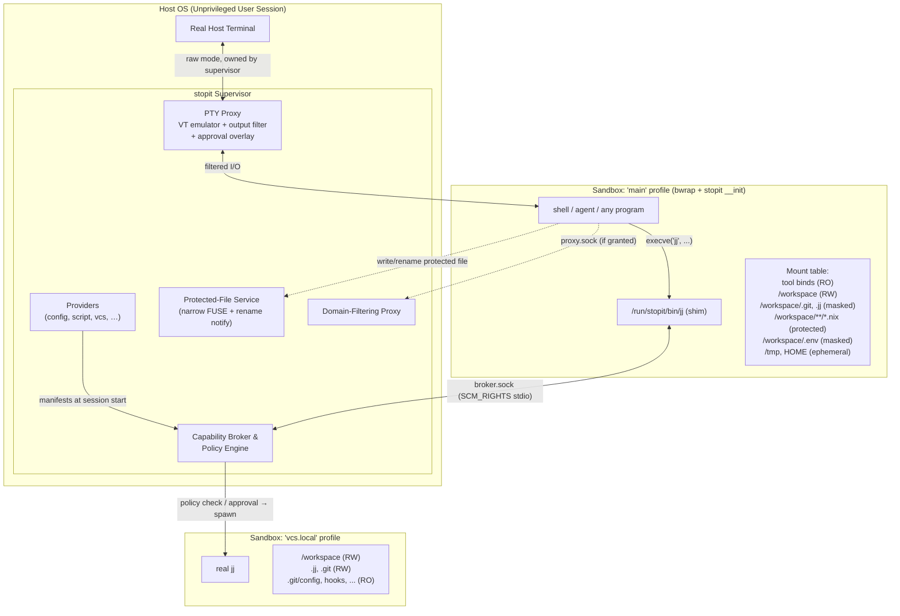

# `stopit` — System Architecture & Security Design Document

**Status:** Draft  
**Target Platform:** Linux (unprivileged user namespaces, Landlock ABI ≥ 4, seccomp user-notify, FUSE)  
**Sandbox Backend:** bubblewrap ≥ 0.11  
**Implementation Language:** Rust

---

## 1. Scope, Threat Model & Invariants

`stopit` is a general-purpose sandbox for running programs with **minimum-required privilege**. Interactive LLM agents are the primary motivating use case, but `stopit` has **no harness-specific features**: agents, their shells, and any other program are all described with the same configuration primitives (see §7.6 for a worked example).

### 1.1 Threat Classes

1. **The Actively Hostile Program (e.g. a prompt-injected agent):**
   * Attempts sandbox escape, data exfiltration, or planting delayed-execution backdoors that run when the human next interacts with the workspace on the host (`.git/hooks`, `.envrc`, `flake.nix` + `use flake`, editor configs).
2. **The Clumsy Program (e.g. a hallucinating agent):**
   * Runs destructive commands (`rm -rf ..`, `git clean -fdx`, `jj abandon`), forkbombs, or corrupts VCS state outside its task scope.
3. **Silent Secret Harvesting:**
   * Reads sensitive host files (`~/.ssh`, `~/.aws`, `~/.config/gh`, `.env`, harness credential directories, `/run/user/$UID/bus`, Nix tokens) which may then be sent to third parties (e.g. model providers as context).

### 1.2 Non-Goals

* **Code the user explicitly runs later.** If the sandboxed program edits `build.rs`, a `Makefile`, or a test, and the user later runs it on the host, that code runs. `stopit` protects against code that runs *without an explicit user action* (I3), not against code the user chooses to execute.
* **Kernel exploits.** Attack surface is reduced (seccomp, Landlock, namespaces) but not eliminated.
* **Secrets embedded inside the tool environment** granted by a provider (§3.6).

### 1.3 Core Security Invariants

These are the guarantees of `base = "default"`. Under `base = "none"` the same mechanisms exist but every grant must be added explicitly (§3.2).

* **I1 — Allowlist-First Visibility:** The sandbox filesystem starts as an empty `tmpfs` root. Nothing from the host — including `HOME` and `/run/user/$UID` — exists unless explicitly granted.
* **I2 — Irreversible Privilege Drop:** Every sandboxed process runs with all capabilities dropped, `PR_SET_NO_NEW_PRIVS` set, user-namespace creation disabled, and a seccomp filter installed. A sandboxed process cannot unmount, remount, or otherwise alter its mount table.
* **I3 — No Deferred Host Execution Without Approval:** Files that host tools execute *automatically* (on `cd`, on a VCS operation, on opening an editor) are **masked** or **protected** (§3.4). They change only with explicit user approval.
* **I4 — Trusted Terminal Ownership:** The sandbox never holds the host terminal. The supervisor owns it, filters sandbox output through an escape-sequence allowlist (§5.3), and renders approval prompts the sandbox cannot forge.
* **I5 — Explicit, Additive Policy:** `base = "none"` grants nothing. Every grant comes from a **provider** (§3.6), and everything `base = "default"` grants can be written out manually as providers (Appendix A).

### 1.4 Attacker Capabilities in Scope

This fixes what a reviewer may assume the attacker can do, so that a failure within these capabilities is a bug and one outside them is an accepted limit.

**In scope.** The sandboxed program runs arbitrary code with everything its profile grants, and:
* **Leaves state behind.** Anything it writes to a sandbox-writable location persists: in the workspace and any `rw` grant, to later sandboxes of the same session (other profiles, brokered commands) and to later sessions; in ephemeral `HOME` (dotfiles included, which another profile of the session may share, §3.4) and `/tmp`, to later sandboxes of the same session. That includes planted symlinks, renamed or deleted directories, `chmod` (e.g. `chmod 000` on a directory it owns), files replaced by directories and vice versa, hard links it can create (within one mount), and socket files. Every decision stopit makes at startup must stay safe whatever the sandbox left behind (§3.4, Symlinks and Pinned parent directories; §6.2, Untrusted links; known gaps: §11, Ephemeral backing directories and Literal restrictive rules rely on pinned parents).
* **Emits terminal output**, including any escape sequence (§5.3), and draws anything on its own screen (§5.4).
* **Talks to the broker and the approval flow** directly, with any request, argument or file descriptor, and as often as it likes (§4, §5.4, §7.1).
* **Runs concurrently** with other sandboxes of the same session, which may act on the same writable locations at the same time, including while a brokered command's sandbox is being mounted (known gap: §11, Path resolution is path-based).

**Out of scope** (documented limitations, not bugs):
* **Host processes changing files during stopit's startup**: another session on the same workspace, or the user editing it. Rules are checked and then mounted by path, so a component swapped in between is followed; fd-based mounting is planned to narrow this (§11, Path resolution is path-based).
* **Directories an earlier session granted `rw`** but this one does not: stopit cannot know their history, so links planted in them are trusted like the host's (§11, Untrusted roots are only what this session grants, Directories granted `rw` only by an earlier session). The workspace is the exception, always untrusted.
* The non-goals of §1.2, **kernel and bubblewrap vulnerabilities**, and **side channels** (timing, cache, resource usage).
* **`/proc` magic links** in host sources, which the kernel resolves differently from their link text (§11, Untrusted links are found by resolving link text).
* **Hard links the host created** to content outside the sandbox's view, or to masked or protected content (§3.4, Hard links; §11, Masks apply to sandbox paths, not host content).
* **A malicious configuration author or provider script.** The configuration defines the policy, and providers run on the host with the user's privileges (§3.6), so they are trusted; stopit validates the configuration to catch mistakes, not to contain its author (§11, Only mount destinations are reserved).

### 1.5 Errors vs. Warnings

The project's **layout** (files, links, modes and permissions on disk, including anything a sandbox left behind, §1.4) can contradict the **configuration**: a rule names a path that is missing, a glob matches a planted link, masked content is visible at another sandbox path. stopit then resolves to the **safe outcome**, the one that never grants more access than the configuration intended (a restriction stays on; a grant may be dropped), and emits a **warning** naming the rule and the layout, so the maintainer can fix the layout. It does not special-case such layouts. It does not refuse to start either, so that what a sandbox left behind cannot stop the next session from starting. The exceptions are the layouts below with no safe outcome yet, and those listed in §11. Examples (§3.4, §6.2): a missing path, or a final link whose target is missing, skips its rule; a directory a restrictive rule cannot inspect (one a sandbox made `chmod 000` or `chmod a-x`, say) is masked as a whole, with a louder warning when that hides a whole grant, such as the workspace mount; a link matched by a glob inside an untrusted root is skipped; an `rw` rule or bind through a planted link is dropped; content under a mask visible at another sandbox path (or protected content writable there) is masked (or protected) at that path too.

Errors are reserved for:
1. **Configuration mistakes**: invalid or contradictory configuration itself, such as reserved paths (§6.2, Reserved paths), the workspace mounted at a second sandbox path (§6.2, Workspace exposure), two rules conflicting at the same path (two binds, or a bind and a path rule, mounting different content at one sandbox path), settings merging cannot resolve (conflicting `env.set` or `system.home` values, the same shim from two providers in one profile, §3.5), invalid provider output, or a provider that cannot run (§3.6). A script provider's source is part of the configuration: it is `protected` by default (`protect = true`, §3.6) in every profile wherever the sandbox could write it, so the sandbox cannot modify it, and renaming its parent directories away is covered by pinned parents (pending, §11, Literal restrictive rules rely on pinned parents); with `protect = false` it must not be sandbox-writable. A script whose path runs through a symlink inside the workspace or a directory a `config` provider grants `rw` is refused, since the sandbox could have planted that link, and so is a protected source with more than one hard link, which the sandbox could rewrite through another name (§3.6); so is a nested `.stopit.toml` found by walking up below one owned by the user (§3).
2. **Layout contradictions with no safe outcome in general yet**: currently a restrictive (`masked`, `protected`, `ro` or `ephemeral`) rule whose host source, glob prefix or (for any restrictive mode, `ephemeral` included) mount destination runs through a symlink inside an untrusted root, or a mask whose shape such a link would decide (§3.4, Symlinks; §6.2, Untrusted links). bwrap follows the link, so stopit cannot mask the link itself and must refuse rather than let a planted link switch the restriction off. These can become warnings once mounts use file descriptors (§11, Path resolution is path-based).

Some current behaviour does not follow this principle yet; see §11, Behaviour not yet aligned with §1.5.

---

## 2. System Architecture

`stopit` is a **single Rust binary** with several personas selected via `argv[0]` / subcommands:

1. **Supervisor (host process, `stopit run` / `stopit shell`):**
   * Owns the real host terminal; runs the **PTY proxy** with VT emulation, output filtering, and the **approval overlay** (§5).
   * Runs **providers** at session start to compute each profile's grants (§3.6).
   * Runs the **Capability Broker** for brokered tools (§7).
   * Runs the **Protected-File Service**: a narrow FUSE filesystem plus the seccomp rename-notify handler (§4).
   * Runs the **Network Proxy** for domain-allowlisted access (§8).
   * Applies optional **resource limits** (§10).
2. **Sandbox Init Helper (`stopit __init`, first process inside every sandbox):**
   * Fills the gaps bubblewrap does not cover: controlling-terminal setup, Landlock, the seccomp filter (including the rename user-notify listener, whose FD is sent to the supervisor), then `execve` of the target (§6.3).
3. **Capability Shim (`/run/stopit/bin/<tool>`):**
   * Symlinks to the `stopit` binary placed at the front of `PATH`. On execution, the shim sends an RPC request plus `stdin`/`stdout`/`stderr` FDs to the broker (§7.1).

### 2.1 Session Runtime Directory

All per-session state lives under `$XDG_RUNTIME_DIR/stopit/<session-id>/` on the host (never `/run/stopit`, which is root-owned):

| Host path (under session dir) | Sandbox path | Purpose |
| :--- | :--- | :--- |
| `broker-<sandbox-id>.sock` | `/run/stopit/broker.sock` | One socket per sandbox, so the broker knows which sandbox (and profile) is asking |
| `proxy.sock` | `/run/stopit/proxy.sock` | Network proxy (when granted) |
| `stopit` | `/run/stopit/stopit` (RO) | Copy of the running `stopit` binary, mode 0500 |
| `lib/` | `/run/stopit/lib` (RO) | Its program interpreter (0500) and shared libraries (0400); empty for a static build |
| `bin/` | `/run/stopit/bin` (RO) | Shim symlinks |
| `protected/` | bind-mounted per file (§4) | Narrow FUSE mount holding protected-file shadows |
| `ephemeral/` | per `ephemeral` rule, keyed by pattern as written (§3.4) | Session-scoped scratch (e.g. `/tmp`, sandbox `HOME`) |

`$XDG_RUNTIME_DIR` must be set to an absolute path of a directory owned by the user and not writable by group or others; stopit never falls back to `/tmp`. `stopit/` and every session directory below it are mode 0700, and an existing `stopit/` must be a real directory (not a link) owned by the user with no group or other access. A session directory is created fresh under a random 128-bit id, never reused, and removed when the session ends (best effort, after its sandboxes exit and its mounts are unmounted).

**Self-provisioning.** `stopit __init` must run in every sandbox, including one that sees neither `/nix/store` nor `/usr`. So at session start the supervisor copies its own binary (the canonical path of `/proc/self/exe`) to `stopit` in the session directory, and its runtime closure to `lib/`: the program interpreter named by its `PT_INTERP`, and every library that interpreter resolves for it in list mode (`<interp> --list <exe>`, which is what `ldd` runs; the environment is cleared so `LD_LIBRARY_PATH` and `LD_PRELOAD` do not change the result). Symlinks are resolved and their targets copied under the names the loader asked for (the `DT_NEEDED` soname); every copy is written to a new file (`O_EXCL`, nothing existing is followed or overwritten) and given its mode explicitly. Both are mounted read-only at `/run/stopit`, so the sandbox can never change them. Copying rather than binding the host paths exposes no host store directories to the sandbox, keeps working if the binary is upgraded or garbage-collected mid-session, and adds no mounts that could collide with user rules. A static binary has no interpreter and is copied alone. Libraries that are only `dlopen`ed (NSS modules, gconv, a `libgcc_s` that is not `DT_NEEDED`) are not copied; `__init` must not use NSS (`getpw*`, `getaddrinfo`) or iconv.

### 2.2 Overview



---

## 3. Configuration Model

Configuration lives in `.stopit.toml` at the workspace root (optionally layered over a user-global config). It is read **only** when the supervisor starts or is explicitly asked to reload. It is the user's responsibility to verify it before use; it does not take effect on `cd`.

Since it decides what the sandbox may do and which script providers run on the host as the user, `.stopit.toml` (found by walking up from the current directory, §3.1, or the one in `--workspace`) is only read if no one else could have written it: it must be a regular file owned by the user, without the group or other write bit, and its directory must be owned by the user or root and not writable by group or others unless it is sticky (as `/tmp` is). The directory is opened, the file opened in it without following a symlink, and both checked with `fstat` on those descriptors, so the file read is the file checked. A `.stopit.toml` that is a symlink is refused, whatever it points to. A file that fails these checks is an error naming the file and the reason, never skipped: walking up from `/tmp/proj` would otherwise find a `/tmp/.stopit.toml` that any user can create. These checks do not cover a `.stopit.toml` the sandbox itself writes in the workspace: it is the user's own file. Instead, **the supervisor protects the loaded configuration file** in every profile of its session, wherever the profile would let the sandbox write it, like a script provider's source (§3.6: the supervisor's rule, not a grant, attributed to `stopit`, a provider name reserved for this, §3.2), so neither `base = "none"` nor a loosening rule leaves it writable. The default base also protects every other existing `.stopit.toml` in the workspace (`{workspace}/.stopit.toml` and `{workspace}/**/.stopit.toml`, Appendix A), so the sandbox cannot change one; but a glob only protects what exists at the start (§3.4), so the sandbox can still create `sub/.stopit.toml`, which a later `stopit run` from `sub/` would find first. So **nested configurations are refused when found by walking up**: once a `.stopit.toml` is found, the directories above it are checked too, and if one of them has a `.stopit.toml` owned by the user (any entry of that name, whatever its mode or its directory's), stopit refuses to start, naming both files and suggesting `--workspace` with the inner directory (to use a nested configuration on purpose) and, if the outer one passes the checks above, with the outer directory (to use it); otherwise the error says the outer one fails them. Ownership alone decides because a sandbox can change modes in the workspace but not owners: with `chmod 0777` on the workspace root, which it owns, it could otherwise make the outer configuration fail the checks and so switch the rule off (that configuration is then refused when loaded too, the safe direction). One owned by someone else (a `/tmp/.stopit.toml` anyone could have created) is skipped: it is never loaded, so it protects nothing. The rule's soundness rests on the supervisor's protection of the loaded configuration, not on the default base: every session of the outer workspace protected the outer file, so a sandbox cannot have created or changed it, and a planted inner one is never used without the user naming its directory. `--workspace` does not look up, so it is how a nested configuration is used deliberately.

**A configuration is required.** The workspace is the directory with the nearest `.stopit.toml`; if walking up from the current directory finds none, or the directory given to `--workspace` has none of its own, stopit refuses to start (exit 125), naming the directory and suggesting `touch .stopit.toml` there, since an empty file is the default configuration (`base = "default"`). Running the default configuration without a file would let a sandbox create `{workspace}/.stopit.toml` (with a script provider, or `rw ~`) that the next plain `stopit run` loads, and the protections above only cover a configuration that already exists. What remains is in §11: `--workspace` naming a planted directory, and a planted configuration in a directory the user later runs from that has no protected outer configuration. Trust on first use (`stopit allow`, §11) is planned to replace this refusal.

At startup the supervisor prints a short summary of every grant that **widens** access beyond the empty sandbox (binds, especially under `$HOME` or `/etc`; network domains; allowed brokered subcommands; sockets that delegate to host daemons; providers with `protect = false`). This is informational and does not block.

### 3.1 Structure: Top-Level Settings vs. Providers

The configuration has a single way of granting resources: **providers**. Only session-wide settings, which are not grants, live at the top level.

| Top level (session-wide, not grants) | Providers (`[[provider]]`, all grants) |
| :--- | :--- |
| `base` — starting set of providers (§3.2) | Filesystem rules and path modes |
| `[workspace]` — workspace identity and mount point | System mounts (`/proc`, `/dev`, synthesized `/etc`, `HOME`) |
| `[limits]` — resource limits (§10) | Environment (pass, deny, set, `PATH`) |
| `[approval]` — timeout, masked-file writes (§4.3) | Network |
| `[terminal]` — output-filter options, hotkey (§5) | Brokered shims and their policy |
| `[profiles.<name>]` — which sandboxes exist (§3.3) | Hardening opt-outs (namespace sharing, syscalls) |
| | Contributed profiles |

```toml
base = "default"

[workspace]
mount = "/workspace"          # where {workspace} appears inside the sandbox

[limits]
memory = "8G"

[approval]
timeout = "off"

[[provider]]
type = "script"
source = "scripts/agent-env.sh"

[[provider]]
type = "config"
[provider.sandbox]
fs.ro = ["/etc/ssl/certs"]
network = { mode = "proxy", allow_domains = ["static.crates.io", "index.crates.io"] }
```

**Workspace.** The workspace is the host directory the session is about: by default the directory with the nearest `.stopit.toml`, walking up from the current directory (§3), overridable with `stopit run --workspace <dir>`. Its identity is session-wide because the supervisor depends on it (socket and hard-link scans, protected-file shadows, repository resolution, broker cwd checks) and every provider's `{workspace}` paths are relative to it. *Access* to it is still a grant: under `base = "none"` the workspace is defined but not mounted until a provider grants it. The workspace mount point (like `system.home`) is subject to the reserved-path rules in §6.2. Otherwise `{workspace}` rules are resolved and checked like `~` and absolute ones (§3.4, §6.2); the workspace is special in exactly three ways: (1) it is the session's identity, whose path comes from `.stopit.toml` or `--workspace` and which the supervisor relies on, so it must appear in the sandbox only at its mount (§6.2, Workspace exposure); (2) it is always an untrusted root for symlinks, even when no profile of the session grants it `rw` (§3.4, Symlinks); (3) the default base grants it `rw` (§3.2).

### 3.2 Bases

```toml
base = "default"   # "default" (the default) | "none"
```

The design rule is: **restrictions default on, grants default off.** A base is a set of built-in providers placed **before** the user's providers.

* `base = "none"` — no built-in providers. The sandbox is empty: nothing mounted (no `/proc`, no `/dev`), an environment of only `HOME`, `USER` and `LOGNAME` (§9), no network at all (not even `lo`), full hardening, no shims. `stopit run /bin/sh` fails because `/bin/sh` does not exist. That is intended.
* `base = "default"` — a built-in `config` provider named `base` with the defaults below (the name is reserved: a user provider cannot use it under this base), plus the `vcs` provider (§7.3). Under every base, the provider name `stopit` is reserved too: it names the supervisor's own rules (the protection of the loaded configuration, §3), so a user provider cannot use it.

| Aspect | `base = "none"` | `base = "default"` |
| :--- | :--- | :--- |
| Filesystem | Empty `tmpfs` root | `/proc` (masked subset), minimal `/dev`, synthesized `/etc`, workspace RW + default path rules (§3.4), ephemeral `/tmp` and `HOME`, tool binds from user providers |
| Environment | `HOME`, `USER`, `LOGNAME` only (§9) | Identity (`HOME`, `USER`, `LOGNAME`); `TERM`, `LANG`, `COLORTERM` passed through; secret patterns denied (§9) |
| Namespaces | All unshared (user, mount, pid, net, ipc, uts, cgroup) | Same |
| Network | **None** — no interfaces up | Loopback only |
| Hardening (seccomp, Landlock, `nosuid`/`nodev`, no caps, `NO_NEW_PRIVS`, no nested userns) | On | On |
| Terminal output filter | On | On |
| Brokered tools | None | `jj`, `git` via the `vcs` provider (§7.4) |

Notes:
* Standard I/O is always connected (through the PTY proxy or pipes); it is the channel back to the user, not a host capability.
* `base = "default"` does not include tools: at least one user provider must grant them, or `stopit` refuses to start and prints example configurations.
* Intermediate bases may be added later; they are just alternative built-in provider sets.
* A golden test asserts that Appendix A (everything written out under `base = "none"`) produces the same `SandboxSpec` as `base = "default"` (§12).

### 3.3 Profiles

A **profile** is a complete sandbox description: mounts, network, environment, shims. `stopit run` / `stopit shell` start the program in profile **`main`** unless `--profile <name>` is given. After that, the **only** way into another profile is a shim: each brokered command runs in a *fresh* sandbox built from the shim's target profile. Nothing ever leaves sandboxing entirely; a brokered command just gets a sandbox with different permissions.

```
main profile (shell / agent)                 vcs.local profile (fresh sandbox per command)
  /workspace        rw                         /workspace          rw
  /workspace/.git   masked   ── jj commit ──▶  /workspace/.git     rw
  network           loopback   (via shim)      .git/config, hooks  ro (locked)
                                               network             none
```

Profiles come from two places:
* **Declared by the user** at the top level, as structure only (which sandboxes exist):
  ```toml
  [profiles.harness]       # inherit = "main" is the default
  [profiles.bare]
  inherit = "none"         # starts from the empty sandbox, ignoring base
  ```
  Grants are then attached by providers (`config` providers take `profile = "<name>"`; §3.6).
* **Contributed by providers** as part of their manifest. These are prefixed with the provider's name to avoid collisions: the `vcs` provider contributes `vcs.ro`, `vcs.local`, `vcs.remote`. Inside the manifest they are written as plain single-segment names (`ro`, `local`, `remote`) and the prefix is added automatically (§3.6). Most users never see them.

`inherit = "<profile>"` (default `"main"`) means the profile starts from the parent's fully merged grants, then adds its own. `inherit = "none"` starts from the empty sandbox. `stopit-grant` (§7.5) creates a temporary profile: the caller's profile plus the requested delta.

### 3.4 Path Modes

| Mode | What the sandbox sees | Mechanism |
| :--- | :--- | :--- |
| `masked` | Name exists but is empty: empty RO file, or empty RO directory | bwrap `--ro-bind-data` (empty) / `--tmpfs` + `--remount-ro` |
| `ro` | Real content, read-only | bwrap `--ro-bind` |
| `rw` | Real content, writes go to the host | bwrap `--bind` |
| `protected` | Real content; writes trigger an approval prompt with a diff (§4) | Narrow FUSE shadow + seccomp rename notify |
| `ephemeral` | Writable, starts empty, deleted at session end; shared by all sandboxes of the session | bwrap `--bind` of a session-dir subdirectory |
| `cow` *(future)* | Writable, all changes staged for review | Full-workspace FUSE or overlayfs (§11) |

Semantics:
* **Masked ≠ absent.** A bind mount cannot remove a name from a bind-mounted directory; a true `ENOENT` would need overlay whiteouts or FUSE. Paths that are simply never granted (e.g. host `HOME`) are absent. A masked stub also prevents the sandbox from *creating* that name (e.g. a top-level `.git`).
* **Ephemeral backing directories are keyed by pattern.** Each `ephemeral` rule gets one backing directory under `ephemeral/` per session, keyed by the rule's pattern as written (`~`, `/tmp`, `{workspace}/target`), not its expansion, and shared by every sandbox of the session. So `~` is one directory across profiles even with different `system.home`: a profile's own `system.home` does not isolate an ephemeral `~`; to keep a profile's HOME separate, write its ephemeral rule as an absolute path (`ephemeral = ["/home/agent"]`). Ephemeral rules of equal precedence at one sandbox path never conflict; the first in rule order names the backing directory, so a later one's pattern is not backed there in that profile.
* All mounts carry `nosuid,nodev`. Execute permission is **not** restricted by mount flags: `noexec` is not a security boundary (`bash script`, `ld.so ./bin`) and would break `cargo run`, test runners and scripts.
* `chmod` on a protected file counts as a change and goes through approval (the diff shows the mode change). `ro`/`masked` reject it with `EROFS`.
* **Deleting or renaming a protected file away** fails with `EBUSY` (it is a mount point). This is intended.
* **New files matching a protected glob** (e.g. a new `nix/foo.nix`) are written through directly: every pre-existing file that could reference them is itself protected. See §11 for the auto-import caveat.

Path syntax (in any provider):
* `{workspace}` — the host workspace directory, mounted at `workspace.mount` (default `/workspace`).
* `~/…` — host `$HOME/…` on the host side, sandbox `HOME` on the sandbox side (`/home/user` unless a provider sets `system.home`; the default base leaves it unset).
* Absolute paths map to the same path inside the sandbox; `fs.bind` entries remap explicitly.
* Built-in providers may resolve additional concrete host paths internally (e.g. `vcs` resolves git worktree and jj workspace storage, §7.3). These are not user-facing placeholders.
* **Syntactic validation (at load time):** no `.`/`..`/empty components, no NUL, no trailing `/`; the bare `/` is rejected; a glob is not allowed as the first component directly below `/` or `~` (`/*` and `~/**` are rejected; `{workspace}/**` is fine). Globs are validated too: `**` only as an entire component, no `/` (or range spanning `/`) in a `[...]` class, and the glob must compile. `?` and `[...]` match a single byte, so they do not match a non-ASCII character as a whole (e.g. a `masked` rule `?.env` does not match `é.env`; use `*`). `fs.ephemeral` entries must be literal paths, without glob characters (each rule is backed by one session directory).
* Globs (`*`, `**`) are expanded **once at session start** into concrete paths. Files created later are not retroactively masked or protected (except via the "new files are written through" rule above).

Additional checks:
* **Symlinks: trust by writer.** Every symlink attack needs a link the sandbox planted, and a sandbox can only plant links where it can write. So stopit trusts a link by who could have written it. The **untrusted roots** of a session are the host directories some sandbox of the session can write: the host workspace (always, even when no profile grants it `rw`: another session or an earlier one may have), and the host source, resolved to its canonical path, of every `rw` mount (path rules and `rw` binds) of **every** profile of the session, since a sandbox in one profile can plant links that a rule of another follows. (Ephemeral backing directories, §2.1, are to be roots too; they are not yet, see §11.) stopit never follows a symlink located inside an untrusted root, whatever the rule's anchor and however the lookup got there; links outside every root (`/nix/store`, `/etc/static`, home-manager links in `~`) are the host's and are followed fully. Roots may nest (`rw` grants of `~/.cache` and `~/.cache/tool`); a link is attributed to the innermost root containing it. An `rw` source written through host links (`~/cachelink/tool` with `~/cachelink -> .cache`) makes the directory it leads to a root; one that cannot be resolved is not a root (it could not be mounted, and is dropped below).

  Rules of every anchor are resolved alike, `{workspace}`, `~` and absolute ones: symlinks on the way to a rule's host path are followed (home-manager and `/etc/static` rely on it), the final component of a matched path is kept as it is (a bind follows it when mounting), and globs never descend into symlinked directories below their walk root. The untrusted-root checks then decide (§6.2, Untrusted links): a host source, or a mount destination on the way through the mount underneath it, that runs through a symlink inside an untrusted root, however the lookup got there, makes a `masked`, `protected`, `ro` or `ephemeral` mount a startup error (a planted link must never switch a restriction off) and drops an `rw` mount (rule or bind) with a warning. This holds for links pointing inside their root too: with the workspace granted `rw`, a planted `x -> .git` would otherwise turn an rw `{workspace}/x/hooks` into a mount at `.git/hooks`, under a stricter rule. A symlink **matched by a glob** inside an untrusted root is skipped with a warning for every mode instead: the walk visits the real files directly, so a planted link can neither redirect the glob nor make it miss them (with `config` renamed to `config2` and `config -> config2` planted, `{workspace}/**/*.env` still matches `config2/prod.env`). Such a match is skipped after the winner at its sandbox path is picked, so nothing is mounted there. A link matched outside every root (a home-manager link matched by `~/.config/*`) is the host's and is kept, and a glob whose literal prefix or walk root runs through a link inside a root reached whatever that link leads to, so its matches are refused like a literal rule's. For a link inside the host workspace, the one root known before every profile is planned, this is decided before walking: such a glob is a startup error for a restrictive mode and skipped with a warning for `rw`, so that a planted `config -> /` cannot make `{workspace}/config/**/*.env` walk the whole host filesystem first (for other roots, see §11). In short: links matched by a glob inside a root are skipped for every mode; links on the way (in a literal path, a glob's literal prefix, a mount destination) or at the end of a literal path are errors for restrictive modes, except that a final link whose target is missing mounts nothing and is skipped like a missing path. A legitimate link skipped this way leaves its target as readable as before if the target does not match the glob (see §11). Likewise, a path that exists but cannot be inspected, or a directory a glob walk cannot read, is never skipped by a `masked`, `protected` or `ro` rule, anywhere (the sandbox could otherwise `chmod 000` a directory it owns to switch a mask off at the next start): the directory that cannot be searched or read (the deepest directory on the way, as written, that can itself be inspected, or the one the walk cannot read) is masked as a whole instead, with a warning, which hides everything the rule could apply to there, and more (§1.5); a glob's other matches still apply. A glob walk lists the entries of a directory that can be read but not searched (`chmod a-x`) without inspecting them, so every match of a restrictive glob is inspected, and one that cannot be masks that directory the same way. Such a mask outranks every other rule at its sandbox path, since a less strict one winning there would lift the restriction below it. When it hides another rule's mount there entirely (the workspace mount, with the workspace itself made unsearchable, or an `rw` grant of that directory), a separate, louder warning names that grant, says it is hidden this session, and how to get it back (restore the directory's permissions). Mounts below it are kept, as below any masked directory (nothing below a directory that cannot be searched can be resolved, so they show other content). An `rw` rule or bind host is skipped with a warning instead. A missing path (including an entry that vanishes during a glob walk, or a path through a dangling link) skips any rule with a warning, and so does a final link whose target is missing (§6.2, Workspace exposure). A `masked` rule matching a symlink masks it as its target's kind (an empty file or an empty directory); a dangling link is skipped with a warning (there is nothing to hide), and a target that cannot be inspected otherwise is a startup error (§11, Behaviour not yet aligned with §1.5), except for a link matched by a glob inside an untrusted root, which is skipped like any such match without looking at its target. A mask whose shape would be decided by a link inside an untrusted root is a startup error like any other restrictive rule: a planted link must not change a mask's shape.
* **Pinned parent directories.** Renaming a parent directory of a restrictive mount away (e.g. `mv config cfg2` with `{workspace}/config/secrets.env` masked) would otherwise make the literal rule "missing" at the next start, and the file readable as `cfg2/secrets.env`. So for every `masked`, `protected`, `ro` or `ephemeral` mount inside the mount of an untrusted root (the workspace mount, or an `rw` mount), stopit self-binds each existing directory between that mount and the restrictive one (`--bind d d`), turning it into a mount point: `rename` and `rmdir` on it fail with `EBUSY`, while creating, editing and deleting files inside it still work. (Not implemented yet, see §11.)
* **Unix sockets.** Network namespaces isolate abstract sockets, but a socket *file* created by a host process inside an RW directory is reachable through the bind mount (e.g. `.devenv/state/postgres/.s.PGSQL.5432`). With `fs.mask_sockets = true` (default base), sockets found in RW grants at startup are masked (an empty file with mode 0000, so connecting fails with `EACCES`).
* **Hard links.** A protected file with `nlink > 1` is writable through its other name. The sandbox cannot create such links (`link` across mounts fails with `EXDEV`), but pre-existing ones trigger a startup warning.

### 3.5 Merging & Precedence

All providers' manifests are merged per profile, in order: base providers first, then user providers in file order; a profile with `inherit` starts from its parent's merged result.

**Path rules** — for each path, the effective mode is decided by:
1. **Most specific path wins.** An exact path beats a glob; a deeper path beats a shallower one (`{workspace}/.git` beats `{workspace}`; `{workspace}/flake.nix` beats `{workspace}/**/*.nix`).
2. **A profile's own rules beat inherited rules** at equal specificity. This is what lets `vcs.local` (inheriting `main`) make `.git` writable although `main` masks it.
3. **Strictest mode wins** among the remaining ties: `masked` > `protected` > `ro` > `ephemeral` > `rw`.

To loosen a restriction, configure the provider that added it (e.g. `vcs` with `view = "ro"`), add a more specific rule, or use `base = "none"`. Mounts are applied in path-depth order so children overlay parents.

Two kinds of mounts are not rules and stand outside this precedence: the masks synthesized over a directory a restrictive rule cannot inspect (§3.4, Symlinks), which outrank every rule at their path, and the protection of script providers' sources (§3.6) and of the loaded configuration file (§3), which the supervisor adds after planning wherever a profile would let the sandbox write them, whatever the rules say there.

**Other sections:**

| Section | Merge rule |
| :--- | :--- |
| `env.pass` / `env.deny` | Union; **`deny` always wins** over `pass` |
| `env.set` | Conflicting values for the same variable are an **error** unless identical; a profile's own value overrides the inherited one, per variable |
| `env.path_prepend` | Later providers' entries first within a profile, then inherited entries; earlier entries take precedence in `PATH`; duplicates keep the first occurrence |
| `network.mode` | Within a profile: the most permissive granted mode (`none` < `loopback` < `proxy` < `full`). A profile's own value overrides the inherited one |
| `network.allow_domains` | Union |
| `shims` | Union; the same shim name from two providers in one profile is an **error**; a profile's own shim replaces an inherited one of the same name |
| `sandbox.share`, `sandbox.allow_syscalls` | Union |
| `system.proc`, `system.dev` | Logical OR within a profile; a profile's own explicit value overrides the inherited one |
| `system.etc` | Union |
| `system.home` | Conflicting values within a profile are an **error** (like `env.set`); a profile's own value overrides the inherited one |
| `fs.mask_sockets` | Tri-state (unset / `true` / `false`). Within a profile, `true` wins over `false` (strictest wins). A profile's own explicit value overrides the inherited one, so a contributed or user profile can opt out of masking that `main` enables |

### 3.6 Providers

A **provider** produces a **manifest**: the canonical grant structure used by every provider type. `[[provider]]` entries share these fields:

| Field | Applies to | Meaning |
| :--- | :--- | :--- |
| `type` | all | `config`, `script`, `vcs` (later: `nix`, …) |
| `name` | all | Optional; defaults to `type`. Prefix for contributed profiles; shown in the startup summary |
| `profile` | `config` | Profile the grants apply to (default `main`) |
| `[provider.sandbox]` | `config` | The manifest itself, written inline in TOML |
| `source` | `script` | Path to the executable, relative to `.stopit.toml`; executed **on the host** |
| `protect` | `script` | Whether `source` is automatically `protected` (default `true`) |
| `[provider.config]` | `script` only | Free-form parameters for the script, passed as JSON on stdin. Only scripts need a free-form keyspace |
| type-specific keys | built-in types (`vcs`, later `nix`) | Options written directly under `[[provider]]` (e.g. `view`, `tools`, `devshell`) |

```toml
[[provider]]
type = "config"
profile = "main"
[provider.sandbox]
fs.ro = ["/etc/ssl/certs"]
env.pass = ["RUST_*", "CARGO_*"]

[[provider]]
type = "script"
source = "scripts/agent-env.sh"
protect = true
[provider.config]
devshell = "agent"

[[provider]]
type = "vcs"
view = "masked"
```

**Manifest schema** (identical for `[provider.sandbox]` and script output):

```json
{
  "version": 1,
  "fs": {
    "rw": ["{workspace}"], "ro": [], "masked": [], "protected": [], "ephemeral": ["/tmp", "~"],
    "bind": [{ "host": "/etc/ssl/certs", "sandbox": "/etc/ssl/certs", "mode": "ro" }],
    "mask_sockets": true
  },
  "system":  { "proc": true, "dev": "minimal", "etc": ["passwd", "group", "hosts", "nsswitch.conf"], "home": "/home/user" },
  "env":     { "pass": ["TERM"], "deny": ["*_TOKEN"], "set": { "LANG": "C.UTF-8" }, "path_prepend": ["/nix/store/…/bin"] },
  "network": { "mode": "loopback", "allow_domains": [] },
  "sandbox": { "share": [], "allow_syscalls": [] },
  "shims":   { "<name>": { "binary": "…", "deny_flags": [], "default": { "decision": "ask", "profile": "main" }, "rules": [] } },
  "profiles": { "<name>": { "inherit": "main", "fs": {}, "env": {}, "network": {}, "shims": {} } }
}
```

* Top-level manifest sections apply to the target profile (`profile` for `config`; `main` for other types). Entries under `profiles` are contributed profiles, prefixed with the provider's `name`.
* **Contributed profile keys** inside a manifest are plain single-segment names (e.g. `local`); the provider's `name` prefix is added automatically (`vcs.local`). Contributed profiles cannot themselves contain `profiles` or `version`.
* **Reference rule:** within a manifest, a plain profile reference (`inherit = "local"`, shim `profile = "ro"`) resolves first to that manifest's own contributed profile, then to a user-declared profile. `main` and other providers' profiles are referenced by their full names. A full name (e.g. `vcs.local`) always resolves globally, including to the manifest's own profiles; plain names are preferred inside a manifest because the provider `name` can change.
* **Validation:** every manifest table accepts only maps (array forms are rejected) and unknown keys are rejected. A JSON manifest from a script **must** include `"version"`; an inline `[provider.sandbox]` may omit it (defaults to 1). Bind `mode` is one of `ro`, `rw`, `protected` only (`masked` and `ephemeral` have no host content to bind). Bind `host`/`sandbox` paths contain no globs (glob characters are `*`, `?`, `[`, `]`), and a bind's `sandbox` side additionally allows no `{workspace}` placeholder. Path rules are also validated syntactically at load time (§3.4).
* **Script providers** receive on stdin a JSON object containing their `[provider.config]` and a context (`workspace` host path, `workspace_mount`, `home`, `session_dir`, provider `name`, target `profile`), and print a manifest on stdout. A non-zero exit or invalid manifest aborts startup.
* **Scripts run on the host with the user's privileges.** With `protect = true` (default) the script — and its directory, if it sources other files (not implemented yet: only the script itself is protected, §11) — is `protected` so the sandbox cannot rewrite code that runs on the host next session. `protect = false` is allowed but flagged in the startup summary.
* **How a source is protected.** The script is resolved once to its canonical path, which is both the file run and the file protected (protecting a link would leave its target writable). That protection is the supervisor's rule, not a grant, so it is not a path rule competing in precedence (§3.5), where an exact `rw` rule of the same path, or a profile's own rule, would beat it, and no provider's output can lift it. Instead, once a profile's mounts are planned and checked (§6.2, after the restricted-content covers), the source P is protected wherever the profile lets the sandbox write it, in **every** profile of the session: for every `rw` mount M whose canonical source S is P or an ancestor of it, M shows P at X, M's sandbox path joined with P's path below S; unless another mount lies between M's path and X (mounted on top: a mask there hides P, a read-only or protected mount shows it read-only, an `rw` one is compared in turn), X gets a `protected` mount of P, attributed to the script provider, replacing M if X is M's own path. So the source is protected at its aligned path when it lies in the workspace, and at every other path an `rw` grant shows it (a `~` grant, a bind); a profile where it is not visible, masked or read-only gets nothing. Like the covers of Restricted content exposure (§6.2), these mounts need no other checks: P is canonical and lies inside S, and X lies below M's path, reached through M's tree along P. A directory P is protected as a directory, and an `rw` mount whose source lies strictly inside it is not the narrower grant it would be under a protected rule: it is mounted `protected` too, with a warning naming both providers. A source that cannot be inspected when the session is compiled is an error naming the provider, and so is a regular file with more than one hard link that the user owns or can write (`faccessat`, so ACLs count; a Nix store file deduplicated by `auto-optimise-store`, owned by root and read-only, cannot be rewritten through any name and is accepted): the sandbox could rewrite it through another name inside an `rw` tree, which no mount at the protected name prevents, so there is no safe outcome (§1.5); give the script a single link. A script provider checks this right after resolving its path, before the script runs (it may already have been rewritten that way), and the session compiler checks every protected source again. Hard links to files inside a protected directory are not detected (§11). The supervisor protects the loaded `.stopit.toml` the same way (§3). These protected mounts are checked and mounted by path like every other, so they inherit its gap (§11, Path resolution is path-based; Literal restrictive rules rely on pinned parents): another session of the same workspace could swap a parent directory between the compile and the mount.
* **Script paths through writable links are refused.** Before a script runs, its path as declared (`source` joined to the configuration's directory) is resolved one component at a time like a host source (§6.2, Untrusted links), and that one lookup gives the canonical path that is run and protected; if it runs through a symlink inside the workspace or inside a directory that a `config` provider grants `rw` (in any profile: an `fs.rw` path, a glob's literal prefix, or the host side of an `rw` bind), the final component included, the provider is refused with an error naming it, the link and that directory. This holds even when the lookup fails after following the link, as a planted link may be why it fails. The sandbox can plant or replace such a link (only the link's target is protected), and the next session would run whatever it leads to. There is no safe outcome (running it is host code execution; skipping the provider changes the grants), so this is an error (§1.5): point `source` at a path without links inside them. These are the untrusted roots known before any script runs: `config` providers' rules are static, while the `rw` grants of script providers are known only once they have run (§11). Renaming a parent directory of a protected source away is covered by pinned parents, still pending (§11, Literal restrictive rules rely on pinned parents).
* Manifests are cached, keyed by a hash of the provider's protected inputs and config.

**Rust model:**

```rust
pub trait Provider: Send + Sync {
    fn name(&self) -> &str;
    /// Static grants, contributed profiles and shims, computed at session start.
    fn manifest(&self, ctx: &ProviderContext) -> Result<Manifest>;
    /// Optional runtime logic invoked by the broker (e.g. argv parsing, prompt facts).
    fn handlers(&self) -> Vec<Box<dyn BrokerHandler>> { Vec::new() }
}
```

Built-in providers can implement `handlers` in Rust (the `vcs` provider parses `jj`/`git` global flags, resolves push URLs for prompts, and resolves the on-disk VCS layout, §7.3.1). `config` and `script` providers declare shims with the declarative rule format only; a script-based handler protocol may come later.

**Provider types:**

| `type` | Status | Behavior |
| :--- | :--- | :--- |
| `config` | v1 | The manifest written inline in `[provider.sandbox]` |
| `script` | v1 | Runs `source`, passes `[provider.config]` + context on stdin, parses the manifest |
| `vcs` | v1 | Repository-root resolution, `.git`/`.jj` masking, VCS profiles and `jj`/`git` shims (§7.3) |
| `nix` | later | `devshell = "<name>"`: runtime closure of the devShell's `inputDerivation` plus `nix print-dev-env --json`, resolved on the host |

**Host daemons.** A provider may grant access to a host daemon's socket (e.g. a future `buck2` provider talking to the buck2 daemon). Such daemons run *outside* the sandbox — buck2 executes build rules on the host — so granting the socket is equivalent to granting host code execution (the same reason the Nix daemon is never exposed). This is allowed as a deliberate choice; socket grants are flagged as **delegates to host** in the startup summary.

**Nix guidance (outside `stopit` core):** define a comprehensive `devShells.agent` (or similar) in your flake and expose it through a `script` provider (later the `nix` provider). The closure-only manifest means only the store paths that environment needs are visible, not all of `/nix/store`, which on NixOS can contain secrets (e.g. `access-tokens` rendered into `nix.conf`). The `nix` provider refuses closures that pull in paths named `*-etc`, `*-home-manager-files`, or `*nix.conf*`. The sandbox has **no access to the Nix daemon**; changing the tool environment requires the user to edit the (protected) flake and restart or reload the session.

---

## 4. Protected Files & the Approval Flow

Any attempt to modify a protected file triggers an approval prompt showing the diff. The **kernel mounts remain the security boundary**; the FUSE service and the seccomp hook are there to implement the approval UX on top of them.

### 4.1 Two Writer Styles, Two Hooks

| Writer style | Syscalls | When is the full content known? | Typical users |
| :--- | :--- | :--- | :--- |
| In place | `open(O_TRUNC)` → `write`… → `close` | At `close` | Harness Edit/Write tools, shell `>`, Rust `fs::write` |
| Atomic rename | write `tmp` → `rename(tmp, target)` | At `rename` | `sed -i`, vim (often), formatters |

**In-place writes — narrow FUSE.** The supervisor mounts a small FUSE filesystem (via `fusermount3`, on the host, under the session dir) exposing a shadow copy of each protected file. Each shadow is bind-mounted over the real path inside the sandbox. The filesystem implements only `getattr`, `setattr` (truncate, mode), `open`, `read`, `write`, `flush`:
* The prompt fires in **`flush`** (called on every `close()`), not `release` (asynchronous; its error never reaches the program). It fires only when content or mode changed since the last decision.
* **Allow:** the supervisor writes the new content into the host file **in place** (truncate + write — never rename, which would break the inode pinned by single-file bind mounts), and `close()` returns 0.
* **Deny:** the shadow reverts to the host content and `close()` returns `EROFS`.

**Atomic renames — seccomp user-notify.** `rename(tmp, flake.nix)` never reaches FUSE: the target is a mount point (the VFS returns `EBUSY`) and the source lives on a different filesystem. So the init helper's seccomp filter sends `rename`/`renameat`/`renameat2` to the supervisor:
1. The supervisor resolves the target via `/proc/<pid>/root` and `/proc/<pid>/fd/<dirfd>`.
2. Not protected → `SECCOMP_USER_NOTIF_FLAG_CONTINUE` (the kernel still enforces all mounts).
3. Protected → copy the source content **into memory**, show the diff, and on **allow** write that exact copy into the host file in place and unlink the temp file (the sandbox cannot swap content between review and write). On **deny**, return `EROFS`.
* Check `SECCOMP_IOCTL_NOTIF_ID_VALID` before responding, to handle signals interrupting the blocked syscall.

### 4.2 Decisions

| Key | Decision | Effect |
| :--- | :--- | :--- |
| `y` | Allow once | Apply this change |
| `s` | Allow for this session | Apply, and apply further writes to this path without prompting |
| `p` | Allow and persist | Apply, and add an exact-path `rw` rule (which beats the protecting glob, §3.5) to a `config` provider named `approvals` in `.stopit.toml`, created if absent (edited via `toml_edit`, preserving formatting). The live policy updates immediately. The prompt states that this removes protection for future sessions |
| `n` | Deny | Revert; the syscall fails with `EROFS` |

The same four decisions are used for brokered-tool approvals (§7.4), where "persist" adds an allow rule for that shim to the `approvals` provider.

### 4.3 Details

* **Masked files** (e.g. `.env`): writes are denied without a prompt by default; the program never saw the original, so a diff is meaningless and approval would silently overwrite a secrets file. Configurable: `[approval] masked_writes = "deny" | "ask"`.
* **Approval timeout:** off by default (a pending write blocks indefinitely). Configurable: `[approval] timeout = "5m"` auto-denies.
* **Host-side conflicts:** the supervisor records each protected file's hash at session start. If the host copy changed during the session, the prompt shows a three-way diff instead of overwriting.
* **Ignored `close()` errors:** some programs ignore `close()` failures (e.g. Rust's `Drop` for `File`). They believe the write succeeded, but the file has been reverted. See §11.
* **Feedback to the sandboxed program:** a syscall can only return an errno, not a message. `stopit` generates an instruction snippet (for `AGENTS.md`/`CLAUDE.md` or similar) explaining that writes to files matching the protected rules prompt the user and that `Read-only file system` on them means the user denied the change. Shims print recent denials on stderr on their next invocation, and `stopit log` lists them.
* **Secrets and the prompt:** the overlay is drawn directly on the host terminal while sandbox output is buffered (§5), so the diff (including the old content of any file) is never visible to the sandbox.

---

## 5. Terminal: PTY Proxy, Output Filtering & Approval Overlay

`stopit run [--workspace DIR] [--profile NAME] [--] <cmd> [args…]` runs `<cmd>` in the sandbox; everything from `<cmd>` on is the command's, flags included. `stopit shell` is shorthand for `stopit run $SHELL`, with `SHELL` from the host environment (it is an error if unset; the sandbox must grant that shell). The supervisor exits with the command's status, or `128 + N` if it was killed by signal `N`, as shells report it. When it fails itself before the command starts (configuration, providers, the session directory, a missing bwrap or a failure to spawn it), it prints `stopit: error: …` and exits with 125. bwrap's own setup failures (a mount that fails, say) are not told apart from the command's yet: bwrap exits with 1 for them, as a command exiting with 1 does (§11). Warnings are printed as `stopit: warning: …`, each distinct message once (an inherited rule is planned, and warns, again in every profile inheriting it), except missing paths of the default base's own rules (`.envrc`, `flake.lock`, …, which most workspaces lack). Every line stopit prints is escaped: control and format characters are shown as `\u{1b}` (§6.3), since configuration, scripts and the filesystem put text in them; bwrap's own messages are not stopit's and are not escaped. The supervisor catches `SIGINT`, `SIGQUIT`, `SIGTERM` and `SIGHUP` from the start (a signal ignored when it started stays ignored). One that arrives before bwrap is spawned ends the run, after the session directory is removed, with `128 + N`; one that arrives while bwrap runs is forwarded to bwrap, whose death ends the sandbox (`--die-with-parent`), and the supervisor then removes the session directory and exits with bwrap's status (`128 + N` when the signal killed it). Caught signals return to their default action on `exec`, so bwrap and script providers inherit nothing from this. While the sandbox shares the host terminal (§6.2 step 1), the supervisor also ignores `SIGTSTP`, `SIGTTIN` and `SIGTTOU` (`__init` resets them for the command), refuses to start in the background of its terminal, and restores the terminal's settings (`tcsetattr`) after the command. Interactive programs put the terminal into raw mode and draw TUIs, so the supervisor acts as a minimal terminal multiplexer.

### 5.1 PTY Proxy

* The supervisor allocates a PTY; the slave becomes the sandbox's stdio and controlling terminal (set up by `stopit __init`, §6.3). Host `/dev/tty` is never exposed.
* Sandbox output is parsed by a **VT emulator** (`vt100` or `alacritty_terminal` crate) that maintains a virtual screen. This is required both for filtering (§5.3) and for redrawing the screen after an overlay: switching the alternate screen (`?1049h`/`l`) alone breaks programs that already use it, and the alternate screen does not nest.
* `SIGWINCH` / window size changes are forwarded to the PTY.
* The dedicated hotkey (`[terminal] hotkey`, default `Ctrl+]`) opens the supervisor menu (pending approvals, session rules, `stopit log`).

### 5.2 State Machine

```mermaid
stateDiagram-v2
    [*] --> Passthrough: stopit shell / stopit run

    state Passthrough {
        [*] --> Forwarding
        Forwarding: Host TTY input → PTY master
        Forwarding: PTY master → VT emulator → filter → Host TTY
    }

    Passthrough --> Intercepting: approval request (broker, protected file) or hotkey

    state Intercepting {
        [*] --> Overlay
        Overlay: 1. Keep feeding sandbox output to the VT emulator only (not to the host TTY)
        Overlay: 2. Flush pending host input; ignore keys for a short arming delay
        Overlay: 3. Draw the overlay with the supervisor marker
        Overlay --> WaitDecision: read keys ONLY from the host TTY
        WaitDecision --> Restore: allow once / session / persist / deny
        Restore: Repaint the screen from the VT emulator state
    }

    Intercepting --> Passthrough: return decision
```



### 5.3 Output Filtering (Escape-Sequence Allowlist)

Raw sandbox output reaching the host terminal is an escape channel: OSC 52 can set the clipboard (malicious paste), some terminals support file transfer over escape sequences, and query/response tricks have caused RCE in some emulators. All OSC, DCS, APC, PM, and SOS sequences are **blocked by default**; the following are allowed:

| Sequence | Decision | Reason |
| :--- | :--- | :--- |
| OSC 0/1/2 (title) | Allow | Harmless |
| OSC 4/10/11/12 color *queries* | Allow | Light/dark detection (neovim, bat, delta, TUIs) |
| OSC 8 hyperlinks | Allow `http(s)` only | Used by cargo, gcc, ls; `file://` would open host paths |
| OSC 9 / 777 / 99 notifications | Allow (rate-limited) | "Task done" notifications |
| OSC 133 prompt marks | Allow | Emitted by fish 4 and others |
| OSC 52 clipboard **read** | Always block | Would leak the host clipboard |
| OSC 52 clipboard **write** | Block (`[terminal] clipboard_write = "block" \| "allow" \| "ask"`; `ask` shows the content) | Malicious paste risk |
| OSC 7 (cwd) | Drop | Sandbox paths are meaningless on the host |
| OSC 1337, OSC 5113, kitty graphics with file/shm sources, DCS `tmux;` passthrough | Block | File transfer, host file reads, bypassing an outer tmux's filter |
| CSI 20t / 21t (title report) | Block | Classic input-injection vector |

TIOCSTI from inside the sandbox only reaches the sandbox's own PTY and is harmless to the host; it is also blocked by seccomp (§6.3).

### 5.4 Approval Prompt Safeguards

* **Ground truth:** prompts display resolved facts, not sandbox claims: the exact binary path, arguments, working directory, capability delta; for pushes, the resolved remote URL plus the commits and bookmarks being pushed; for protected files, the diff.
* **No typeahead:** pending host input is flushed and keys are ignored for a short arming delay when an overlay opens, so keystrokes meant for the program cannot land on `y`.
* **Rate limiting:** repeated requests are coalesced or throttled to prevent approval fatigue.
* **Unforgeable marker:** the sandbox can draw anything in its own screen, including a fake prompt. The overlay carries a per-session secret word/color chosen at startup and shown in the supervisor's startup banner, so a genuine prompt is recognizable.
* **Precise session rules:** "Allow for this session" matches exactly the displayed scope (e.g. this remote *and* this bookmark), not the whole subcommand.
* **Deny feedback:** brokered commands return exit code `126` with `[stopit: denied by user]` on stderr; file writes return `EROFS` (§4.3).

---

## 6. Sandbox Construction

### 6.1 `SandboxEngine` Trait

The supervisor turns a profile's merged manifest into a backend-independent `SandboxSpec` (mounts and modes, namespaces, env, FDs, seccomp/Landlock policy, command) and hands it to an engine:

```rust
pub trait SandboxEngine: Send + Sync {
    fn spawn(&self, spec: &SandboxSpec, stdio: StdioFds) -> Result<ChildHandle>;
}
```

The only implementation is **`BwrapEngine`**. The trait is kept so other engines (e.g. macOS Seatbelt) can be added later without touching policy code.

### 6.2 `BwrapEngine`

`SandboxSpec` is compiled into bubblewrap arguments, passed over `--args FD` because closure-only binds can produce thousands of arguments; only `--args FD -- <cmd…>` is on bwrap's argv. The arguments, and each empty file given to `--ro-bind-data`, are written to a sealed memfd before bwrap starts: a memfd holds any amount of data without a reader, whereas a pipe written before the spawn blocks above its buffer size (64 KiB). The descriptors are created close-on-exec and inherited by bwrap alone, at the numbers the arguments name: in the forked child, just before `exec`, each is reopened through `/proc/self/fd/N` and moved onto `N` without that flag. The reopened descriptor is a new open file description at offset 0, so spawning the same command again reads the same arguments (bwrap reads its descriptors to the end). bwrap accepts at most 9000 arguments in all, those on its argv after the program name (the command included) and those read through `--args`; more make it fail, so a sandbox holds about 3000 mounts at most, and stopit refuses a spec that needs more with an error that says to narrow the profile's globs (see also §11, Mount count).

1. **Namespaces:** a new user, mount, pid, net, ipc, uts and cgroup namespace, each unshared individually (`--unshare-user`, `--unshare-pid`, …) rather than through `--unshare-all`, which would make the user and cgroup namespaces optional; `--disable-userns`, `--die-with-parent`, and no `--new-session` once the supervisor runs the sandbox on its own PTY (§5.1, §6.3). Until then (Phase 2) the sandbox's stdio is the host's, so it could reach the host terminal and push input into it with `TIOCSTI` on kernels that allow it, before seccomp blocks that ioctl (§6.3 step 4, not installed yet). So `--new-session` is passed, which runs the sandbox in a new session with no controlling terminal, whenever it could reach a terminal: any of the supervisor's stdio is one, or the supervisor has a controlling terminal at all (the sandbox could open it as `/dev/tty` even with its stdio redirected). The kernel's job-control checks only apply to a process's controlling terminal, so a detached sandbox could go on reading and writing the terminal while the supervisor is stopped or in the background. Until the PTY proxy exists, job control is therefore disabled: the supervisor ignores `SIGTSTP`, `SIGTTIN` and `SIGTTOU` before spawning bwrap, which inherits them ignored (`__init` resets them to their defaults for the command, §6.3 step 5), so Ctrl-Z is ignored; and with any stdio a terminal it refuses to start (exit 125) unless it is in the foreground process group of that terminal (`tcgetpgrp`), so a background start (`stopit run … &`) is refused. A terminal on stdio that is not the supervisor's controlling terminal has no foreground for it and passes. Terminal-generated signals (Ctrl-C) reach bwrap, which is in the supervisor's process group, rather than the sandboxed program, which is killed with bwrap (`--die-with-parent`); the supervisor forwards them to bwrap too (§5), so a signal sent to it alone has the same effect. A detached sandbox can still change the terminal's settings; the supervisor restores them after the command (§5). See §11. Providers may grant sharing of individual namespaces (`sandbox.share = ["net"]`), whose `--unshare-*` is then left out; `sandbox.share` accepts only `net`, `pid`, `ipc`, `uts`, `cgroup` (user and mount are always unshared). A new UTS namespace starts with the host's hostname, which `uname -n` would show, so it gets `--hostname stopit` (bwrap refuses `--hostname` without `--unshare-uts`); a shared UTS namespace is the host's by the user's choice, and nothing is set. Network mode `full` shares the network namespace too (until it runs through `pasta`, §8); every other mode unshares it. bwrap brings `lo` up in a new network namespace, which suits `loopback` and `proxy`; for `none` it is not taken down yet (§11).
2. **Root:** bwrap's empty `tmpfs` root; `--tmpfs` skeleton directories as needed. bwrap leaves that root writable, so `--remount-ro /` is the very last option, once every mount point exists: the sandbox cannot create anything next to its mounts (`/x`, `/run/y`, or inside the intermediate directories bwrap created for mount points, such as `/home` for an ephemeral `/home/user`). The remount is not recursive, so the `rw` and ephemeral mounts on top stay writable.
3. **System mounts** (when granted): `--proc /proc` with `/proc/sys`, `/proc/bus`, `/proc/fs`, `/proc/irq` masked by an empty read-only `tmpfs` and `/proc/kcore`, `/proc/keys`, `/proc/timer_list` by an empty file with mode 0000. The masks whose entry depends on the kernel configuration (`/proc/bus`, `/proc/kcore`, `/proc/keys`, `/proc/timer_list`) are left out when the host's `/proc` has no such entry, since bwrap could not create a mount point in procfs; the others are always applied, failing closed, since the host's `/proc` may be mounted with `subset=pid` while the sandbox's is a full new instance; `--dev /dev` (minimal: `null`, `zero`, `full`, `random`, `urandom`, `tty`, new `devpts` instance).
4. **Synthesized files:** the `/etc` files `system.etc` lists, each via `--perms 0444 --ro-bind-data` (read-only, so writing fails with `EROFS`), and sandbox-`HOME` stubs (e.g. `.gitconfig` with `user.name`/`user.email`; not generated yet, §11). Their content comes from the spec and the sandbox user's ids, never from the host's `/etc`:
   * `passwd`: the sandbox user, named `user` whatever the host user is called (the sandbox does not need the host's user name), with the caller's uid and gid (bwrap's `--unshare-user` maps the caller's real ids to themselves; stopit passes no `--uid`/`--gid`, so files created in `rw` mounts belong to the user on the host), an empty GECOS field, `system.home` as its home and `/bin/sh` as its shell (the conventional default, whether or not the sandbox has one). Then `nobody` with the overflow id 65534 (home `/nonexistent`, shell `/bin/false`): every id not mapped into the user namespace, host root included, shows as 65534, so files of other host users and supplementary groups then have a name. There is no `root` entry: host root is unmapped and shows as `nobody`, so uid 0 does not exist in the sandbox unless stopit itself runs as root. An entry whose id the sandbox user already has is left out. `system.home` contains no `:` and no control character (checked when it is parsed), so it cannot add fields or entries.
   * `group`: the sandbox user's primary group, also named `user`, then `nogroup` (65534) unless that is the user's gid.
   * `hosts`: `localhost` for `127.0.0.1` and `::1`, each line also naming the sandbox's hostname, `stopit` (step 1), so that it resolves (`127.0.0.1 localhost stopit`, `::1 localhost stopit`). With a shared UTS namespace (`sandbox.share = ["uts"]`) stopit sets no hostname, so the lines name `localhost` only: the host's name is not copied, which would leak it a second time.
   * `nsswitch.conf`: `files` for every database, and `files dns` for `hosts`, both built into glibc (2.34+), so glibc never tries `systemd`, `sss`, `ldap` or other modules the sandbox lacks. In `loopback` and `proxy` modes DNS lookups fail fast (the proxy resolves names, §8); with `full` they work if a provider grants `/etc/resolv.conf`.

   The `/etc` files come before the filesystem grants and cannot be hidden by them: no rule or bind may equal or contain one (Reserved paths, below), and grants elsewhere in `/etc` (`/etc/ssl/certs`) coexist with them, bwrap creating `/etc` and the mount points in its root `tmpfs`. The `HOME` stubs are to come after the grants instead, so that an ephemeral or granted `HOME` does not hide them.
5. **Filesystem grants** (§3.4–3.5) in path-depth order (parents first): `--ro-bind`/`--bind`; masks via `--ro-bind-data` (empty, `--perms 0000`) for files (a masked socket, FIFO or device node too) and `--tmpfs` + `--remount-ro` for directories; protected files via `--bind` from the session's FUSE mount (read-only binds until it exists); ephemeral rules via `--bind` of their session backing directory, created mode 0700 if missing and otherwise required to be a real directory owned by the user. A masked directory's `--remount-ro` comes after every filesystem mount, so after every mount nested below it: bwrap creates their mount points in the `tmpfs`, which a read-only one would refuse. Remounting is not recursive, so the mounts nested below keep their own mode.
6. **Runtime directory:** `/run/stopit`, after every filesystem mount so none can hide it (the reserved paths forbid mounts there anyway). Only the provisioned pieces are mounted, each read-only and on its own: `stopit`, `lib/` and `bin/` (shims) (§2.1), plus later the broker socket and the proxy socket if granted. The session directory as a whole is never mounted: it also holds `ephemeral/` (every sandbox's scratch, of every profile) and the other sandboxes' sockets.
7. **Environment:** `--clearenv`, and stopit sets nothing in bwrap's own environment. The sandbox working directory (`--chdir`) is the workspace mount if the profile mounts something there, else `/`. bwrap itself sets `PWD` to the sandbox working directory after applying `--clearenv` and `--unsetenv`, so `__init` starts with `PWD` alone. That is not a loader-controlled variable, and `__init` discards it: the target's working directory is still the one `--chdir` set, but its `PWD` is whatever its own environment says. The target's environment (the filtered and explicit variables, §9) is not given to bwrap but handed to `__init` over an inherited file descriptor (step 8).
8. **Command:** `stopit __init --env-fd N -- <cmd…>`, run from the provisioned copy (§2.1) through its copied interpreter: `/run/stopit/lib/<interp> --library-path /run/stopit/lib /run/stopit/stopit __init --env-fd N -- <cmd…>` (just `/run/stopit/stopit __init --env-fd N -- <cmd…>` for a static build). Everything after `--` is the target's argv, passed on unchanged. Invoking the loader explicitly means the binary's own `PT_INTERP` and run path, which name host paths, need not exist in the sandbox, without patching the ELF file or setting `LD_LIBRARY_PATH` (which the target command would inherit). The library path is searched before the binary's `DT_RUNPATH` and the system directories (only a legacy `DT_RPATH` would precede it), so the copies are loaded even if a profile mounts `/usr/lib` or the store. Inside the sandbox `/proc/self/exe` then names the interpreter, not `stopit`, so the init helper must not rely on it. `--library-path` replaces any `LD_LIBRARY_PATH`. The loader, and `__init` itself, must run with no loader-controlled variables: `LD_*` and `GLIBC_TUNABLES` would otherwise load or configure code in `__init` before Landlock and seccomp are installed (a preload from a sandbox-writable path persists across sandboxes, §1). So bwrap starts `__init` with an empty environment (`--clearenv`; only bwrap's own `PWD` remains, which `__init` discards), the supervisor hands it the target's environment over an inherited file descriptor, and `__init` passes that to `execve` of the target unchanged. That descriptor is one more sealed memfd, created and inherited like the `--args` one (above) but read by `__init`, not bwrap, which passes inherited descriptors through to its command; its number `N` is the one on `__init`'s argv. It holds every variable as `KEY=VALUE` followed by a NUL byte, in order. Any byte but NUL is allowed in names and values; a name must be non-empty, free of `=` and unique, and the whole at most 16 MiB (a bound on what `__init` allocates, far above what `execve` accepts). The supervisor refuses anything else before bwrap starts, and `__init` refuses it again (an entry without `=`, an empty or repeated name, a missing final NUL, more than 16 MiB) rather than guess.

**Reserved paths.** The workspace mount (`[workspace] mount`) and `system.home` must not be equal to or an ancestor of any of `/proc`, `/dev`, `/etc`, `/tmp`, `/run/stopit`, and must not be inside `/proc`, `/dev`, `/etc` or `/run/stopit`. `system.home` must not equal the workspace mount or lie inside it. A workspace mount *inside* `system.home` or `/tmp` is allowed (it is mounted over the ephemeral directory), and so is a `system.home` inside `/tmp`. The sandbox destination of every filesystem rule and bind (any mode, `masked` included, and from any provider) must not equal, contain or be inside `/proc`, `/dev` or `/run/stopit`, and must not equal or contain a synthesized `/etc` file (`/etc/passwd`, `/etc/group`, `/etc/hosts`, `/etc/nsswitch.conf`, whether or not `system.etc` enables it): these are stopit's own, and a rule there would replace the sandbox's procfs or `/dev` with the host's, or shadow stopit's files. Other `/etc` paths (`/etc/ssl/certs`) and other `/run` subtrees (`/run/user/1000`) are fine; `/run` itself is not, since it contains `/run/stopit`. In particular path rules cannot target `/dev` (bwrap's binds are `nodev` anyway); device access belongs to a future `system.dev` mode, not to path rules. Paths are compared by component (`/procfs` is not inside `/proc`). This is checked when the `SandboxSpec` is built, after glob rules are expanded.

**Workspace exposure.** The workspace must appear in the sandbox only at its mount. This is part of its role as the session's identity (§3.1): the supervisor maps sandbox paths to workspace files through the workspace mount alone (the broker's cwd check takes workspace-relative paths, §7.1), pinned parents pin directories below the workspace mount (§3.4), and restrictions on workspace content that are neither masks nor protected files (an `ro` `.git` under an `rw` workspace, §7.3) apply only there, so a second view of the workspace could bypass them. Masks and protected files are covered more generally by the next check, which this one runs before. For every filesystem rule and bind with a host source except `masked` ones (which show nothing of it; `fs.ephemeral` has no host source), the source, resolved to its canonical path (following symlinks, as the mount would), must not be the host workspace or an ancestor of it (e.g. `~/Projects` while the workspace is `~/Projects/stopit`), unless it is the workspace itself at the workspace mount; and a source inside the host workspace must be mounted at its aligned path, the workspace mount joined with its path relative to the host workspace. So `{workspace}/sub` is fine, as is a `~` rule that lands on the aligned path (workspace `~/proj` mounted at `/home/user/proj`, rule `~/proj/x`), while a bind of `{workspace}/sub` to `/opt/sub`, an absolute rule for a path inside the workspace, or a rule for `~/ws-link` linking to the workspace is rejected. A source that cannot be resolved (its final link's target is missing, loops or lies below a directory that cannot be searched) cannot be checked: if the target is missing, the mount is skipped with a warning whatever its mode (there is nothing to show, as for a missing path); an `rw` mount is dropped with a warning whatever the cause; a `masked` one, which shows nothing of its source and whose shape was decided while planning, is kept with a warning (its content is then not compared below); a `protected` or `ro` one inside a masked directory of the profile is dropped with a warning (the mask hides it anyway; the planner masks a directory a restrictive rule cannot inspect below, so this covers a layout that changed since); and any other `protected` or `ro` one is a startup error, since its target cannot be inspected and not even the shape of a mask over it is known (§11, Behaviour not yet aligned with §1.5). If the lookup followed a link inside an untrusted root before failing for any other reason than a missing target, a restrictive mount is refused for that link instead (Untrusted links, below). A missing target is skipped first, before the destination is checked, wherever the link lies: the mount would show nothing. A mask nested inside such a grant (e.g. `~/Projects/stopit` masked under `~/Projects` `ro`) does not make it acceptable; instead grant narrower paths that leave the workspace out, mask the path, or reach the files through the workspace mount.

**Restricted content exposure.** Masks and protected files apply to sandbox paths, not to host content, so host content covered by a `masked` mount should not be visible, nor content covered by a `protected` mount writable, at another sandbox path of the same sandbox. For every such mount R of the host path P (canonical) at the sandbox path T_R, and every other mount M that shows host content of the canonical source S at T_M (for a `masked` R any mode but `masked`; for a `protected` R only `rw`, since a read-only view exposes nothing protected: the content is readable at T_R anyway; `fs.ephemeral` has no host content): if S is P or an ancestor of it, M shows P at T_M joined with P's path below S, which is fine only if that is T_R (R covers it there) or if another mount lies between T_M and that path, mounted on top of M (that mount is checked in turn). If S lies strictly inside P (a directory), M exposes nothing, wherever it is mounted: the most specific rule wins (§3.5), and a grant of part of a masked or protected directory is a narrower, explicit grant of that part. So masking `~/Projects` to hide the other projects keeps the workspace `~/Projects/stopit` at its mount, and a bind of `~/.config/tool/token` to `/opt/token` with `~/.config/tool` masked shows the token there. Only a grant of P itself or of an ancestor, a grant at least as broad as the restriction, exposes it. Specificity is decided on canonical paths, so a grant written outside P (and outside R's source as written) that reaches strictly inside P through a host link (`ro ~/.toolrc` with `~/.toolrc -> .ssh/id_ed25519` and `~/.ssh` masked) is not covered either, but is warned about: the user may not realize it lies under the restriction. The workspace mount is never covered: a `masked` rule matching the host workspace itself (a shared `~/Projects/*` masked to hide other projects, while the workspace is `~/Projects/stopit`) does not apply to the workspace mount, since the workspace's identity wins (Workspace exposure, above); the workspace stays mounted and a warning names the rule and suggests excluding the workspace from it. Restricted content inside the workspace, shown through the workspace mount, is still covered there. Anything else is a layout contradiction with a safe outcome (§1.5): such content is commonly host-controlled rather than planted (a home-manager file masked at `~/.config/foo` whose `/nix/store` target is mounted too, with the rest of the store), so refusing it would break ordinary setups. Instead stopit **covers** it at the other sandbox path X for this session, and warns. M shows P at X, and no other mount shows anything at X (it would be mounted on top). So X gets a mount of P, attributed to R's provider: a `masked` one of P's kind (an empty file or directory) for a masked R, a `protected` one for a protected R (for now a read-only bind of P; with protected files served by FUSE, the same content). Restrictive mounts of the same content (two masked home-manager links to one store path, or a masked and a protected one) meet at the same X, which gets one mount, the stricter (`masked`); exposures at several paths, or through several mounts, get one mount each. If X is M's own path (S is P: a grant of the restricted path itself, mounted elsewhere), the cover replaces M, being stricter. An exposure inside a cover that already hides it (inside a masked directory X, or for protected content inside a protected one) adds nothing. Mounts planned below X stay on top of the cover, as below any mask, showing what their own rules configure (and are compared in turn); the covers are placed in plan order like any mount. A covering mask is not one of the masked directories the Workspace exposure check consults (they are taken from the plan, before any cover is added), so a `protected` or `ro` mount below it whose source cannot be resolved is not dropped as hidden by a mask, and stays a startup error. They need none of the other checks: their sources are canonical, so run through no link, and lie inside M's source, which passed the workspace check; their destinations lie at or below M's, reached through M's tree along P itself, so with no link on the way, and a path below a valid destination is valid too (Reserved paths). The warning names both mounts, where the content was shown (or writable) and how it is covered there, and how to fix the configuration so it does not happen: narrow the grant, add a rule for the content's host path where the mount shows it at that path (`masked /nix/store/…-foo` under an aligned `ro /nix/store`), or an `ephemeral` rule over the other sandbox path. An absolute rule cannot mask a bind destination: it names a host path, which for `/opt/cfg/tool/token` does not exist, so it is skipped as missing. So with `~/.config/tool/token` masked, `ro ~/.config` mounted at its own path is fine (the mask covers the token there), while a bind of `~/.config` to `/opt/cfg` masks `/opt/cfg/tool/token` too, with a warning, unless something covers it there already; likewise a protected `~/proj2/flake.nix` with `~/proj2` bound `rw` to `/src` gets a protected `/src/flake.nix` (bound `ro`, nothing is added), and an `rw` bind of a protected `~/proj2` itself to `/src` is replaced by a protected mount. Each sandbox is one profile, so the mounts of one profile are compared, and covered in that profile's spec only, after the destination check has dropped what it drops. Host paths are compared canonically, so what this cannot see is listed in §11 (Masks apply to sandbox paths).

**Untrusted links.** Resolving a host source must not follow any symlink that lies inside an untrusted root (§3.4, Symlinks: the workspace and the canonical source of every `rw` mount of every profile of the session), whatever the rule's anchor and however the path got there; this applies to every mode, `masked` included (the planner takes a mask's shape from the entry the lookup ends at, and a planted link must not decide it). The sandbox can plant links there, so `~/proj/x` with `x -> ../.ssh` would otherwise mount `~/.ssh`, which neither contains nor lies inside the workspace; likewise, with `~/.cache/tool` granted `rw` in any profile, `ro ~/.cache/tool/cfg` and a planted `cfg -> ../../.ssh` would mount `~/.ssh` read-only. The same holds for a path that enters a root through a link outside it: with `~/current -> Projects/stopit` (the workspace), `~/current/config` and a planted `config -> ../../.ssh` would mount `~/.ssh` where the rule would otherwise be rejected as misaligned, and so would `~/.toolrc -> Projects/stopit/toolrc` once `toolrc` is replaced by a link. The source is therefore resolved one component at a time, as the kernel does, following links outside every root and refusing a link found inside one (links in a root's ancestors are fine): it makes a `masked`, `protected` or `ro` mount a startup error and drops an `rw` mount (rule or bind) with a warning, since a dropped grant only removes access (a planted link must never switch a restriction off, but may switch a grant off). The error names the link, the root and what made it untrusted (the workspace, or the `rw` grant, its provider and its profile), the source as written and where it resolves to; the fix is to remove the link or change the rule. Only links count: a literal `..` may leave a root again, since the sandbox cannot change what it means and only the config author writes it. Rule paths cannot contain `..`, but the target of a link outside the roots can (`~/via -> proj/../.ssh` mounts `~/.ssh` like any other path to it). This applies alike to every rule and bind with a host source, whatever its anchor: the workspace is just one root. A link matched by a glob inside a root is skipped with a warning before any of these checks (§3.4, Symlinks); one reached through a link inside a root is not, and is refused like any source.

Mount **destinations** are checked too, against the mount underneath them. bwrap applies the mounts parents first and resolves each destination in the sandbox's mount tree as built so far, following symlinks, so the host directory it traverses is that of the destination's nearest ancestor mount: the ancestor's canonical host source joined with the destination's path below it. With `rw ~/.cache/tool` mounted at `/home/user/.cache/tool`, a bind to `/home/user/.cache/tool/cfg` (or an ephemeral rule there) and a planted `cfg -> ../../.ssh` would land the mount on `~/.ssh`'s sandbox path instead, and a mask there would leave the real `cfg` visible. (A rule `ro ~/.cache/tool/cfg` would be refused by the host-source check as well, since its source is the planted link; a bind of another source, or an ephemeral rule, has no such source.) So every component on that way, the final one included, is inspected without following links, and a symlink inside an untrusted root makes a `masked`, `protected`, `ro` or `ephemeral` mount a startup error and drops an `rw` mount with a warning (a dropped grant only removes access). The error names the mount, the link, the ancestor mount and its source, and the root. The ancestor decides what is checked: one whose source lies in an untrusted root (an `rw` mount, the workspace mount, or any mount of something inside a root) refuses every link; one outside every root is the host's, so the walk refuses only links inside a root below it (`ro ~` with `~/.cache/tool` granted `rw` elsewhere) and stops at the first host link, which bwrap follows within the sandbox (see §11); a masked directory shows an empty directory nothing written persists in, and needs no check; an ephemeral one is not checked yet (§11); a destination with no ancestor mount lies on bwrap's own root `tmpfs`. A missing component is fine (bwrap creates the mount point). One that exists but cannot be inspected drops an `rw` mount with a warning; for a restrictive mount (`ephemeral` included) the directory containing it, which cannot be searched, is masked as a whole instead, and the mount is kept on top of the mask, where nothing needs checking, with a warning (§1.5): bwrap reaches the mask's mount point without searching that directory, and the mask hides what it held around the mount. If that directory is the ancestor's own source, the mask replaces the ancestor, an `rw` grant or the workspace mount included, and a separate, louder warning says that grant (or the workspace) is hidden this session and how to get it back (restore the directory's permissions). Mounts are checked parents first, so the mounts below a dropped `rw` mount are checked against what is really underneath them and meet the same link. An `rw` mount whose own host source runs through a link inside a root (see above) is dropped in the same pass, right after its destination is checked, so the mounts below it too are checked against what is really underneath them: with `~/.cache` granted `rw`, a planted `~/.cache/tool -> ../.ssh` and an `rw` bind of `~/.cache/tool` at `/home/user/.cache/sub`, a mount at `/home/user/.cache/sub/cfg` is checked against `~/.cache/sub/cfg`, not against `~/.ssh/cfg`. A dropped mount's source stays an untrusted root, which refuses more (see §11). The destination check runs before the rest of the host-source check (only a source whose final link's target is missing is skipped before it, see Workspace exposure above), so a mount it drops is not source-checked, and a restrictive rule failing both (a `~` rule below an `rw` grant of its parent) is reported as a destination error.

Because the roots are collected from all profiles, every profile's mounts are planned before any profile's destinations and sources are checked. All these checks run when the `SandboxSpec` is built.

**Mount locking.** bubblewrap drops all capabilities before executing the init helper, so the sandbox cannot `umount` or `mount -o remount,rw` anything (no `CAP_SYS_ADMIN`). `--disable-userns` plus seccomp prevent creating a new user namespace to regain capabilities; even if one were created, the kernel marks all inherited mounts `MNT_LOCKED` and locks their `ro`/`nosuid`/`nodev` flags, so they could not be detached or remounted read-write individually.

### 6.3 Init Helper (`stopit __init`)

Runs as the first program inside the sandbox (bwrap remains PID 1 and reaps zombies), then:

1. **Controlling terminal:** `setsid()` + `ioctl(TIOCSCTTY)` on the PTY slave (bwrap's `--new-session` would leave no controlling terminal and break job control).
2. **FD hygiene:** read the target's environment from the inherited FD named by `--env-fd` (§6.2, step 8), validate it and close it; move preserved FDs (stdio, broker socket) to fixed low numbers, then `close_range(first_free, ~0U, 0)`, which closes whatever else bwrap passed on (its own `--args` and `--ro-bind-data` FDs if still open, and anything the supervisor leaked). Any failure of `close_range`, `ENOSYS` included, fails `__init` (exit 125): the sandbox requires Landlock (Linux 5.13+), newer than `close_range` (5.9), so there is no fallback to trust. Until the broker socket exists, only stdio (0–2) is preserved. Right after this step, before steps 3 and 4, `__init` sets `prctl(PR_SET_NO_NEW_PRIVS)`: installing a Landlock ruleset or a seccomp filter needs it, and `__init` does not rely on bwrap having set it too.
3. **Landlock:** a ruleset derived from the filesystem grants (defense in depth; Landlock cannot deny a subtree beneath an allowed tree, so mounts remain the primary control). ABI v4+ TCP port rules when network is granted; ABI v6 signal/abstract-socket scoping when available.
4. **Seccomp-BPF** (always installed; providers can opt specific syscalls back in with `sandbox.allow_syscalls`):
   * `clone3` → `ENOSYS` (its flags live in a struct seccomp cannot inspect; libc falls back to `clone`, which is filtered).
   * `clone`/`unshare` with any `CLONE_NEW*` flag → `EPERM`; `setns` → `EPERM`.
   * Mount APIs: `mount`, `umount2`, `pivot_root`, `fsopen`, `fsconfig`, `fsmount`, `fspick`, `open_tree`, `move_mount`, `mount_setattr` → `EPERM`.
   * Attack surface: `io_uring_*`, `bpf`, `perf_event_open`, `userfaultfd`, `keyctl`, `add_key`, `request_key`, `kexec_*`, `open_by_handle_at`, `ioctl(TIOCSTI | TIOCLINUX)` → `EPERM`.
   * `ptrace` → `EPERM` by default; opt-in via `allow_syscalls = ["ptrace"]` (debuggers are common tools; with a PID namespace it only reaches sandboxed processes).
   * `socket()` family allowlist: `AF_UNIX`, `AF_INET`, `AF_INET6`, `AF_NETLINK` (route only); notably **`AF_VSOCK` is denied** (not isolated by network namespaces).
   * **`allow_syscalls` accepts only:** `ptrace`, `perf_event_open`, `io_uring` (`io_uring_setup`/`enter`/`register`), `userfaultfd`, `bpf`, `keyctl` (`keyctl`/`add_key`/`request_key`). Namespace creation, mount APIs, `setns`, `clone3`, `kexec_*` and `open_by_handle_at` can never be re-enabled.
   * `rename`, `renameat`, `renameat2` → `SECCOMP_RET_USER_NOTIF` (§4.1); the listener FD is sent to the supervisor over the broker socket before `execve`.
5. `execve(<cmd…>)` with the environment read in step 2, unchanged (`__init` itself runs with only bwrap's `PWD`, which it discards, §6.2 step 7). `SIGPIPE`, which the Rust runtime ignores, and `SIGTSTP`, `SIGTTIN` and `SIGTTOU`, which the supervisor ignores while the sandbox shares the host terminal (§6.2 step 1), are reset to their defaults and the signal mask cleared first, so the target does not inherit them. Only what `__init` and the supervisor changed is reset: signal dispositions ignored by `__init`'s ancestors (e.g. `nohup`'s `SIGHUP`) pass through to the target, as with `Command` and POSIX `exec`. A command containing `/` is run as given. Otherwise it is looked up in the `PATH` of the target's environment (never `__init`'s), as musl's `execvpe` does: entries in order, empty ones skipped (not taken as the working directory), the search going on past `ENOENT`, `ENOTDIR` and `EACCES` and ending at any other error; with no other result, `EACCES` if an entry gave it, else not found. A target environment without `PATH` makes a bare command not found; there is no default search path. A relative `PATH` entry is resolved against the working directory. Unlike `execvpe`, a file refused with `ENOEXEC` is not retried with `/bin/sh`.

If `__init` fails it prints `stopit __init: …` to stderr and exits, as shells and `env` do, with 127 if the command was not found (`ENOENT`, not in `PATH`, or no `PATH`), 126 if it could not be run for another reason (`EACCES`, `ENOEXEC`, `E2BIG`, …), and 125 for its own failures before that (bad arguments, an unreadable or invalid environment FD, a failed step, `close_range` failing). A target can itself exit with 125–127, so the supervisor must not take those codes as proof that `__init` failed. The command name in the message is sandbox-controlled and is printed escaped: control and format characters (and U+2028/U+2029) as `\u{1b}`, bytes that are not UTF-8 as `\xff`, and `\` as `\\`. Otherwise the target's exit status is bwrap's, so it reaches the supervisor unchanged.

---

## 7. Brokered Tools

### 7.1 Shims & Broker Protocol

* `/run/stopit/bin` (RO, front of `PATH`) contains a symlink to the `stopit` binary for every shim granted to the profile (`jj`, `git`, `stopit-grant`, user-defined shims).
* A shim sends a request (`argv`, workspace-relative cwd) plus `stdin`/`stdout`/`stderr` over `SCM_RIGHTS` to its sandbox's broker socket.
* **The shim is untrusted.** A sandboxed program can talk to the socket directly; the broker re-parses everything and trusts nothing from the request except what it verifies.
* **cwd:** the shim sends a workspace-relative path *and* an `O_PATH` FD. The broker checks the FD's `st_dev`/`st_ino` against the path resolved in the host view, then the tool sandbox opens the path itself with `openat2(RESOLVE_IN_ROOT | RESOLVE_NO_SYMLINKS)`. (Passing the FD through and `fchdir()`-ing into it would keep the *caller's* mount, so `.jj` would resolve to the caller's masked view.)
* **Lifecycle:** the broker relays signals (Ctrl+C, harness timeouts killing the shim) to the tool sandbox, kills the tool sandbox if the shim's connection closes, and returns the exit status to the shim.
* **Environment:** the broker discards the shim's environment and builds a clean one from the target profile.
* **Binary resolution:** a shim's `binary` is resolved in the target profile's `PATH`.
* Unlisted subcommands use the shim's `default` (required; conventionally `ask`).

**Shim declaration** (in any manifest):

```toml
[provider.sandbox.shims.cargo-publish]
binary     = "cargo"
deny_flags = ["--config"]
default    = { decision = "ask", profile = "publish" }
rules      = [
  { subcommand = ["publish"], decision = "ask", profile = "publish" },
]
```

* `binary` and `default` are **required**. `binary` is never inferred from the shim name, and `default` has no implicit value because `ask`/`allow` need a target profile.
* A rule or default with `decision = "deny"` must not name a `profile`; `allow` and `ask` must.
* Shim names `stopit` and `stopit-grant` are reserved.
* Each entry in a rule's `subcommand` list is one or more tokens separated by single spaces (`[a-z0-9][a-z0-9_-]*`); the last token may be `*` (e.g. `bookmark *`). A lone `*` is rejected (use `default`), and flags are not subcommands.

### 7.2 Global-Flag Parsing

Policy is matched after parsing each tool's global options with the tool's own grammar, so that flags anywhere in `argv` are seen. The `vcs` provider's handlers implement this for `jj` (`-R/--repository`, `--at-op`, `--ignore-working-copy`, `--config`, `--config-file`, `--config-toml`) and `git` (`-C`, `-c`, `--git-dir`, `--work-tree`, `--exec-path`, `--config-env`, `--upload-pack`, `--receive-pack`). Config-injection flags are denied outright. Declarative shims (from `config`/`script` providers) match on the first non-flag arguments and `deny_flags`.

### 7.3 The `vcs` Provider

```toml
[[provider]]
type    = "vcs"
view    = "masked"      # "masked" (default) | "ro"
tools   = ["jj", "git"]
fetch   = "ask"         # "deny" | "ask" (default) | "allow"
push    = "ask"         # "deny" | "ask" (default) | "allow"
signing = false         # SSH commit signing in vcs.local (§7.3.4)
```

#### 7.3.1 Layout Resolution

The provider cannot assume `{workspace}/.git` and `{workspace}/.jj` are self-contained directories. At session start it resolves the actual on-disk layout by asking the tools' own discovery logic (`git rev-parse --git-dir --git-common-dir --show-toplevel`, jj's workspace loading via `jj-lib`) on the host, never by trusting path strings written inside the workspace without validation:

| Layout | What `{workspace}` contains | Additional storage outside `{workspace}` |
| :--- | :--- | :--- |
| Plain git repo | `.git/` directory | — |
| Git worktree | `.git` **file** (`gitdir: …`) | Per-worktree admin dir (`<common>/.git/worktrees/<name>`: `HEAD`, `index`) and the **common dir** (`<common>/.git`: objects, refs, config) |
| jj repo (incl. colocated) | `.jj/` (`working_copy/`, `repo/`), plus `.git/` if colocated | — |
| jj secondary workspace | `.jj/working_copy/`, `.jj/repo` **file** pointing to the main workspace's `.jj/repo` | The main `.jj/repo` directory, and its git backend directory if the store is git-backed (e.g. the main workspace's colocated `.git`) |
| Workspace is a subdirectory of a checkout | No VCS metadata | The checkout root and its metadata |

The result is a set of concrete host paths in three categories:
1. **Workspace metadata:** the workspace's own `.git` (file or directory) and `.jj`.
2. **Backing storage:** git common dir, worktree admin dir, main jj repo dir, jj's git backend dir.
3. **Checkout root:** only when `{workspace}` is a subdirectory of the checkout. VCS operations snapshot or scan the whole working tree, so they need all of it.

Pointer files (`.git` gitfiles, `.jj/repo`) live in the agent-writable workspace, so they are read and resolved **by the supervisor at session start**, before any sandbox runs, and every resolved path appears in the startup summary.

#### 7.3.2 Grants

* **`main`:** the workspace metadata is **masked** (`view = "masked"`) or **RO** (`view = "ro"`, for projects whose tools read `.git` directly, e.g. `build.rs` using `git describe`, gix/libgit2 tools; note `.git/config` may contain credentials when using HTTPS remotes). Backing storage is **not granted** in `main` (absent) with `view = "masked"`, and RO with `view = "ro"`. The checkout root outside `{workspace}` is never granted to `main`.
* **Contributed profiles** (each inherits `main`; the VCS paths below are granted on top):

| Profile | Workspace metadata + backing storage | Locked read-only even when RW | Checkout root (if outside `{workspace}`) | Network |
| :--- | :--- | :--- | :--- | :--- |
| `vcs.ro` | RO | — | RO | None |
| `vcs.local` | RW | Git config files in every resolved git dir (`config`, `config.worktree`, `info/attributes`; `hooks/` masked as an empty stub), submodule configs/hooks (`modules/*/config`, `modules/*/hooks/`), worktree configs (`worktrees/*/config.worktree`); legacy `.jj/repo/config.toml` if present | RW | None (filtered signing agent if `signing = true`, §7.3.4) |
| `vcs.remote` | RW | Same as `vcs.local` | RW | Per-command tunnel to the resolved remote + filtered SSH agent (§7.3.3). Only created if `fetch` or `push` is not `"deny"` |

* **Shims** `jj` and `git` (per `tools`) with the default policy (§7.4) and the runtime handlers (flag parsing, remote resolution, push URL/commit resolution for prompts).

#### 7.3.3 Remote Access (`fetch` / `push`)

`fetch` and `push` each take `"deny" | "ask" | "allow"` (default `"ask"` for both). They decide which remote-touching commands are routed to `vcs.remote`, and with which decision:

| Setting | jj | git |
| :--- | :--- | :--- |
| `fetch` | `git fetch`, `git clone` (see below) | `fetch`, `pull`, `ls-remote`, `remote update`, `clone` (see below) |
| `push` | `git push` | `push` |

`"deny"` returns exit code `126` with `[stopit: <fetch|push> disabled by policy]`. Push is the main exfiltration channel, so a common configuration is `fetch = "allow"`, `push = "ask"`.

**Which remotes.** Only remotes listed by `git remote` are reachable:
* The supervisor reads the remote list and URLs **on the host** from `.git/config`, which the sandbox cannot modify (`git remote add` / `jj git remote add` fail with `EROFS` in `vcs.local`).
* URLs are resolved with the user's host git config (`git remote get-url`, plus `--push` for pushes), so `insteadOf` rewrites apply.
* Commands must name a remote; **URLs passed on the command line are denied**.
* **Clone** is treated as a fetch and allowed only when the URL matches a configured remote's URL. Cloning is not a sandbox-escape risk (git writes the new repository's config itself and never clones hooks); the restriction exists because an arbitrary URL means a connection to an arbitrary host, which can encode data in the hostname or path.

**What an approved command gets** (set up for that one command and torn down when it exits):
1. **Transport:** the safe git config sets `core.sshCommand = ssh -F /run/stopit/ssh_config`, whose `ProxyCommand stopit __connect %h %p` opens a CONNECT tunnel through `proxy.sock`. The proxy allows **only the resolved remote's `host:port`** (e.g. `github.com:22`). DNS stays in the proxy. Recent jj versions run `git` for fetch and push, so this covers both tools.
2. **Authentication:** a supervisor-served **filtered SSH agent** socket that relays to the user's real agent, offering only the key for the resolved host (optionally with per-use confirmation). The raw `SSH_AUTH_SOCK` is never forwarded and private key files are never mounted.
3. **`ssh_config`:** synthesized from `ssh -G <host>` run on the host (resolving aliases such as `github-work`, `HostName`, `User`, `Port`), plus `IdentityAgent` pointing at the filtered socket, `IdentitiesOnly yes`, and `StrictHostKeyChecking yes`. The user's `~/.ssh/config` is never mounted.
4. **`known_hosts`:** only the target host's entries, extracted from the user's `~/.ssh/known_hosts`. Mounting the whole file would reveal every host the user connects to.

The approval prompt shows the remote name, resolved URL, `host:port`, key fingerprint, and for pushes the commits and bookmarks being pushed.

The `ssh` client binary must be present in the tool environment granted by the user's providers.

HTTPS remotes (proxy environment plus a credential helper) are future work.

#### 7.3.4 Commit Signing (`signing`)

With `signing = true`, `vcs.local` (and `vcs.remote`) get a filtered SSH agent socket offering **only the signing key** — no network. The supervisor reads the signing configuration from the user's host config (git: `gpg.format = ssh`, `user.signingKey`, `commit.gpgSign`; jj: `signing.backend = "ssh"`, `signing.key`, `signing.behavior`) and carries it into the safe git/jj configs. `ssh-keygen` must be present in the tool environment.

#### 7.3.5 Details

* **jj repository config** is stored outside the repository in current jj versions (under `~/.config/jj/repos/`). The VCS profiles mount that repository's config directory **read-only** so brokered jj behaves like jj on the host.
* **Safe overrides** in the VCS profiles:
  * `GIT_CONFIG_NOSYSTEM=1`, `GIT_CONFIG_GLOBAL=/run/stopit/gitconfig-safe` (`core.hooksPath=/dev/null`, `core.fsmonitor=false`, `core.pager=cat`, `protocol.ext.allow=never`).
  * `JJ_CONFIG=/run/stopit/jjconfig-safe.toml` (`ui.pager=":builtin"`, external diff/merge tools and `fix.tools` disabled).
* Brokered commands see the **host** version of protected files (only approved content exists there).

### 7.4 Default `vcs` Shim Policy

| Tool | Subcommand | Decision | Profile | Notes |
| :--- | :--- | :--- | :--- | :--- |
| `jj` | `status`, `diff`, `log`, `show`, `evolog`, `op log` | Allow | `vcs.ro` | |
| `jj` | `new` (without `-A`/`-B`), `commit`, `describe` | Allow | `vcs.local` | |
| `jj` | `squash`, `rebase`, `abandon`, `restore`, `undo`, `bookmark *`, `op *` | Ask | `vcs.local` | |
| `jj` | `git fetch`, `git clone` | `fetch` setting (default Ask) | `vcs.remote` | Named remotes only; clone only from a configured remote's URL (§7.3.3) |
| `jj` | `git push` | `push` setting (default Ask) | `vcs.remote` | Shows resolved URL, commits, bookmarks |
| `git` | `status`, `diff`, `log`, `show`, `add`, `commit` | Allow | `vcs.local` | |
| `git` | `reset`, `rebase`, `checkout`, `switch`, `branch`, `tag`, `clean`, `stash` | Ask | `vcs.local` | |
| `git` | `fetch`, `pull`, `ls-remote`, `remote update`, `clone` | `fetch` setting (default Ask) | `vcs.remote` | Named remotes only; clone only from a configured remote's URL |
| `git` | `push` | `push` setting (default Ask) | `vcs.remote` | Shows resolved URL, commits, refs |
| any | Config-injection flags (§7.2) | Deny | — | |
| any | Anything unlisted | Ask | `vcs.local` | |

### 7.5 `stopit-grant` (Ad-Hoc Capability Requests)

```
stopit-grant +net:<domain> +rw:<path> +secret:<NAME> +ssh-agent:<key> -- <cmd…>
```

Always **Ask**. Runs `<cmd>` in a temporary profile derived from the caller's plus the requested delta:
* `+secret:<NAME>` injects a named secret (from the user's global config or a host secret store) as an environment variable for that command only, e.g. `CARGO_REGISTRY_TOKEN` for `cargo publish`.
* `+ssh-agent:<key>` exposes a filtered SSH agent offering only the named key, with per-use confirmation.

### 7.6 Worked Example: Running an Agent Harness

There is no harness-specific feature; profiles, providers and shims cover it. To give a harness its credentials and model API access while running every shell it spawns in the stricter `main` profile:

```toml
[profiles.harness]          # inherits "main"

[[provider]]
type = "config"
profile = "harness"
[provider.sandbox]
fs.rw   = ["~/.claude"]
network = { mode = "proxy", allow_domains = ["api.anthropic.com"] }
env.set = { SHELL = "/run/stopit/bin/sh-main" }
shims.sh-main = { binary = "fish", default = { decision = "allow", profile = "main" } }
```

```
stopit run --profile harness claude
```

Trade-offs to be aware of:
* The harness's built-in file tools run in the `harness` profile and see its credentials directory, but nothing else from the host.
* Model API domains are **exfiltration-capable** (a hostile program can use an attacker's API key to upload data), and are tagged as such (§8).
* The alternative — harness on the host with `SHELL` pointing at `stopit shell` — sandboxes only shell commands; the harness's own file tools can still read host secrets.

---

## 8. Networking

Network access is a manifest section:

```toml
[provider.sandbox.network]
mode = "proxy"   # "none" | "loopback" | "proxy" | "full"
allow_domains = ["cache.nixos.org", "index.crates.io", "static.crates.io"]
```

| Mode | Behavior |
| :--- | :--- |
| `none` | Network namespace with no interfaces up — no connectivity at all, not even `lo`. **The `base = "none"` state.** |
| `loopback` | Only `lo` (`127.0.0.1`/`::1`). Local servers, databases and tests work. **The `base = "default"` setting.** |
| `proxy` | `loopback` plus an HTTP CONNECT / SOCKS5 proxy on `proxy.sock`, forwarded to `127.0.0.1:1080` inside the sandbox; `HTTP_PROXY`/`HTTPS_PROXY`/`ALL_PROXY` set. Domain allowlist enforced |
| `full` | `pasta` (from passt) with `--no-map-gw` so host localhost services stay unreachable. No domain filtering; flagged in the startup summary |

Proxy details:
* The CONNECT host and the TLS SNI must both match the allowlist **and each other**. Domain fronting through CDNs that permit it cannot be detected without TLS interception (§11).
* **`allow_domains` entries** are lowercase DNS hostnames only: at least two labels, and the final label starts with a letter. This rejects IP literals (including short and hex forms), wildcards, ports, schemes and a trailing dot.
* DNS is resolved by the proxy; the sandbox has no resolver access. The proxy refuses connections whose resolved address is host-local (e.g. `foo.localhost`): 127.0.0.0/8, ::1, 0.0.0.0, ::, 169.254.0.0/16, fe80::/10, and IPv4-mapped IPv6 forms of these, even when the name is allowlisted.
* **Exfiltration tagging:** domains that accept uploads (`github.com`, `gist.github.com`, `pastebin.com`, model API endpoints such as `api.anthropic.com`/`api.openai.com`) are tagged **exfiltration-capable** in prompts and the startup summary, distinguishing them from read-only package registries.

Abstract unix sockets are isolated by the network namespace; path-based sockets are handled by masking (§3.4).

---

## 9. Environment

The environment is a manifest section:

```toml
[provider.sandbox.env]
pass = ["TERM", "LANG", "COLORTERM", "RUST_*", "CARGO_*", "PKG_CONFIG_*"]
deny = ["*_TOKEN", "*_KEY", "*_SECRET", "*_PASSWORD", "AWS_*", "GITHUB_*", "SSH_AUTH_SOCK", "NIX_CONFIG"]
set  = { EDITOR = "nvim" }
path_prepend = ["/nix/store/…/bin"]
```

* Host variables are passed **only** if they match a `pass` pattern. **`deny` always wins** over `pass` (e.g. `CARGO_REGISTRY_TOKEN` matches both and is denied).
* `NIX_CONFIG` is denied by the default base (it commonly carries `access-tokens`).
* `set` values are explicit and not subject to the host filter (`deny` does not apply to them, and they override a passed host variable of the same name); conflicting `set` values across providers are an error (§3.5). `set` must not contain `PATH`: `PATH` is built from `path_prepend`, whose entries are absolute sandbox paths and must not contain `:`.
* Matching is on the variable's name, byte for byte; `*` stands for any run of bytes, so names and values that are not UTF-8 are matched and passed intact. `pass` is case-sensitive, but `deny` ignores ASCII case, as it is the safety net: `*_TOKEN` also drops `github_token`, and `AWS_*` drops `aws_secret_access_key`.
* `PATH` is **never** taken from the host (its entries are host paths that mostly do not exist in the sandbox), even if `pass` matches it: it is the `path_prepend` entries joined with `:`, in merged order. With no entries there is no `PATH` at all, and a bare command is not found (§6.3, step 5).
* stopit sets the sandbox's identity itself, because many tools break without `HOME`: `HOME` is the profile's `system.home` (§6.2 step 4), and `USER` and `LOGNAME` are the user the synthesized `/etc/passwd` defines (`user`). These are never taken from the host, even if `pass` matches them, so these variables never reveal the host home path or user name; a broad `pass` can still pass others that do (`PWD`, `XDG_*`, …). `set` may override them (explicit configuration wins), even if that disagrees with `/etc/passwd`; `deny` does not touch them.
* Under `base = "none"` the environment holds only `HOME`, `USER` and `LOGNAME`.
* The result is sorted by name, so it is deterministic; a name repeated in the host's environment uses its first occurrence.
* This is the target's environment, and exactly what it gets: nothing more is added (not even `PWD`). It reaches the target through `__init`, which itself runs with an empty environment but for bwrap's `PWD`, which it discards; the supervisor hands it this environment over an inherited memfd (§6.2, step 8), and `__init` looks a bare command up in this environment's `PATH` (§6.3, step 5).

---

## 10. Resource Limits (Optional, Top-Level)

```toml
[limits]
pids   = 4096
memory = "8G"
cpu    = "400%"   # of one CPU
```

Session-wide, so not a provider setting. Off unless configured. Applied by launching the session's sandboxes in a transient cgroup scope (`systemd-run --user --scope` or direct cgroup v2 delegation), so limits are scoped to the session rather than the user's whole login. Mitigates forkbombs and runaway memory (threat class 2).

---

## 11. Known Limitations & Future Work

* **Nested repository creation.** The sandbox can create `subdir/.git` (or `.jj`) with hostile config (e.g. `core.fsmonitor`) that a shell prompt running `git status` on `cd` would execute on the host. Not mitigated in v1. Future fix: full-workspace FUSE (below) can intercept `mkdir .git` anywhere.
* **Ignored `close()` errors** make denied in-place writes look successful to some programs (§4.3).
* **Auto-import patterns** (`import-tree`, haumea, `listFilesRecursive`) evaluate *new* `.nix` files without any protected file changing. Data files read during provider evaluation (`rust-toolchain.toml`, `Cargo.toml`) are not protected by default.
* **Secrets inside granted tool closures** (packages that embed tokens) are visible.
* **Git history** (including removed secrets) is reachable through brokered VCS commands.
* **HTTPS remote credentials** in `.git/config` are readable when `vcs` uses `view = "ro"`.
* **Domain fronting** cannot be detected by the proxy.
* **Masked/protected globs** are evaluated once at startup.
* **Path resolution is path-based.** Rule paths are resolved to concrete host paths at startup and mounted by path, so another sandbox of the same session, or another session, on the same workspace can swap a component (e.g. replace a directory with a symlink) between resolution and mounting. The same holds for mount destinations: they are checked for symlinks against the mount underneath them when the `SandboxSpec` is built (§6.2, Untrusted links), but a link planted between that check and bwrap's mount is still followed. A workspace mount inside an ephemeral `HOME` or `/tmp` passes through a directory shared by all sandboxes of the session, so a link planted there by one sandbox redirects where the next sandbox's workspace is mounted; no escape is known (masks follow the same link), but one sandbox can rearrange another's view. Planned hardening: resolve to `O_PATH` file descriptors (below an untrusted root, for host sources and destinations alike, `openat2(O_PATH, RESOLVE_NO_SYMLINKS)`, which enforces the same no-symlink rule) and mount them with bwrap `--bind-fd`/`--ro-bind-fd`. The same `RESOLVE_NO_SYMLINKS` resolution, or stopit creating and checking those mount points itself, covers the shared ephemeral directories. Today every mount, including the ephemeral backing directories and the provisioned pieces of `/run/stopit`, is passed to bwrap by path (§6.2).
* **Not yet in the bwrap arguments** (§6.2), so absent from every sandbox for now:
  * **Sandbox-`HOME` stubs** (§6.2 step 4): the spec has no content for them yet (e.g. a `.gitconfig` with `user.name`/`user.email`), so none is generated. The synthesized `/etc` files are.
  * **`lo` down for `network = "none"`** (§8): bwrap brings `lo` up in every new network namespace, so `none` behaves like `loopback` until `lo` is taken down again, by `__init` before seccomp or by the supervisor through netlink in the sandbox's namespace.
  * **Sockets masked by `fs.mask_sockets`** (§3.4, Unix sockets).
  * **Protected files** (§4) are read-only binds until the FUSE shadow exists: writes fail with `EROFS` instead of prompting.
* **`stopit run` / `stopit shell` are incomplete** (§5). They find the workspace and its `.stopit.toml`, run the providers, compile the session, and run the command in `main` or `--profile`'s sandbox on the host's stdio, but:
  * **No PTY proxy yet** (§5.1): the sandbox's stdio is the host terminal's, with no output filtering (§5.3), so sandboxed output can send escape sequences to the host terminal. To keep the sandbox from pushing input into the host terminal (`TIOCSTI`) before seccomp exists, it runs in a new session (`--new-session`) whenever it could reach a terminal (§6.2 step 1). Job control is disabled until the PTY proxy exists: Ctrl-Z is ignored, a background start is refused, and Ctrl-C kills the whole sandbox through bwrap instead of reaching the foreground program.
  * **The detached sandbox still controls the terminal's state** (§6.2 step 1). The supervisor restores the terminal's settings (`tcsetattr`: raw mode, echo, the window size is not saved) after the command, but the sandbox can still use `TCXONC` (suspend output), `TCFLSH` (discard pending input), `TIOCSWINSZ` and `TIOCSETD` (change the line discipline) on the inherited terminal, with effects that outlast it, until seccomp filters these ioctls or the PTY proxy keeps the host terminal out of the sandbox.
  * **bwrap's setup failures exit with 1** (§5), like a command exiting with 1, instead of 125. Planned: read bwrap's `--json-status-fd`, which reports the child's pid once setup succeeded and its exit status, and map a failure before it to 125.
  * **No startup summary** (§3) of the grants that widen access.
  * **No user-global configuration** (§3): only the workspace's `.stopit.toml` (required, §3; an empty one is the default configuration) is read.
  * **The default base does not refuse to start without tools** (§3.2): with no user provider granting any, the command is just not found.
  * **Script providers' sources are protected only partly** (§3.6). The script itself is protected wherever a profile would let the sandbox write it, but:
    * **Not the files it sources, nor its directory.** A script that sources `lib.sh` next to it runs whatever the sandbox writes there; give such files `protected` rules of their own, or keep them outside every `rw` grant. Planned: an option naming the files (or the directory) a script depends on.
    * **Links on its path are refused only inside the workspace and `config` providers' `rw` grants.** The `rw` grants of script providers are known only once they have run, so a script reached through a link inside one (`source = "~/.cache/tool/env.sh"` with `~/.cache/tool` granted `rw` by a script provider and a planted `env.sh -> …`) is run, and only its target protected. Planned: check the script's path against every root of the session once compiled, and refuse to start if it runs through a link inside one (the script has run once, but the next session would not run what the sandbox can redirect).
    * **Hard links into a protected directory are not detected.** A protected source that is a regular file with more than one link is refused (§3.6), but for a directory source, a file inside it may have another name inside an `rw` tree, through which the sandbox can rewrite it. Planned with protecting a script's directory: check the link count of every file below it.
    * **Renaming a parent directory away** (`mv scripts s2`, then a new `scripts/env.sh`) is not prevented until pinned parents exist (see "Literal restrictive rules rely on pinned parents").
  * **A sandbox can still create a `.stopit.toml`** (§3). The loaded one is protected in every profile, other existing ones in the workspace under the default base (`{workspace}/.stopit.toml`, `{workspace}/**/.stopit.toml`), and a nested one found by walking up is refused when a directory above it has one owned by the user, but a glob does not keep the sandbox from creating a file that did not exist at the start (§3.4), and the nested-configuration check needs an outer configuration. A workspace needs a `.stopit.toml` (§3), so a sandbox cannot plant the one a plain `stopit run` from the workspace loads, and one planted below it is refused when found by walking up. Two cases remain. `--workspace` on a directory below a workspace uses that directory's `.stopit.toml` without the nested-configuration check, so a planted one is used if the user names its directory. And a configuration planted in a directory that the user later runs from, which has no protected outer configuration above it (for instance a sandbox with `rw` on a directory that is not itself a workspace, such as `~` granted by a provider), is loaded with its grants and script providers. Until fixed, review a nested configuration before naming its directory, and do not run from directories a sandbox could write that have no configuration of their own above them. Planned: trust on first use (a direnv-style `stopit allow`), with a store of allowed (canonical path, content hash) pairs kept outside every grant; a configuration not in the store, or whose hash changed, is refused with a hint to run `stopit allow`.
  * A supervisor killed by `SIGKILL` (or any signal it does not catch) leaves its session directory behind (see "Session directory cleanup is best effort"); `SIGINT`, `SIGQUIT`, `SIGTERM` and `SIGHUP` are caught (§5). After a forwarded signal kills bwrap, the sandbox is killed asynchronously (`--die-with-parent`), so the session directory is removed while it may still be exiting.
* **Mount count.** bwrap accepts at most 9000 arguments, so about 3000 mounts (§6.2), and parses the whole mount table after each bind, so its start time grows quadratically with the number of mounts: about 13 s for 3000 file binds on a desktop machine. A profile granting thousands of single files (closure-only binds) starts slowly or not at all; granting directories keeps the count down. Future work, roughly by effort:
  * **Prune redundant nested mounts:** a mount whose parent mount already shows the same host content with the same mode adds nothing.
  * **Collapse full globs:** when a glob matches every entry of a directory with the same mode, bind the directory once instead of each entry.
  * **Nix closures as store paths:** grant each store path of a closure as one directory instead of its files one by one.
  * **Mount from `__init`:** in the long term, have `__init` (or a helper before it) build the mounts itself with `open_tree`/`move_mount` on descriptors the supervisor hands in, which is linear in the number of mounts. bwrap's `--bind-fd` does not help: it goes through the same per-bind mount-table parse.
* **Only mount destinations are reserved.** The reserved-path check (§6.2) looks at where a rule or bind is mounted, not at its host source: a bind or absolute rule whose host source is (or links to) `/proc` or `/sys` can still expose host process information elsewhere in the sandbox (e.g. at `/hostproc`). A host-source check is future work, tied to how far providers are trusted.
* **Untrusted links are found by resolving link text.** The host-source checks (§6.2, Workspace exposure, Restricted content exposure and Untrusted links) resolve host sources in userspace, following each symlink by what `readlink` returns. `/proc` magic links (`/proc/<pid>/root`, `/proc/self/fd/N`) are followed by the kernel to the object they refer to, not to that text, so a source through one may resolve differently when mounted than when checked.
* **Untrusted roots are only what this session grants.** Host sources and mount destinations never follow a link inside the workspace or inside the source of any `rw` mount of the session (§3.4, Symlinks; §6.2, Untrusted links). Not yet covered:
  * **Directories granted `rw` only by an earlier session.** A directory that a previous session (or another config) granted `rw`, but this session does not, is not known to be untrusted: links planted in it while it was writable are followed like the host's own. The workspace is always untrusted for this reason; other directories are not.
  * **Ephemeral backing directories are not roots yet.** They exist under the session's `ephemeral/` and are bound at their mounts (§2.1, §6.2), and every sandbox of the session can write them, but they are not untrusted roots: a mount destination inside an ephemeral mount (a bind at `/tmp/x`, a rule under an ephemeral `HOME`) is not checked, so bwrap follows any link on the way there, and one sandbox can plant a link in the shared backing directory that redirects that mount in the next sandbox of the session. Planned: treat each backing directory as a root, so such a destination's walk refuses every link in it.
  * **Destinations past a host link are not checked further.** The destination check walks the host directory under the nearest ancestor mount up to the first symlink. A link outside every root is the host's and is followed, but bwrap follows it within the sandbox's mount tree, where its target may lie under another mount; what lies past it is not checked. A path rule whose sandbox path matches its host path is covered anyway, since the host-source check resolves the same host link and refuses the planted one past it. The gap is mounts whose destination is not their host source: binds, ephemeral rules and absolute rules whose source differs from what is mounted underneath, and layouts that do not match the host (a misaligned bind, the workspace mount, a sandbox `HOME` other than the host's). With `ro ~/.config`, a host link `~/.config/foo -> ../.cache/tool` and `~/.cache/tool` granted `rw`, a bind or ephemeral rule at `/home/user/.config/foo/cfg` reaches, through the `rw` mount at `/home/user/.cache/tool`, a `cfg` link the sandbox may have planted there. Planned fix: on a host link, resolve its target as a sandbox path (relative to the link's sandbox directory), look up the nearest kept ancestor among the mounts processed so far, and continue the walk below that mount's source, up to the kernel's 40-link limit.
  * **Dropped `rw` sources stay roots.** An `rw` mount dropped because its source runs through a planted link, or skipped as a link matched by a glob inside a root, still makes its canonical source, the directory that link leads to, an untrusted root, which can wrongly refuse a legitimate host link in it: a startup refusal the sandbox can trigger, of the same kind as the errors for planted links. In particular, the roots are collected from the plans before glob-matched links are skipped, so a link planted in an untrusted root and matched by an `rw` glob adds its target as a root: with `{workspace}/*.d` granted `rw`, a planted `x.d -> ~/.config` makes `~/.config` a root, and a legitimate home-manager link there is then refused for restrictive rules.
  * **Glob walk roots are checked before walking only for the workspace.** A glob whose literal prefix runs through a link inside the host workspace is refused before it is walked (§3.4, Symlinks). The other roots, the sources of `rw` mounts, are only known once every profile is planned, so a `~` or absolute glob whose literal prefix runs through a link planted in an `rw` grant (`~/.cache/tool/cfg/**` with a planted `cfg -> /`) is walked first and its matches refused afterwards: the session still fails closed, but the walk can take very long before it does.
* **Literal restrictive rules rely on pinned parents.** A literal `masked`/`protected` rule only survives the sandbox renaming a parent directory away because those parents are pinned as mount points (§3.4, Pinned parent directories). `{workspace}/**/<name>` globs are robust anyway: they find the file wherever it was moved. Pinned parents are not implemented yet: the bwrap arguments (§6.2) do not yet add the self-binds below the mount of every untrusted root (the workspace mount and every `rw` mount). Until then the sandbox can rename a parent directory away (the rule's source is then missing, so it is skipped with a warning at the next start), with `~/.config/tool` granted `rw` and `~/.config/tool/sub/token` masked as much as with `{workspace}/config/secrets.env` masked.
* **Behaviour not yet aligned with §1.5.** These layout contradictions are startup errors, or warnings without a safe outcome, today although a safe outcome exists or may exist; an audit will align them. Their documented behaviour is unchanged until then:
  * **Links whose target cannot be inspected.** A `masked` rule matching a symlink outside every untrusted root whose target exists but cannot be inspected (a loop, or a target below a directory that cannot be searched) is an error (§3.4, Symlinks), and so is a `protected` or `ro` mount whose host source is such a link (§6.2, Workspace exposure), since the shape of a mask over it is unknown. Safe outcome: to be decided. The link is the host's, but its target may lie in an `rw` grant, where a sandbox can make a directory on the way unsearchable: with `~/.toolrc -> .cache/tool/rc` granted `ro` and `~/.cache/tool` granted `rw`, `chmod 000 ~/.cache/tool` stops the next session from starting.
  * **Masks over looping host links.** A mask synthesized over a directory a restrictive rule cannot inspect (§3.4, Symlinks) can be a host symlink that loops (`ro ~/loop/x` with `~/loop -> loop` masks `~/loop` as a directory). Inside a host-tree mount (under `ro ~`, say), bwrap resolves the mask's destination through that link and fails to create its mount point, so the session fails closed at start. Safe outcome: to be decided.
  * **Hard-link warnings leave content exposed.** A protected file with other hard links (§3.4, not implemented yet) is warned about, but stays writable through its other names. Safe outcome: cover the content at the other paths too, as restricted-content exposure does (§6.2).
  * **Spurious refusals from dropped `rw` sources.** A dropped or skipped `rw` source stays an untrusted root and can make a legitimate host link in it an error for restrictive rules (see "Dropped `rw` sources stay roots" above).
* **Legitimate links matched by a restrictive glob inside an untrusted root are skipped.** With `.env -> secrets/prod.conf` and `{workspace}/**/.env` masked, the link is skipped with a warning and `secrets/prod.conf` stays readable, since it does not match the glob. The warning tells the user to write a rule for the target.
* **Masks apply to sandbox paths, not host content.** A grant whose host source contains the host workspace (e.g. `~/Projects` granted `ro` while the workspace is `~/Projects/stopit`, a bind of a workspace subdirectory, or an absolute rule naming the host workspace path), or more generally that shows host content a `masked` or `protected` mount covers at another sandbox path, would expose that content there. Grants exposing the workspace are rejected and other exposures of masked or protected content covered at the other path, with a warning, when the `SandboxSpec` is built (§6.2, Workspace exposure and Restricted content exposure), comparing canonical host paths. Outside the workspace only masks and protected files are covered: an `ro` restriction (`ro ~/.cache/tool/cfg` under `rw ~/.cache`) is bypassed by an `rw` mount of the same content elsewhere, and the sockets masked at startup (§3.4) are not compared yet. What the comparison cannot see remains: a hard link to a workspace file outside the workspace, the same directory reachable under another host path (a host bind mount, bindfs, `/proc/<pid>/root`; see also "Only mount destinations are reserved"), and a link swapped in between the check and the mount (see "Path resolution is path-based").
* **Session directory cleanup is best effort.** A sandbox can make parts of `ephemeral/` unremovable (`chmod 000`), and a killed supervisor never cleans up, so stale session directories can remain under `$XDG_RUNTIME_DIR/stopit` until logout. Planned: reclaim stale sessions at startup, for example by holding a lock on each live session directory.
* **Shims need a directly executable binary.** The provisioned `stopit` (§2.1) runs only through its copied interpreter, but shims (Phase 3) are run by the sandboxed program as `/run/stopit/bin/<tool>`, which the kernel loads through the copy's own `PT_INTERP`, a host path. Shims will need the copy's `PT_INTERP` rewritten to `/run/stopit/lib/<interp>` (with a run path of `/run/stopit/lib`), or a static build.
* **Self-provisioning is tested with glibc only.** The closure is resolved by parsing the loader's list output (§2.1). musl's loader prints the same `name => path (0x…)` format and accepts `--list` and `--library-path`, so it should work, but it is untested. A library loaded by absolute path (a `DT_NEEDED` with a `/`) is an error, since the copy would not be found there.
* **A `noexec` `$XDG_RUNTIME_DIR` breaks the provisioned binary.** The read-only mount at `/run/stopit` keeps the host mount's `noexec` flag, so neither the copied interpreter nor its libraries could be executed or mapped. systemd mounts `/run/user/<uid>` without `noexec`; a host that adds it fails at sandbox start.
* **`$XDG_RUNTIME_DIR/stopit` is not yet a reserved host path.** A rule granting it, or a directory containing it, would expose other sessions' sockets and shim directories. Planned: refuse any rule or bind whose host source is, contains or lies inside it.

**Future:**
* **`WorkspaceBackend` abstraction** with `BindBackend` (v1) and `FuseBackend`: full-workspace FUSE using FUSE passthrough (Linux 6.9+), likely built on `fuse-backend-rs`. Gains: renames handled natively (no seccomp hook), nested-`.git` control, live policy changes, a write log. Costs: the daemon becomes a security boundary (requires `O_PATH`-per-inode, `openat2(RESOLVE_BENEATH | RESOLVE_NO_SYMLINKS)` discipline), and every lookup/stat still goes through the supervisor. Benchmark on a cargo build and an `npm install` before adopting; keep kernel bind mounts for `.git` stubs and masks on top, and allow large low-risk directories (`target/`, `node_modules/`) to bypass FUSE.
* **`cow` mode** with session-end diff review.
* **Additional bases** between `none` and `default`.
* **More providers:** `nix`, `buck2` (host-daemon delegation, §3.6), script-based broker handlers.
* **Other engines** behind `SandboxEngine` (e.g. macOS).

---

## 12. Phased Implementation Plan & Verification

### Phase 1: Scaffold, Configuration, Providers, `BwrapEngine`
* Cargo package (a library plus the `stopit` binary) + `flake.nix` dev environment (Rust toolchain, bubblewrap, jujutsu, git).
* Config parser: top-level settings, bases, profiles (`inherit`), `[[provider]]` with `config` and `script` types, manifest v1, merging and precedence (§3.5).
* Path modes `masked`/`ro`/`rw`/`ephemeral`; env; network `none`/`loopback`.
* `SandboxSpec` → `BwrapEngine`; `stopit __init` (controlling terminal, FD hygiene, Landlock, seccomp).
* Startup summary of widening grants.

### Phase 2: PTY Proxy, Output Filter & Approval Overlay
* PTY allocation, VT emulator, escape-sequence allowlist, window-size forwarding.
* Overlay with arming delay, input flush, supervisor marker, four-way decisions, approval timeout setting.
* "Ask" decisions are only enabled once this phase lands.

### Phase 3: Broker, Shims & the `vcs` Provider
* Per-sandbox broker sockets, `SCM_RIGHTS`, cwd verification, signal/exit relay, declarative shim rules, `BrokerHandler`.
* `vcs` provider: layout resolution (git worktrees, jj secondary workspaces, subdirectory workspaces), masking, `vcs.ro`/`vcs.local`/`vcs.remote`, `jj`/`git` handlers.
* Remote access: `fetch`/`push` settings, remote resolution, `stopit __connect` tunnel, filtered SSH agent, synthesized `ssh_config`/`known_hosts`; `signing`.
* `stopit-grant` with `+net`, `+rw`, `+secret`, `+ssh-agent`.

### Phase 4: Protected Files
* Narrow FUSE shadow filesystem, prompt in `flush`, in-place host writes, conflict detection.
* Seccomp rename user-notify handling.
* Persist-to-config (`approvals` provider via `toml_edit`); agent instruction snippet generation; `stopit log`.

### Phase 5: Network Proxy, Resource Limits, More Providers
* Proxy mode with SNI/CONNECT matching and exfiltration tagging; `full` mode via `pasta`.
* `[limits]` via transient cgroup scopes.
* `nix` provider.

### Escape & Behavior Test Suite (`tests/escape_suite.rs`)
1. `umount` / `mount -o remount,rw` on masked and RO paths → `EPERM`.
2. `mv`/`rm -rf` on masked `/workspace/.git` → `EBUSY`/`EROFS`.
3. `unshare -U -m` → fails; `clone3` → `ENOSYS`; `io_uring_setup` → `EPERM`; `socket(AF_VSOCK, …)` → fails.
4. Read `/workspace/.env` → empty; read `~/.ssh` → `ENOENT`.
5. FDs ≥ 3 other than the preserved set → `EBADF`.
6. Connect to `/run/user/$UID/bus` → `ENOENT`; connect to a masked workspace socket → `ECONNREFUSED`.
7. Network `none`: no interfaces, `lo` down. Network `loopback`: `lo` works, `1.1.1.1` unreachable.
8. Output filter: emitting OSC 52, OSC 5113, OSC 1337, CSI 21t produces nothing on the host TTY.
9. Protected in-place write denied → `close()` returns `EROFS`, host unchanged; allowed → host content updated **with the same inode**.
10. Protected rename denied → `EROFS`; allowed → host updated in place, temp file removed.
11. `base = "none"`: `stopit run /bin/sh` fails (nothing mounted); network has no interfaces; environment is only `HOME`, `USER` and `LOGNAME`.
12. **Expressiveness golden test:** Appendix A under `base = "none"` compiles to the same `SandboxSpec` as `base = "default"` for every profile.
13. **Precedence:** an exact-path `rw` beats a protecting glob; `vcs.local`'s own `rw` on `.git` beats `main`'s inherited mask; equal-specificity ties resolve to the strictest mode; conflicting `env.set` across providers fails startup; `inherit = "none"` yields the empty sandbox.
14. Brokered `jj commit` succeeds; `jj --config-toml=… status` is denied; `jj -R /elsewhere` is rejected; writing `.git/config` from `vcs.local` → `EROFS`.
15. **VCS layouts:** brokered `git commit` works from a git worktree (common dir writable, common `config` read-only, hooks masked); brokered `jj commit` works from a jj secondary workspace; from a subdirectory workspace, `jj status` sees the full checkout while `main` sees only `{workspace}`; backing storage is absent in `main` with `view = "masked"`.
16. **Remote access:** `git push <url>` is denied; `git push origin` reaches only the resolved `host:port` (any other destination through the tunnel is refused); the filtered agent offers only the remote's key; `fetch = "deny"` returns `126`; `jj git clone` of a non-configured URL is denied; with `signing = true`, `jj commit` produces a signed commit while `vcs.local` still has no network.

---

## Appendix A: `base = "default"` Written Out Explicitly

```toml
base = "none"

[workspace]
mount = "/workspace"

[approval]
timeout = "off"
masked_writes = "deny"

[terminal]
hotkey = "ctrl-]"
clipboard_write = "block"

# --- What the built-in default `config` provider grants ---
[[provider]]
type = "config"
name = "base"
profile = "main"
[provider.sandbox]
system = { proc = true, dev = "minimal", etc = ["passwd", "group", "hosts", "nsswitch.conf"] }
network = { mode = "loopback" }
[provider.sandbox.fs]
rw = ["{workspace}"]
masked = [
  "{workspace}/**/.env", "{workspace}/**/.env.*", "{workspace}/**/*.pem",
  "{workspace}/**/*.key", "{workspace}/**/.npmrc", "{workspace}/**/.pypirc",
]
mask_sockets = true
protected = [
  "{workspace}/**/*.nix", "{workspace}/flake.lock", "{workspace}/.envrc",
  "{workspace}/.stopit.toml", "{workspace}/**/.stopit.toml", "{workspace}/.vscode",
  "{workspace}/.idea", "{workspace}/.github/workflows",
]
ephemeral = ["/tmp", "~"]
[provider.sandbox.env]
pass = ["TERM", "LANG", "COLORTERM"]
deny = ["*_TOKEN", "*_KEY", "*_SECRET", "*_PASSWORD", "AWS_*", "GITHUB_*", "SSH_AUTH_SOCK", "NIX_CONFIG"]

# --- The built-in `vcs` provider with its default options ---
[[provider]]
type    = "vcs"
view    = "masked"
tools   = ["jj", "git"]
fetch   = "ask"
push    = "ask"
signing = false

# Plus at least one user provider granting tools (required).
```

For reference, the `vcs` provider's manifest is ordinary manifest data plus Rust handlers. For a **plain colocated repository** (all metadata inside `{workspace}`), its grants are equivalent to the following. For worktrees, jj secondary workspaces and subdirectory workspaces, the provider adds the resolved backing-storage and checkout-root paths (§7.3.1) as concrete absolute paths in the same sections. Inside a manifest, contributed profiles use plain names and references (§3.6); from outside they appear as `vcs.ro`, `vcs.local`, `vcs.remote`.

```toml
[provider.sandbox.fs]                      # applied to "main"
masked = ["{workspace}/.git", "{workspace}/.jj"]

[provider.sandbox.profiles.ro]             # appears as "vcs.ro"; inherits "main"
fs.ro = ["{workspace}/.git", "{workspace}/.jj", "~/.config/jj/repos/<repo-id>"]

[provider.sandbox.profiles.local]          # appears as "vcs.local"
fs.rw = ["{workspace}/.git", "{workspace}/.jj"]
fs.ro = [
  "{workspace}/.git/config", "{workspace}/.git/config.worktree", "{workspace}/.git/info/attributes",
  "{workspace}/.git/modules/*/config", "{workspace}/.git/worktrees/*/config.worktree",
  "{workspace}/.jj/repo/config.toml", "~/.config/jj/repos/<repo-id>",
]
fs.masked = ["{workspace}/.git/hooks", "{workspace}/.git/modules/*/hooks"]

[provider.sandbox.profiles.remote]         # appears as "vcs.remote"
inherit = "local"
network.mode = "proxy"                     # domains derived from the resolved remote at approval time

[provider.sandbox.shims.jj]
binary = "jj"
deny_flags = ["--config", "--config-file", "--config-toml"]
default = { decision = "ask", profile = "local" }
rules = [
  { subcommand = ["status", "diff", "log", "show", "evolog", "op log"], decision = "allow", profile = "ro" },
  { subcommand = ["new", "commit", "describe"], decision = "allow", profile = "local", deny_flags = ["-A", "--insert-after", "-B", "--insert-before"] },
  { subcommand = ["git fetch", "git clone"], decision = "ask", profile = "remote" },   # from `fetch`
  { subcommand = ["git push"], decision = "ask", profile = "remote" },                 # from `push`
]

[provider.sandbox.shims.git]
binary = "git"
deny_flags = ["-c", "--config-env", "--exec-path", "--upload-pack", "--receive-pack"]
default = { decision = "ask", profile = "local" }
rules = [
  { subcommand = ["status", "diff", "log", "show", "add", "commit"], decision = "allow", profile = "local" },
  { subcommand = ["fetch", "pull", "ls-remote", "remote update", "clone"], decision = "ask", profile = "remote" },  # from `fetch`
  { subcommand = ["push"], decision = "ask", profile = "remote" },                                                 # from `push`
]
```

The declarative form above reproduces the `vcs` provider's *grants*; its runtime handlers (global-flag parsing, remote-name enforcement, the per-command SSH tunnel and filtered agent, push URL/commit resolution for prompts) exist only in the built-in provider.

---

## Appendix B: Changes from Draft v1

* Added bases (`none`/`default`), the explicit additive policy model (I5), path modes including `protected` and `ephemeral`, profiles, and Appendix A.
* **Provider-centric configuration:** every grant (filesystem, system mounts, env, network, shims, hardening opt-outs, contributed profiles) comes from a `[[provider]]` (`config`, `script`, `vcs`, later `nix`). Only `base`, `[workspace]`, `[limits]`, `[approval]`, `[terminal]` and `[profiles.*]` remain top-level. Explicit merge/precedence rules.
* Replaced Nix integration (flake trust cache, nix-broker, daemon access) with tool-agnostic providers; closure-only tool binds; no Nix daemon access.
* `.git`/`.jj` masked in the main profile by the `vcs` provider; all VCS access brokered. Added VCS layout resolution (worktrees, jj secondary workspaces, subdirectory workspaces), jj's external repo config, and more locked paths inside `.git`.
* Protected files with prompt-on-save (narrow FUSE + seccomp rename notify) and four-way decisions.
* Terminal output filtering (escape-sequence allowlist), VT emulation for overlay restore, prompt safeguards.
* Dropped `NativeLinuxEngine`; bubblewrap plus the `stopit __init` helper. Corrected the mount-locking rationale.
* Seccomp additions: `clone3` → `ENOSYS`, new mount API, `setns`, socket-family allowlist (`AF_VSOCK` denied), configurable `ptrace`.
* Broker fixes: per-sandbox sockets under `$XDG_RUNTIME_DIR`, cwd verification without `fchdir` into the caller's mount, signal/exit relay, global-flag parsing, explicit shim default.
* Network `none` mode; CONNECT/SNI matching; model APIs tagged exfiltration-capable.
* Env `deny` wins; `NIX_CONFIG` denied.
* Optional resource limits; unix-socket masking; hard-link warning; no harness-specific features (§7.6 example instead).
* **Implementation-driven clarifications:** syntactic path and manifest validation rules (§3.4, §3.6), the in-manifest profile reference rule, required shim `binary`/`default`, per-key `system.*` and `fs.mask_sockets` merge rules, reserved paths for the workspace mount and `system.home`, the proxy's refusal of host-local addresses, and the exact values accepted by `sandbox.share`, `sandbox.allow_syscalls`, `allow_domains`, `env.set` and `path_prepend`.
